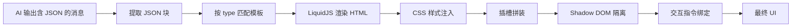
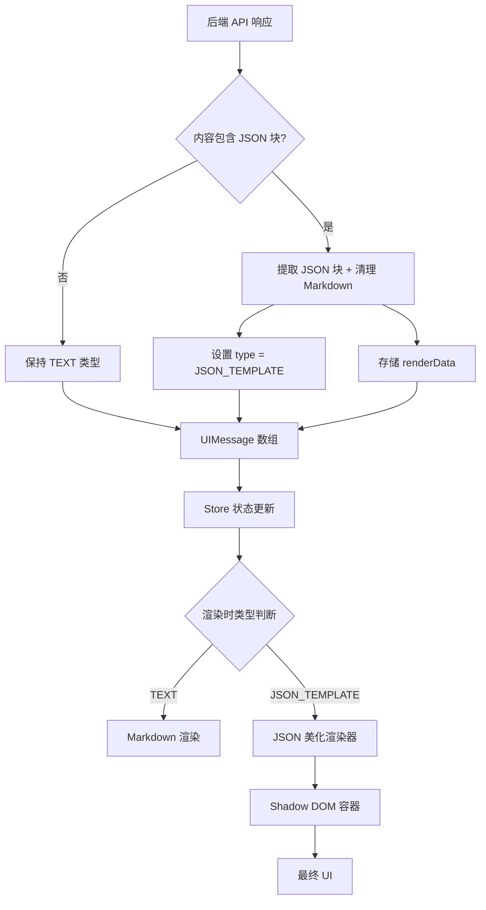

# JSON 美化功能逆向工程与系统集成方案

> **文档版本**: v1.0.0  
> **创建日期**: 2026-01-13  
> **作者**: Antigravity AI

---

## 文档目标

本文档基于对 PEVSO JSON 美化功能的深入分析，结合本项目 **chats feature** 的现有架构，提供一套完整的 JSON 美化功能逆向实现方案。与通用逆向工程思路不同，本文档重点阐述：

1. **如何将 JSON 美化机制嵌入到现有的消息处理流程中**
2. **如何利用现有的 Store、Adapters、Hooks 架构实现美化功能**
3. **如何保持架构一致性，避免破坏现有的消息同步、轮询、Galgame 等核心功能**

---

## 一、现有架构梳理

### 1.1 消息处理流程概览

```mermaid
graph TD
    A[后端 API] -->|响应数据| B[useEnginePlay Hook]
    B -->|ServerStoryEvent[]| C[Message Adapters]
    B -->|ServerCurrentScene| C
    C -->|UIMessage[]| D[useEngineStore]
    D -->|状态分发| E[ChatboxContainer]
    E -->|消息渲染| F[ChatboxTemplateRenderer]
    F -->|类型判断| G{MessageType?}
    G -->|TEXT| H[TextMessageRender]
    G -->|JSON_TEMPLATE| I[LiquidRenderer - 待实现]
    H -->|Markdown 解析| J[Markdown Component]
    J -->|最终 UI| K[用户界面]
```

### 1.2 核心模块职责划分

| 模块 | 职责 | 关键文件 |
|------|------|---------|
| **Hooks** | API 调用、状态管理、业务编排 | `use-engine-play.ts`、`use-engine-play-action.ts` |
| **Adapters** | 服务端数据 → UI 数据转换 | `message-adapters.ts` |
| **Store** | 全局状态管理 (消息、模式、轮询等) | `use-engine-store.ts` |
| **Components** | UI 渲染 (消息气泡、Markdown、Galgame) | `chatbox-render.tsx`、`markdown.tsx` |
| **Types** | 类型定义 | `chat-model.ts`、`engine-play.ts` |

### 1.3 消息数据流关键节点

```typescript
// 1. 服务端数据 (ServerStoryEvent)
{
  id: string
  type: 'user_choice' | 'assistant' | 'opening'
  content: string  // 可能包含 JSON 块
  choices: Choice[]
  timestamp: string
}

// 2. 适配后的 UI 数据 (UIMessage)
{
  id: string
  role: SenderRole  // USER | SYSTEM | AUTHOR
  type: MessageType // TEXT | JSON_TEMPLATE (已预留)
  content: string   // 原始内容
  renderData?: unknown  // 解析后的 JSON 数据 (待扩展)
  choices?: UIChoice[]
  timestamp: string
}

// 3. 渲染层决策 (ChatboxTemplateRenderer)
if (message.type === MessageType.JSON_TEMPLATE) {
  // TODO: Liquid Render
} else if (message.type === MessageType.TEXT) {
  // Markdown Render
}
```

---

## 二、PEVSO JSON 美化核心机制拆解

### 2.1 协议设计精髓

PEVSO 的核心创新在于 **将 AI 输出从"自由文本"约束为"结构化协议"**：

```json
// AI 输出 (嵌入在 Markdown 代码块中)
```json
{
  "type": "status-card",
  "title": "指挥官简报",
  "comment": "保持冷静，优先稳定全排士气。"
}
```
```

- **`type` 字段**：唯一标识符，用于匹配预定义的 UI 模板
- **其余字段**：动态数据，由 AI 填充，通过 LiquidJS 注入到 HTML 模板中

### 2.2 渲染链路拆解



### 2.3 关键技术要点

| 技术点 | 作用 | 实现难度 |
|--------|------|---------|
| **JSON 块提取** | 从 Markdown 中识别 ` ```json ` 块 | ⭐️ 简单 |
| **模板注册表** | 维护 `type → {html, style}` 映射 | ⭐️⭐️ 中等 |
| **LiquidJS 渲染** | 将 JSON 数据注入 HTML 模板 | ⭐️⭐️⭐️ 中等 |
| **插槽系统** | 支持 `{{slot:child-type}}` 嵌套 | ⭐️⭐️⭐️⭐️ 较高 |
| **Shadow DOM** | 样式隔离与安全防护 | ⭐️⭐️⭐️ 中等 |
| **交互指令** | `data-action-send` 等声明式 API | ⭐️⭐️⭐️⭐️ 较高 |
| **HTML/CSS 净化** | 防 XSS、CSS 注入 | ⭐️⭐️⭐️⭐️⭐️ 高 |

---

## 三、系统集成方案设计

### 3.1 架构兼容性原则

> 🎯 **核心原则**: 在不破坏现有消息流的前提下，通过 **扩展而非重构** 的方式嵌入 JSON 美化功能。

### 3.2 集成方案总览



### 3.3 分层集成策略

#### **Layer 1: 数据适配层 (Adapters)**

**目标**: 在消息适配阶段识别 JSON 块，转换为结构化数据

**修改点**: `lib/adapters/message-adapters.ts`

```typescript
// 新增: JSON 块提取函数
function extractJsonBlocks(content: string): {
  cleanMarkdown: string
  jsonBlocks: Array<{ type: string; data: Record<string, unknown> }>
} {
  const jsonBlocks: Array<{ type: string; data: Record<string, unknown> }> = []
  let cleanMarkdown = content

  // 正则匹配 ```json ... ``` 块 (需支持换行)
  const jsonRegex = /```json\s*\n([\s\S]*?)\n```/g
  let match

  while ((match = jsonRegex.exec(content)) !== null) {
    try {
      const parsed = JSON.parse(match[1])
      if (parsed.type) {
        jsonBlocks.push({ type: parsed.type, data: parsed })
      }
    } catch (e) {
      logger.warn('JSON 解析失败，跳过该块', e)
    }
  }

  // 清理原始 Markdown 中的 JSON 块
  cleanMarkdown = content.replace(jsonRegex, '')

  return { cleanMarkdown, jsonBlocks }
}

// 修改: adaptStoryEventToUI 函数
export function adaptStoryEventToUI(
  event: ServerStoryEvent,
  createChoiceAction?: ChoiceActionCreator
): UIMessage {
  const { cleanMarkdown, jsonBlocks } = extractJsonBlocks(event.content || '')
  
  const baseMessage: UIMessage = {
    id: event.id || `event_${Date.now()}_${Math.random()}`,
    role: mapEventTypeToRole(event.type),
    type: jsonBlocks.length > 0 
      ? MessageType.JSON_TEMPLATE 
      : MessageType.TEXT,
    content: cleanMarkdown, // 使用清理后的 Markdown
    renderData: jsonBlocks.length > 0 ? jsonBlocks : undefined, // 存储 JSON 数据
    timestamp: event.timestamp || new Date().toISOString(),
    isRevealed: true,
  }

  // ... 其余逻辑保持不变
  return baseMessage
}
```

**影响范围**: 所有消息适配函数 (`adaptSceneToUIMessage`, `adaptServerMessagesToUI`)

---

#### **Layer 2: 类型扩展层 (Types)**

**目标**: 扩展 `UIMessage` 类型，支持模板渲染数据

**修改点**: `types/chat-model.ts`

```typescript
export interface UIMessage {
  id: string
  role: SenderRole
  type: MessageType
  content: string // 清理后的 Markdown
  renderData?: {
    jsonBlocks: Array<{
      type: string
      data: Record<string, unknown>
    }>
  } | unknown // 解析后的 JSON 数据
  choices?: UIChoice[]
  timestamp: string
  isRevealed?: boolean
}
```

**新增**: 模板定义类型 `types/json-template.ts`

```typescript
/**
 * JSON 模板定义
 */
export interface JsonTemplate {
  type: string      // 模板唯一标识 (如 "status-card")
  html: string      // LiquidJS 模板字符串
  style?: string    // CSS 样式字符串
  version?: number  // 模板版本号
}

/**
 * 模板注册表类型
 */
export type TemplateRegistry = Map<string, JsonTemplate>

/**
 * 特殊模板类型
 */
export enum SpecialTemplateType {
  INTRO_BEFORE = 'intro-before',   // 开场白顶部固定
  INTRO_AFTER = 'intro-after',     // 开场白底部固定
  GLOBAL_THEME = 'global-theme'    // 全局样式
}
```

---

#### **Layer 3: 渲染引擎层 (Lib)**

**目标**: 实现 JSON → UI 的核心渲染逻辑

**新建**: `lib/json-renderer/index.ts`

```typescript
import { Liquid } from 'liquidjs'
import DOMPurify from 'dompurify'
import type { JsonTemplate } from '@/features/chats/types/json-template'

/**
 * JSON 渲染引擎
 */
export class JsonRenderer {
  private liquid: Liquid
  private templates: Map<string, JsonTemplate>

  constructor() {
    this.liquid = new Liquid({
      strictFilters: true, // 严格模式
      strictVariables: false, // 允许未定义变量 (输出空串)
    })
    this.templates = new Map()
  }

  /**
   * 注册模板
   */
  registerTemplate(template: JsonTemplate) {
    this.templates.set(template.type, template)
  }

  /**
   * 渲染单个 JSON 块
   */
  async renderBlock(type: string, data: Record<string, unknown>): Promise<{
    html: string
    style: string
  } | null> {
    const template = this.templates.get(type)
    if (!template) {
      console.warn(`模板未注册: ${type}`)
      return null
    }

    // 特殊类型处理
    if (type === 'global-theme') {
      return { html: '', style: template.style || '' }
    }

    // LiquidJS 渲染 (带超时保护)
    const renderPromise = this.liquid.parseAndRender(template.html, data)
    const timeoutPromise = new Promise<string>((_, reject) =>
      setTimeout(() => reject(new Error('渲染超时')), 5000)
    )

    let renderedHtml = ''
    try {
      renderedHtml = await Promise.race([renderPromise, timeoutPromise])
    } catch (e) {
      console.error('LiquidJS 渲染失败', e)
      return null
    }

    // HTML 净化 (防 XSS)
    const safeHtml = DOMPurify.sanitize(renderedHtml, {
      ALLOWED_TAGS: ['div', 'p', 'span', 'h1', 'h2', 'h3', 'button', 'form', 'input'],
      ALLOWED_ATTR: ['class', 'data-action-send', 'data-action-submit', 'data-display-toggle'],
      FORBID_TAGS: ['script', 'iframe', 'object', 'embed'],
      FORBID_ATTR: ['onerror', 'onload', 'onclick']
    })

    return {
      html: safeHtml,
      style: this.sanitizeCSS(template.style || '')
    }
  }

  /**
   * CSS 净化
   */
  private sanitizeCSS(css: string): string {
    // 移除危险 CSS 特性
    let safeCss = css
      .replace(/@import/gi, '') // 禁止外部导入
      .replace(/url\(/gi, '')   // 禁止外部资源
      .replace(/@font-face/gi, '') // 禁止自定义字体

    return safeCss
  }
}

// 导出单例
export const jsonRenderer = new JsonRenderer()
```

**新建**: `lib/json-renderer/template-loader.ts`

```typescript
import { jsonRenderer } from './index'
import type { JsonTemplate } from '@/features/chats/types/json-template'

/**
 * 模板加载器
 * 从后端或本地配置加载模板定义
 */
export async function loadTemplates(engineId: string): Promise<void> {
  try {
    // 方案 1: 从后端加载 (需要新增 API)
    // const templates = await fetch(`/api/engines/${engineId}/templates`)

    // 方案 2: 从 Engine 数据中加载 (利用现有 API)
    // 假设后端在 /engines/{id} 响应中返回 jsonTemplates 字段

    // 临时方案: 硬编码示例模板
    const exampleTemplate: JsonTemplate = {
      type: 'status-card',
      html: `
        <div class="status-card">
          <h3>{{ title }}</h3>
          <p>{{ comment }}</p>
        </div>
      `,
      style: `
        .status-card {
          padding: 14px;
          border-radius: 12px;
          background: linear-gradient(135deg, #667eea 0%, #764ba2 100%);
          color: white;
        }
      `
    }

    jsonRenderer.registerTemplate(exampleTemplate)
  } catch (error) {
    console.error('模板加载失败', error)
  }
}
```

---

#### **Layer 4: 组件渲染层 (Components)**

**目标**: 实现前端 UI 渲染组件

**新建**: `components/json-message-render.tsx`

```tsx
import { useEffect, useRef, useState } from 'react'
import { jsonRenderer } from '../lib/json-renderer'
import type { UIMessage } from '../types/chat-model'

interface JsonMessageRenderProps {
  message: UIMessage
}

export function JsonMessageRender({ message }: JsonMessageRenderProps) {
  const containerRef = useRef<HTMLDivElement>(null)
  const [isRendered, setIsRendered] = useState(false)

  useEffect(() => {
    if (!containerRef.current || !message.renderData) return

    const renderJson = async () => {
      const jsonBlocks = (message.renderData as any)?.jsonBlocks || []
      let globalStyles = ''

      // 创建 Shadow DOM (样式隔离)
      const shadowRoot = containerRef.current!.attachShadow({ mode: 'open' })
      const wrapper = document.createElement('div')
      wrapper.className = 'json-message-wrapper'

      for (const block of jsonBlocks) {
        const result = await jsonRenderer.renderBlock(block.type, block.data)
        if (!result) continue

        if (block.type === 'global-theme') {
          globalStyles += result.style
        } else {
          // 渲染普通 JSON 块
          const blockElement = document.createElement('div')
          blockElement.innerHTML = result.html

          // 注入 style
          if (result.style) {
            const styleElement = document.createElement('style')
            styleElement.textContent = result.style
            blockElement.prepend(styleElement)
          }

          wrapper.appendChild(blockElement)
        }
      }

      // 注入全局样式
      if (globalStyles) {
        const globalStyleElement = document.createElement('style')
        globalStyleElement.textContent = globalStyles
        wrapper.prepend(globalStyleElement)
      }

      // 还原清理后的 Markdown
      if (message.content.trim()) {
        const markdownElement = document.createElement('div')
        markdownElement.className = 'markdown-content'
        markdownElement.innerHTML = `
          <!-- 这里可以集成 Markdown 渲染 -->
          <p>${message.content}</p>
        `
        wrapper.appendChild(markdownElement)
      }

      shadowRoot.appendChild(wrapper)
      setIsRendered(true)
    }

    renderJson()
  }, [message])

  return <div ref={containerRef} className="json-message-container" />
}
```

**修改**: `components/chatbox-render.tsx`

```tsx
import { MessageType, type UIMessage } from '../types/chat-model'
import TextMessageRender from './text-message-render'
import { JsonMessageRender } from './json-message-render' // 新增

export const ChatboxTemplateRenderer: React.FC<Props> = ({
  message,
  isLatest,
}) => {
  if (message.type === MessageType.JSON_TEMPLATE) {
    return <JsonMessageRender message={message} />
  } else if (message.type === MessageType.TEXT) {
    return <TextMessageRender message={message} isLatest={isLatest} />
  }

  return <div className='leading-relaxed whitespace-pre-wrap'>不支持的渲染类型</div>
}
```

---

#### **Layer 5: 模板管理层 (新增 Feature)**

**目标**: 为创作者提供模板编辑与预览能力

**建议**: 创建独立的 `features/json-templates` 模块

```
src/features/json-templates/
├── components/
│   ├── template-editor.tsx      # 模板编辑器 (Monaco Editor)
│   ├── template-preview.tsx     # 实时预览
│   └── template-list.tsx        # 模板列表管理
├── hooks/
│   ├── use-template-crud.ts     # CRUD 操作
│   └── use-template-validation.ts # JSON Schema 校验
├── lib/
│   └── schema-validator.ts      # Ajv 校验器
└── types/
    └── template.ts              # 模板相关类型
```

---

## 四、与现有系统的交互要点

### 4.1 不影响现有功能的保障机制

| 现有功能 | 保障措施 |
|---------|---------|
| **消息轮询** | JSON 提取在 Adapter 层完成，不影响轮询状态 (`usePollingHandler`) |
| **Galgame 模式** | `initSegments` 基于 `UIMessage[]`，JSON 渲染对其透明 |
| **消息删除/重新生成** | 操作基于 `message.id`，与 `type` 无关 |
| **分页加载** | `useInfiniteMessages` 返回的 `ServerStoryEvent[]` 在 Adapter 层统一处理 |

### 4.2 数据流一致性验证

```typescript
// 测试: 确保 JSON 消息与普通消息具有相同的数据结构
const testJsonMessage: UIMessage = {
  id: 'test_1',
  role: SenderRole.AUTHOR,
  type: MessageType.JSON_TEMPLATE,
  content: '这是清理后的普通文本',
  renderData: {
    jsonBlocks: [{ type: 'status-card', data: { title: '测试' } }]
  },
  timestamp: new Date().toISOString(),
  isRevealed: true
}

// 应能通过所有现有的消息处理函数
// - clearLastMessageChoices(messages)
// - initSegments(messages.length - 1)
// - setMessages([...messages, testJsonMessage])
```

### 4.3 性能影响评估

| 影响项 | 评估 | 优化方案 |
|--------|------|---------|
| **JSON 提取** | 轻微 (正则匹配) | 缓存提取结果 |
| **LiquidJS 渲染** | 中等 (模板引擎) | Web Worker 异步渲染 |
| **Shadow DOM 创建** | 中等 (DOM 操作) | 虚拟滚动 + 懒加载 |
| **样式注入** | 轻微 (CSS 解析) | 预编译 CSS |

---

## 五、实施路线图

### Phase 1: 基础架构 (Week 1-2)

- [ ] 扩展 `UIMessage` 类型定义
- [ ] 实现 `extractJsonBlocks` 函数
- [ ] 修改 `message-adapters.ts` 支持 JSON 提取
- [ ] 创建 `JsonRenderer` 类 (不含 Shadow DOM)

### Phase 2: 渲染引擎 (Week 3-4)

- [ ] 集成 LiquidJS 与 DOMPurify
- [ ] 实现 `JsonMessageRender` 组件
- [ ] 添加 Shadow DOM 隔离
- [ ] 编写单元测试 (模板渲染、安全净化)

### Phase 3: 模板管理 (Week 5-6)

- [ ] 设计模板数据结构
- [ ] 实现模板 CRUD API
- [ ] 开发模板编辑器 UI
- [ ] 添加实时预览功能

### Phase 4: 高级特性 (Week 7-8)

- [ ] 实现插槽系统 (`{{slot:type}}`)
- [ ] 添加交互指令支持 (`data-action-send`)
- [ ] 开发性能监控工具
- [ ] 编写创作者文档与示例

### Phase 5: 安全加固 (Week 9)

- [ ] 完善 XSS 防护测试
- [ ] 添加 CSS 注入检测
- [ ] 实现渲染超时保护
- [ ] 安全审计报告

---

## 六、与 GPT 方案的差异总结

| 维度 | GPT 通用方案 | 本文档方案 |
|------|-------------|-----------|
| **架构适配** | 通用设计，未考虑现有系统 | 深度集成现有 Adapter/Store/Hook 架构 |
| **数据流** | 独立于业务流程 | 复用现有 `adaptStoryEventToUI` 流程 |
| **类型安全** | 未详细定义 TypeScript 类型 | 完整扩展 `UIMessage`、`JsonTemplate` 类型 |
| **渲染时机** | 未说明与轮询/Galgame 的协调 | 明确不影响现有 `isPolling`、`initSegments` 逻辑 |
| **安全防护** | 理论描述 | 给出具体 DOMPurify 配置与 CSS 净化代码 |
| **实施路径** | 模块化建议 | 分 5 个阶段，与项目迭代节奏匹配 |

---

## 七、风险评估与缓解策略

### 7.1 技术风险

| 风险 | 影响 | 缓解措施 |
|------|------|---------|
| **LiquidJS 性能问题** | 高 | 渲染缓存 + Web Worker |
| **Shadow DOM 兼容性** | 中 | 降级方案 (iframe 隔离) |
| **正则提取失败** | 中 | 严格校验 + 错误容错 |
| **XSS 绕过** | 高 | 多层净化 + CSP 策略 |

### 7.2 业务风险

| 风险 | 影响 | 缓解措施 |
|------|------|---------|
| **创作者滥用模板** | 中 | 模板审核机制 |
| **用户混淆 JSON 块** | 低 | 编辑器自动格式化 |
| **后端协议变更** | 高 | Adapter 层版本兼容 |

---

## 八、总结

本方案通过 **扩展现有架构** 而非重构的方式，将 JSON 美化功能无缝嵌入到项目中。核心优势在于：

1. **零破坏性**: 不影响现有消息流、轮询、Galgame 等核心功能
2. **类型安全**: 完整的 TypeScript 类型定义
3. **渐进式**: 可分阶段实施，每个阶段都可独立交付
4. **可维护**: 复用现有 Adapter 层，遵循项目的 Sliced Store + Actions Hook 架构

**下一步行动**:
1. 与后端团队对齐 API 字段需求 (参见配套文档《后端接口字段需求文档》)
2. 搭建 JSON 渲染引擎 POC
3. 编写自动化测试用例

---

> 📌 **相关文档**:
> - [后端接口字段需求文档](./后端接口字段需求文档.md)
> - [PEVSO JSON 美化功能详解](./PEVSO%20JSON%20美化功能详解与使用指南.md)
> - [GPT 逆向工程思路](./GPT%205.2Thingking%20有关%20PEVSO%20的逆向工程.md)
