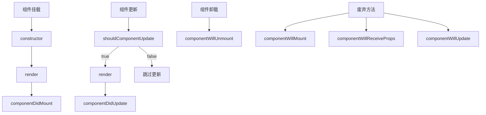

# React 生命周期面试指南

> 本文整理 React 生命周期相关面试常考点，含类组件与 Hooks 对比

## 一、类组件生命周期（React 16.3 之前）

### 1.1 挂载阶段（Mounting）

| 生命周期方法                 | 执行时机      | 常见用途               |
| ---------------------- | --------- | ------------------ |
| `constructor()`        | 组件实例创建时   | 初始化 state、绑定事件处理函数 |
| `componentWillMount()` | render 之前 | ⚠️ 已废弃，不推荐使用       |
| `render()`             | 必选方法      | 返回 JSX             |
| `componentDidMount()`  | 挂载完成后     | 发请求、设置定时器、添加订阅     |

```javascript
class MyComponent extends React.Component {
  constructor(props) {
    super(props);
    this.state = { count: 0 };
    // ❌ 避免在这里调用 setState，会导致二次渲染
  }

  componentDidMount() {
    // ✅ 适合做副作用：API请求、订阅、定时器
    fetch('/api/data').then(...)
  }

  render() {
    return <div>{this.state.count}</div>;
  }
}
```

### 1.2 更新阶段（Updating）

| 生命周期方法                                        | 执行时机      | 常见用途                   |
| --------------------------------------------- | --------- | ---------------------- |
| `componentWillReceiveProps(nextProps)`        | ⚠️ 已废弃    | -                      |
| `shouldComponentUpdate(nextProps, nextState)` | render 之前 | **性能优化**，返回 false 阻止更新 |
| `componentWillUpdate(nextProps, nextState)`   | ⚠️ 已废弃    | -                      |
| `render()`                                    | 必选方法      | 返回 JSX                 |
| `componentDidUpdate(prevProps, prevState)`    | 更新完成后     | 操作 DOM、请求新数据           |
|                                               |           |                        |

```javascript
shouldComponentUpdate(nextProps, nextState) {
  // 只有 count 变化时才重新渲染
  return this.state.count !== nextState.count;
}

componentDidUpdate(prevProps, prevState) {
  if (prevProps.id !== this.props.id) {
    // props.id 变化时重新获取数据
    this.fetchData();
  }
}
```

### 1.3 卸载阶段（Unmounting）

| 生命周期方法             | 执行时机   | 常见用途                             |
| ------------------------ | ---------- | ------------------------------------ |
| `componentWillUnmount()` | 组件卸载前 | **清理副作用**：取消订阅、清除定时器 |

```javascript
componentDidMount() {
  this.timer = setInterval(() => {...}, 1000);
}

componentWillUnmount() {
  // ✅ 必须清理，防止内存泄漏
  clearInterval(this.timer);
}
```

---

## 二、React 16.3+ 新生命周期

### 2.1 新增的生命周期

#### `static getDerivedStateFromProps(props, state)`

- **执行时机**：挂载时 + 每次更新时
- **作用**：替代 `componentWillReceiveProps`
- **返回**：返回 state 更新对象，或 `null` 表示不更新

```javascript
static getDerivedStateFromProps(props, state) {
  if (props.active !== state.wasActive) {
    return {
      wasActive: props.active,
      // ...
    };
  }
  return null;
}
```

> [!warning] 谨慎使用
> `getDerivedStateFromProps` 是**反模式**，只有在罕见情况下使用

#### `getSnapshotBeforeUpdate(prevProps, prevState)`

- **执行时机**：`render` 之后、`componentDidUpdate` 之前
- **作用**：获取更新前的 DOM 状态（如滚动位置）
- **返回**：传递给 `componentDidUpdate` 的 snapshot 值

```javascript
getSnapshotBeforeUpdate(prevProps, prevState) {
  if (prevProps.list.length < this.props.list.length) {
    // 返回滚动位置
    return this.listRef.current.scrollHeight;
  }
  return null;
}

componentDidUpdate(prevProps, prevState, snapshot) {
  if (snapshot !== null) {
    // 保持滚动位置
    this.listRef.current.scrollTop +=
      this.listRef.current.scrollHeight - snapshot;
  }
}
```

### 2.2 废弃的生命周期

以下方法在 React 18 中已完全废弃：

- `componentWillMount`
- `componentWillReceiveProps`
- `componentWillUpdate`

> [!tip] 迁移方案
> 使用 `getDerivedStateFromProps` 替代 `componentWillReceiveProps`

---

## 三、Hooks 替代方案

### 3.1 useEffect 替代场景

| 类组件方法             | Hooks 替代                                    |
| ---------------------- | --------------------------------------------- |
| `componentDidMount`    | `useEffect(() => {...}, [])`                  |
| `componentDidUpdate`   | `useEffect(() => {...}, [dep])`               |
| `componentWillUnmount` | `useEffect(() => { return () => {...} }, [])` |

```javascript
// componentDidMount + componentDidUpdate
useEffect(() => {
  console.log("每次渲染都执行")
})

// componentDidMount（空依赖数组）
useEffect(() => {
  fetchData()
  const subscription = subscribe(id)

  // componentWillUnmount
  return () => {
    subscription.unsubscribe()
  }
}, [id]) // id 变化时重新执行
```

### 3.2 useLayoutEffect

- **执行时机**：DOM 更新后、浏览器绘制前（同步）
- **适用场景**：需要**同步**读取/修改 DOM（如测量元素尺寸、焦点管理）

```javascript
useLayoutEffect(() => {
  // 同步执行，DOM 更新后立即运行
  const rect = ref.current.getBoundingClientRect()
  // ...
}, [dep])
```

> [!info] 选择建议
>
> - **大多数情况**用 `useEffect`（异步，非阻塞）
> - **必须同步**DOM 操作时用 `useLayoutEffect`

---

## 四、面试常考点

### Q1：React 组件生命周期分为哪几个阶段？

1. **挂载（Mounting）**：constructor → render → componentDidMount
2. **更新（Updating）**：props/state 变化 → render → componentDidUpdate
3. **卸载（Unmounting）**：componentWillUnmount

### Q2：constructor 中能否调用 setState？

**不能**。constructor 只做两件事：

1. 初始化 state：`this.state = {...}`
2. 绑定方法：`this.handleClick = this.handleClick.bind(this)`

调用 setState 会触发额外渲染，应该放在 componentDidMount 或事件处理中。

### Q3：setState 是同步还是异步？

**分情况**：

| 情况              | 行为                       |
| ----------------- | -------------------------- |
| React 事件处理中  | **异步**（批量更新）       |
| 原生事件/定时器中 | **同步**                   |
| React 18+         | **总是异步**（自动批处理） |

```javascript
// 异步（React 事件）
handleClick = () => {
  this.setState({ count: 1 })
  console.log(this.state.count) // ❌ 仍是旧值
}

// 同步（setTimeout）
setTimeout(() => {
  this.setState({ count: 1 })
  console.log(this.state.count) // ✅ 新值
}, 0)
```

### Q4：为什么推荐使用 useEffect 替代 componentDidMount？

1. **逻辑聚合**：相关逻辑放一起
2. **无需顾虑 this**：函数式组件无 this 问题
3. **更细粒度**：不同 effect 可有不同依赖
4. **避免重复**：类组件 mount/update 逻辑常重复

### Q5：useEffect 依赖数组怎么选？

| 依赖     | 效果                                          |
| -------- | --------------------------------------------- |
| `[]`     | 仅 mount 时执行一次（类似 componentDidMount） |
| `[a, b]` | a 或 b 变化时执行                             |
| 不写     | 每次渲染都执行（危险！）                      |

> [!warning] 常见错误
>
> ```javascript
> // ❌ 错误：依赖缺失会导致闭包陷阱
> useEffect(() => {
>   setCount(count + 1)
> }, []) // count 不在依赖中
>
> // ✅ 正确
> useEffect(() => {
>   setCount((c) => c + 1)
> }, [])
> ```

### Q6：如何优化 React 组件性能？

1. **`shouldComponentUpdate`**：浅比较 props/state
2. **React.memo**：函数组件缓存
3. **useMemo / useCallback**：缓存计算结果/函数
4. **Code Splitting**：`React.lazy()` + `Suspense`

```javascript
// 类组件优化
shouldComponentUpdate(nextProps, nextState) {
  return shallowCompare(this.props, nextProps) === false;
}

// 函数组件优化
const MemoizedComponent = React.memo(function MyComponent({ name }) {
  return <div>{name}</div>;
});

// 缓存计算结果
const memoizedValue = useMemo(() => computeExpensiveValue(a, b), [a, b]);
```

### Q7：React 18 的自动批处理是什么？

React 18 之前，setState 只在 React 事件中批处理。React 18+：

```javascript
// React 18 之前：2 次渲染
setTimeout(() => {
  setCount((c) => c + 1)
  setFlag((f) => !f)
})

// React 18+：1 次渲染（自动批处理）
```

### Q8：useEffect 和 useLayoutEffect 的区别？

| 特性         | useEffect                    | useLayoutEffect    |
| ------------ | ---------------------------- | ------------------ |
| 执行时机     | 浏览器绘制后（异步）         | DOM 更新后（同步） |
| 是否阻塞绘制 | 否                           | 是                 |
| 推荐场景     | 99% 场景：请求、订阅、定时器 | 测量 DOM、焦点管理 |

---

## 五、流程图

### 类组件生命周期



### Hooks 对应关系

```mermaid
graph LR
    A[类组件] --> B[Hooks]

    A1[constructor] --> B1[state 初始化]
    A2[componentDidMount] --> B2[useEffect fn, []]
    A3[componentDidUpdate] --> B3[useEffect fn, [dep]]
    A4[componentWillUnmount] --> B4[useEffect return]
    A5[shouldComponentUpdate] --> B5[React.memo]
    A6[render] --> B6[函数本体]
```

---

## 六、相关笔记

- [[hook]] — React Hooks 详解
- [[useEffect]] — useEffect 深度解析
- [[React渲染列表]] — 列表渲染与 key
- [[React性能优化]] — 性能优化技巧

---

## 参考资料

- [React 官方文档 - 生命周期](https://zh-hans.reactjs.org/docs/react-component.html)
- [React Hooks 官方文档](https://zh-hans.reactjs.org/docs/hooks-reference.html)
- [React 16.3 更新公告](https://zh-hans.reactjs.org/blog/2018/03/29/react-v-16-3.html)
