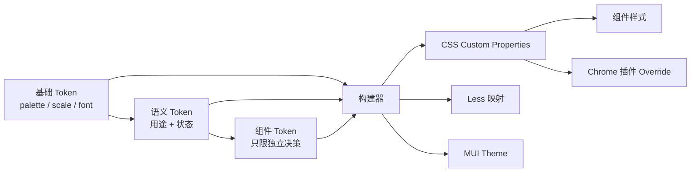

# Token 设计调研

> [!summary]
> 面向小牛原子组件库，Token 不是一份颜色表，而是设计语言的可执行接口：设计工具、AI、组件样式、运行时预览和视觉回归都只能通过它表达视觉决策。建议采用“基础值 -> 语义 -> 组件”三级 Token，源数据可交换、构建结果为 CSS Custom Properties，组件默认只消费语义层。

## 背景与目标

[[快手 - 需求 - 原子组件库从零设计]] 已确定 Token 与原子组件为 P0，底层继续复用 MUI。平台还需要把 CSS Variable diff 注入线上页面，供设计同学即时验证。因此本体系首先服务于以下约束：

- 所有会影响视觉的组件样式都能在运行时被 Override；Less 变量只作为构建期辅助，不能成为组件的消费接口。
- AI 生成页面时只能选已有 Token，不得用 `#xxx`、任意 `px`、任意阴影或任意动画参数“补样式”。
- 同一个语义能在 PC、移动端、亮/暗主题和后续品牌皮肤下映射为不同值，组件代码不变。
- Token 改动是可评审、可追踪、可截图对比的设计变更，而非散落在组件里的 CSS 修改。

## 核心结论

### 1. 分清“值”与“意图”

`orange-600`、`space-4` 是值或尺度，`color-action-primary`、`color-text-danger` 才是在表达意图。组件把按钮背景写成 `orange-600`，意味着每一次品牌色、主题或对比度调整都要找到所有组件逐个修改；写成 `color-action-primary`，则只改映射即可。

因此，产品和业务页面**不直接消费基础 Token**。基础 Token 仅给语义层和极少数设计语言实现使用；业务/原子组件优先消费语义 Token；确有独立、不可共享的视觉决策时，才在组件内定义组件专属 Token。

### 2. Token 数量要克制，但交互状态不能省略

一套初创库最常见的两种失败方式是：只提供十几个通用颜色，导致每个组件自行解释状态；或过早为每个组件、每个属性创建 Token，反而难以维护。P0 应只建立能覆盖所有原子组件的基础和语义层；组件层按“一个值只属于某一组件、且该值预计独立演进”这一标准增量加入。

状态属于语义，不是组件里的临时计算。例如主按钮的 hover 不应通过 `darken()` 从默认色推导，而应明确使用 `--niu-color-action-primary-hover`。这样设计验收、暗色主题、无障碍对比度和线上 Override 都有确定结果。

### 3. CSS Custom Properties 是运行时分发层，不是源数据格式

CSS Variables 满足 Chrome 插件注入、主题切换和局部预览；但它缺少 Token 类型、描述、弃用信息和跨工具引用。建议维护一份符合 [DTCG Design Tokens Format](https://www.designtokens.org/TR/2025.10/format/) 思路的结构化源数据，再生成 Less 与 CSS。DTCG 将 Token 定义为至少含名称和值的数据，并规范了 `$type`、分组和引用；其报告仍是 Community Group Draft，应视作互操作格式，而非视觉设计规范。

## shadcn/ui：值得借鉴的部分与边界

shadcn/ui 不是完整设计系统，而是一套可复制到项目内维护的组件代码和主题约定。它的价值恰好在于把 Token 消费路径压得很短：组件不绑定某一个蓝色或灰色，而是引用稳定的语义槽位；主题只替换槽位值。

### 它如何设计主题 Token

官方 [Theming](https://ui.shadcn.com/docs/theming) 文档的核心是 CSS variables 和 theme tokens。当前 Tailwind CSS v4 方案在 `:root` 中定义 `background`、`foreground`、`card`、`popover`、`primary`、`secondary`、`muted`、`accent`、`destructive`、`border`、`input`、`ring`、`chart-*`、`sidebar-*` 等槽位，并通过 `@theme inline` 映射为 Tailwind 可使用的颜色变量。暗色主题只在 `.dark` 中重写同名变量值；组件继续写 `bg-primary text-primary-foreground`，不需要知道实际色值。

其颜色默认转向 OKLCH。OKLCH 的优势是按感知亮度调整颜色更可控，特别适合同时维护亮/暗主题；但这不是引入 Token 的前提，也不应阻塞 P0。若现有视觉资产仍以 hex 交付，可先用 hex 输出，待色彩体系稳定后再统一迁移。

```css
/* shadcn 的关键模式：槽位名称稳定，主题只重映射其值 */
:root {
  --primary: oklch(0.205 0 0);
  --primary-foreground: oklch(0.985 0 0);
}

.dark {
  --primary: oklch(0.922 0 0);
  --primary-foreground: oklch(0.205 0 0);
}
```

### 应借鉴什么

- **语义槽位优先。** `primary` 与 `primary-foreground` 成对出现，避免只改背景后文字失去对比度。
- **主题重映射。** 亮/暗主题不是改组件选择器，而是同名变量的不同值。
- **颜色角色完整。** 除主次色外，还预留 `muted`、`accent`、`destructive`、`border`、`input`、`ring` 和图表色，减少后期临时命名。
- **组件代码归属应用。** shadcn 不把组件封装成不可修改的黑盒，符合当前“底层 MUI + 小牛设计语言适配”的策略；MUI 的 Theme 与 CSS Variables 可以由同一份 Token 源数据生成。

### 不应照搬什么

- `--primary` 过于通用，适合单应用起步，但难以表达多产品或业务语义。小牛应增加前缀和用途，例如 `--niu-color-action-primary`。
- shadcn 默认 Token 不覆盖完整的密度、响应式字号、阴影、z-index、动效和组件尺寸模型；本项目的原子库需要这些基础域。
- 不要让 Tailwind 的工具类名称成为 Token 的唯一 API。当前组件包含 Less/MUI，Token 应独立于 CSS 框架，Tailwind 仅是一个输出消费者。

## 其他成熟体系的启发

| 体系 | 可验证的做法 | 对当前项目的结论 |
| --- | --- | --- |
| [Adobe Spectrum](https://spectrum.adobe.com/page/design-tokens/) | 区分 global、alias、component-specific Token；建议优先使用 alias，组件专属 Token 不跨组件复用。命名强调可读、扁平、按“上下文-公共单元-澄清信息”递进。 | 三级模型的直接依据。组件层必须受准入约束，不能把公共语义偷塞进 `button-*`。 |
| [Atlassian Design](https://atlassian.design/foundations/tokens) | 使用 `--ds-background-*`、`--ds-text-*`、`--ds-border-*`、`--ds-space-*` 等按属性和角色命名的 CSS Variables，并对 `hovered`、`pressed` 等状态给出独立值。 | 将“表面/文字/边框/图标/动作”拆开；状态应是 Token，而非运行时明暗算法。 |
| [GOV.UK Design System](https://design-system.service.gov.uk/styles/colour/) | 明确要求通过 `govuk-functional-colour("brand")` 等功能色使用颜色，而非复制 hex；更新系统时服务自动继承新版调色板。 | `--niu-color-text-danger` 比 `--niu-red-600` 更应出现在组件代码中，且无障碍检查要绑定语义对。 |
| [DTCG Format](https://www.designtokens.org/TR/2025.10/format/) | 用类型、分组、引用和复合 Token 描述设计决策，目标是让设计工具、翻译工具和文档工具交换同一份数据。 | 源数据使用 JSON Token，保留 `$description`、`$type`、弃用信息；CSS/Less/MUI Theme 是派生产物。 |

## 推荐的信息架构



### L0 基础 Token：设计原料，禁止业务组件直接使用

| 域 | 建议命名 | P0 范围 |
| --- | --- | --- |
| 调色板 | `color.palette.orange.600` | 中性色阶、品牌橙色阶、成功/警告/危险/信息色阶、数据可视化色阶 |
| 间距 | `space.0`、`space.1` ... `space.12` | 以 4px 为基础单位，0/4/8/12/16/20/24/32/40/48 为起步集合；不强制所有尺寸都必须是 4 的倍数，例如 1px 边框例外 |
| 字体 | `font.size.100`、`font.line-height.100`、`font.weight.medium` | 字体族、字号、行高、字重、字间距 |
| 形状 | `radius.sm`、`border.width.default`、`shadow.200` | 圆角、边框宽度、阴影层级 |
| 动效 | `motion.duration.fast`、`motion.easing.standard` | 100/200/300/400ms 与标准/进入/退出曲线 |
| 层级 | `z-index.dropdown`、`z-index.modal` | 页面、浮层、下拉、弹窗、提示层；避免魔法数字 |

基础色阶只描述色彩坐标或顺序，不附着“危险”“按钮”等业务含义。间距序号使用尺度而非像素值，给未来密度调整留下空间。

### L1 语义 Token：组件默认唯一允许的视觉接口

建议按 CSS 属性域开头，再写角色、强调度和状态；CSS 输出统一使用 `--niu-` 前缀和 kebab-case。

| 用途域 | 例子 | 说明 |
| --- | --- | --- |
| 表面 | `--niu-color-surface-canvas`、`--niu-color-surface-raised`、`--niu-color-surface-overlay` | 区分页面底、卡片、浮层，而不是写 `white` / `gray-50` |
| 文字与图标 | `--niu-color-text-primary`、`--niu-color-text-secondary`、`--niu-color-icon-tertiary` | 文字和图标可同值，但语义应独立，便于单独调整 |
| 边框与焦点 | `--niu-color-border-default`、`--niu-color-border-danger`、`--niu-color-focus-ring` | focus ring 是无障碍契约，不能由各组件自行决定 |
| 动作 | `--niu-color-action-primary`、`--niu-color-action-primary-hover`、`--niu-color-action-primary-active`、`--niu-color-action-primary-foreground` | 默认、悬停、按下、前景成组定义 |
| 反馈 | `--niu-color-status-success-*`、`--niu-color-status-warning-*`、`--niu-color-status-danger-*`、`--niu-color-status-info-*` | 每类至少有 surface、text、border、icon；不要把 status 色等同于按钮主色 |
| 内容状态 | `--niu-opacity-disabled`、`--niu-color-text-disabled`、`--niu-color-skeleton` | disabled、loading、empty 等跨组件状态统一表达 |

### L2 组件 Token：少量、局部、可独立演进

组件 Token 名以组件开始，例如 `--niu-button-height-md`、`--niu-button-padding-inline-md`、`--niu-input-control-height-md`。它们的值优先引用 L0/L1，组件样式只消费组件 Token；但当某值实际是全局规则时，应上提至 L1，不要重复创建。

适合组件层的例子：Button 各尺寸高度、Avatar 特有尺寸、BubbleCard 的气泡尖角尺寸。**不适合**组件层的例子：`--niu-button-gray-600`、`--niu-card-padding-16`，前者应是语义色，后者通常应引用间距尺度。

## 命名、引用与主题规则

1. 源数据用点分层级，如 `color.action.primary.hover`；CSS 用 `--niu-color-action-primary-hover`；Figma 变量沿用同一层级。三者可机械转换，禁止出现三套不同词汇。
2. 名称描述“何处、何种属性、什么角色、什么状态”，不描述当前具体值。例如 `color.text.secondary` 可以从灰变棕，`gray.600` 不应承担“次级文字”语义。
3. 同一交互组必须完整：`default / hover / active / disabled / foreground / focus-ring` 按需要定义，并分别验证文字与背景的对比度。
4. 主题、终端和密度只改映射值，不改变 Token 名。PC/移动字号应在各主题或 breakpoint scope 内覆盖 `--niu-font-size-body-md`，组件不写媒体查询决定字号。
5. 引用深度最多两跳：组件 Token -> 语义 Token -> 基础 Token。更深的别名链会降低编辑器、AI 与调试的可读性。
6. 禁止在 Token 名中使用 `new`、`final`、`v2`、具体需求名或人名；变更通过版本和弃用标记管理。

## 建议的源数据与 CSS 输出

源数据可由设计工具导出或人工维护。以下结构保留类型、描述和引用，便于 Figma、文档、lint 和构建器共同消费：

```json
{
  "color": {
    "palette": {
      "orange": {
        "600": { "$type": "color", "$value": "#E85D00" }
      }
    },
    "action": {
      "primary": {
        "$type": "color",
        "$value": "{color.palette.orange.600}",
        "$description": "主操作默认背景"
      },
      "primary-foreground": {
        "$type": "color",
        "$value": "#FFFFFF"
      }
    }
  }
}
```

构建后必须有一个全局 CSS 入口，所有组件只使用下列 Custom Properties。Less 变量可以从同一份源数据生成，但只用于兼容旧样式或生成 CSS，不能直接写进组件规则。

```less
// tokens/index.less：构建期映射，可用于生成 CSS Variable
@color-palette-orange-600: #E85D00;
@space-4: 16px;

:root {
  --niu-color-action-primary: @color-palette-orange-600;
  --niu-color-action-primary-foreground: #FFFFFF;
  --niu-space-4: @space-4;
}

[data-theme="dark"] {
  --niu-color-action-primary: #FF7A1A;
}

.buttonPrimary {
  padding-inline: var(--niu-space-4);
  background: var(--niu-color-action-primary);
  color: var(--niu-color-action-primary-foreground);
}
```

Chrome 插件预览只注入覆盖层，例如 `[data-token-preview] { --niu-color-action-primary: #C84F00; }`，并把 `data-token-preview` 挂在应用根节点。这样覆盖范围可控，移除属性即可回滚；不要向 `:root` 写入永久值或按组件选择器拼补丁。

## 与 MUI 的落地关系

MUI 是底层交互和可访问性能力，不应成为第二套视觉真相。建立 `createNiuTheme(tokens)` 适配层：把 `color.action.primary` 映射给 `palette.primary.main`，把 `color.text.*`、`color.surface.*`、`radius.*`、`shadow.*`、`space.*` 映射给 MUI theme；自定义原子组件和 MUI `sx` 同时引用 CSS Variables。这样 MUI 组件与自研组件在预览覆盖时同步变化。

需要注意：MUI theme 的 JavaScript 对象不会因 CSS Variable 被插件覆盖而自动重新计算。应优先将颜色、间距、圆角等可视属性设置为 `var(--niu-*)`；只有影响 React 逻辑的分支（如 breakpoint）才从 theme 读取。若引入 MUI 的 `cssVariables` 模式，变量命名仍以小牛 Token 为准，避免把 `--mui-palette-*` 直接暴露为业务契约。

## P0 清单与门禁

### 首批 Token

- 基础：中性色和品牌色阶、状态色阶、4px 间距、字体族/字号/行高/字重、圆角、边框、阴影、动效、层级。
- 语义：surface、text、icon、border、focus、action、status、disabled、skeleton、data-viz；每个有实际使用场景的 action/status 均提供必要状态和 foreground。
- 组件：只为 Button、Input、BubbleCard、DataMetric 等种子组件定义确有独立性的尺寸或结构 Token。
- 响应式：先定义稳定名称的正文、标题、辅助文字 Token，再由设计侧交付 PC/移动端值映射；不要让组件自行缩放字号。

### 自动校验规则

| 规则 | 检查方式 |
| --- | --- |
| 组件样式无硬编码色值、阴影、圆角、动效、z-index | 扫描 `.less/.css/.tsx`，仅允许 Token 源文件和特定资产文件含原始值 |
| 布局间距使用 Token | `margin/padding/gap/width/height` 中的裸像素报错；`0px`、`1px border` 等在 allowlist 中明确豁免 |
| 组件不直接用基础 Token | 组件目录内禁止 `--niu-color-palette-*`、`--niu-space-*`（经批准的尺寸 Token 例外） |
| 状态完整 | `action`/`status` Token schema 要求声明 required states；缺 `foreground` 或 `focus` 时报错 |
| 无障碍 | 对已声明的 foreground/surface 组合计算 WCAG 2.2 对比度；键盘焦点必须使用 `focus-ring` |
| 可追溯 | 每个 Token 至少有 description、owner、状态和最后一次变更；删除先标记 deprecated 并给 replacement |

## 推荐推进顺序

1. 设计与前端共同冻结词汇表和三级边界，先为 Button、Input、BubbleCard、DataMetric 做 Token 消费矩阵。
2. 建立 JSON 源数据、CSS Variables、Less 映射和 MUI theme 适配的单向构建链；先不追求完整 Figma 自动同步。
3. 用种子组件验证亮/暗主题、PC/移动字号映射和 Chrome 注入覆盖，检查组件是否仍存在硬编码逃逸点。
4. 接入 `design-token-enforcer`、对比度检查和视觉 diff；lint 先 warning 后 error，清完种子组件再对新增代码强制执行。
5. 将 Token 名、值、用途、可用状态、对比度配对写入机器可读 registry，供 `token-composer` 和页面生成 Skill 检索。

> [!warning] 不把 Token 当作解决设计质量的替代品
> Token 可以保证一致性和可修改性，不能自动决定信息层级、页面结构或业务表达。`aesthetic-dna.yaml`、组件 spec 和页面模板应引用 Token，但仍需独立维护其可执行的美学与布局约束。

## 参考资料

- [shadcn/ui Theming](https://ui.shadcn.com/docs/theming)：CSS variables、theme tokens 与 Tailwind v4 主题映射。
- [Adobe Spectrum - Design tokens](https://spectrum.adobe.com/page/design-tokens/)：global / alias / component-specific 三类 Token、命名和使用规则。
- [Atlassian Design - Tokens](https://atlassian.design/foundations/tokens)：角色化的颜色、状态与主题变量实践。
- [GOV.UK Design System - Colour](https://design-system.service.gov.uk/styles/colour/)：功能色优先于复制具体 hex，及对比度要求。
- [Design Tokens Community Group Format Module](https://www.designtokens.org/TR/2025.10/format/)：Token 交换数据格式、类型、分组、引用与复合值。
