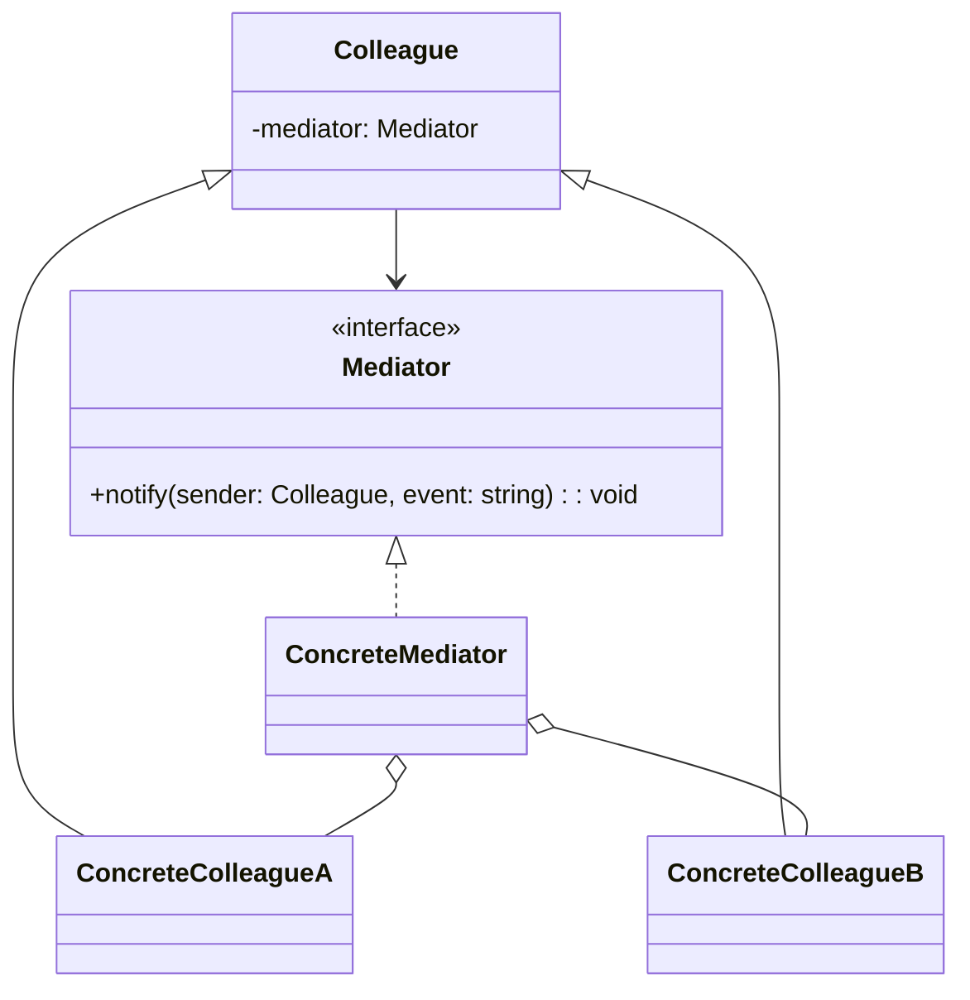
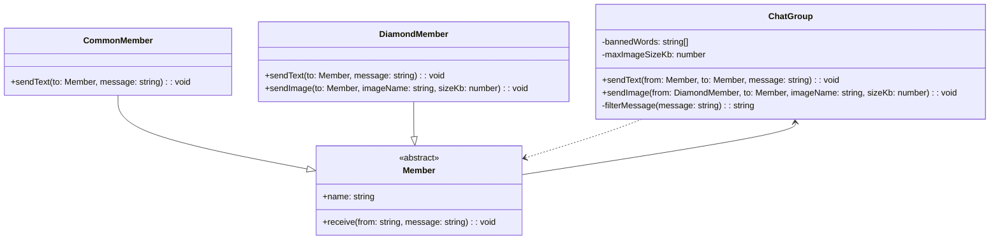
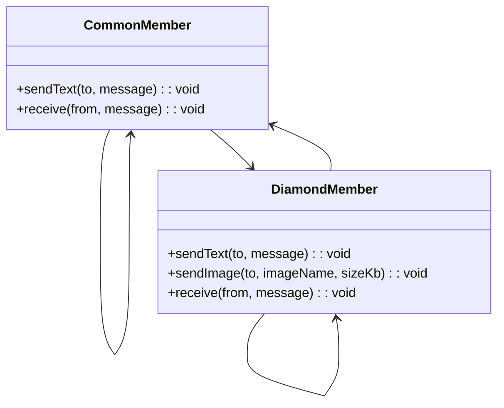

# 模式补全

> 这一节按 [[八面剖析以理解一个概念]] / ljg-learn 的思路整理为 Markdown 版本：先定锚，再用八个方向切开概念，最后压缩成公式、例子、类图和检验题。

## 定锚

中介者模式（行为型）的通行定义：用一个中介对象封装多个对象之间的交互，减少对象之间的网状依赖。

常见误解：中介者不是万能管理器；它只应该协调交互，不应该吞掉所有业务职责。

核心词素：Mediator 是调停者。它把多对多沟通变成对象到中介的一对多沟通。

## 八刀

### 历史

它常见于对话框控件、聊天室、模块事件协调。GoF 用它降低对象协作复杂度。

### 辩证

反面是对象互相引用成网。更高理解是：复杂协作需要一个显式协议中心。

### 现象

聊天室里用户不逐个给所有人发消息，而是发给房间，房间再广播。

### 语言

Mediator 是调停者。它把多对多沟通变成对象到中介的一对多沟通。

### 形式

Colleague -> Mediator.notify(event)。若所有逻辑都塞进中介者，它会变成中心化泥球。

### 存在

它让关系本身成为对象，系统不再被隐形连线缠住。

### 美感

它美在广场：所有声音先来到中心，再被有序分发。

### 元反思

中介隐喻容易鼓励中心化。换成“交通枢纽”隐喻，会提醒我们控制流量和分区。

## 内观

我是协作中心。组件不必彼此认识，只把事件告诉我。我安排谁该回应。

八刀共同指向的深层结构：中介者模式不是为了“炫技”，而是在某个变化点上建立边界，让稳定部分继续稳定，让变化部分有自己的位置。

## 压缩

公式：中介者 = 同事对象 + 协调中心 + 交互解耦

一句话：中介者把对象之间的网状沟通收敛为通过中心协议的沟通。

结构图：

```text
A/B/C -> Mediator -> A/B/C
```

## 动机/意图

当多个对象彼此直接引用、互相通知时，关系会从简单依赖变成网状依赖。中介者模式的意图是把对象之间的复杂交互集中到一个协调者中，让同事对象只和中介者沟通。

## 结构/角色

- `Mediator`：中介者接口，定义同事对象之间的通信协议。
- `ConcreteMediator`：具体中介者，保存同事对象引用并协调交互。
- `Colleague`：同事抽象，持有中介者引用。
- `ConcreteColleague`：具体同事，发生事件时通知中介者，由中介者转发或协调其他对象。
- `Client`：客户端组装中介者和同事对象。

## 典型 UML



## 使用场景

- 多个组件之间交互复杂，直接引用导致难以维护。
- UI 表单、聊天室、工作流节点等需要中心协调。
- 希望复用同事对象，但交互规则经常变化。
- 对象之间的通信规则比对象自身行为更重要。

## 正例：TypeScript

这个例子里，`ChatGroup` 是中介者，所有会员都不再彼此直接通信，而是统一把消息交给聊天室。聊天室负责过滤不雅字符，并限制钻石会员发送图片时的大小。

```ts
abstract class Member {
  constructor(
    public readonly name: string,
    protected chatGroup: ChatGroup,
  ) {}

  receive(from: string, message: string) {
    console.log(`${this.name} receives from ${from}: ${message}`)
  }
}

class CommonMember extends Member {
  sendText(to: Member, message: string) {
    this.chatGroup.sendText(this, to, message)
  }
}

class DiamondMember extends Member {
  sendText(to: Member, message: string) {
    this.chatGroup.sendText(this, to, message)
  }

  sendImage(to: Member, imageName: string, sizeKb: number) {
    this.chatGroup.sendImage(this, to, imageName, sizeKb)
  }
}

class ChatGroup {
  private readonly bannedWords = ["bad", "ugly"]
  private readonly maxImageSizeKb = 2048

  private filterMessage(message: string) {
    return this.bannedWords.reduce(
      (result, word) => result.replaceAll(word, "***"),
      message,
    )
  }

  sendText(from: Member, to: Member, message: string) {
    const filtered = this.filterMessage(message)
    to.receive(from.name, filtered)
  }

  sendImage(
    from: DiamondMember,
    to: Member,
    imageName: string,
    sizeKb: number,
  ) {
    if (sizeKb > this.maxImageSizeKb) {
      console.log(`image ${imageName} is too large to send`)
      return
    }
    to.receive(from.name, `[image:${imageName}, size=${sizeKb}KB]`)
  }
}

const chatGroup = new ChatGroup()
const alice = new CommonMember("Alice", chatGroup)
const bob = new CommonMember("Bob", chatGroup)
const diana = new DiamondMember("Diana", chatGroup)

alice.sendText(bob, "hello, bad word here")
diana.sendImage(alice, "design.png", 1024)
```

## 正例：UML 类图



## 反例：TypeScript

反例里没有中介者，会员对象彼此直接引用。这样文本过滤、图片大小校验这些规则会散落在各个会员类里，耦合很快变成一张网。

```ts
class CommonMember {
  private contacts: Array<CommonMember | DiamondMember> = []

  constructor(public readonly name: string) {}

  addContact(member: CommonMember | DiamondMember) {
    this.contacts.push(member)
  }

  sendText(to: CommonMember | DiamondMember, message: string) {
    const filtered = message.replaceAll("bad", "***")
    to.receive(this.name, filtered)
  }

  receive(from: string, message: string) {
    console.log(`${this.name} receives from ${from}: ${message}`)
  }
}

class DiamondMember {
  private contacts: Array<CommonMember | DiamondMember> = []

  constructor(public readonly name: string) {}

  addContact(member: CommonMember | DiamondMember) {
    this.contacts.push(member)
  }

  sendText(to: CommonMember | DiamondMember, message: string) {
    const filtered = message.replaceAll("bad", "***")
    to.receive(this.name, filtered)
  }

  sendImage(
    to: CommonMember | DiamondMember,
    imageName: string,
    sizeKb: number,
  ) {
    if (sizeKb > 2048) {
      console.log(`image ${imageName} is too large to send`)
      return
    }
    to.receive(this.name, `[image:${imageName}, size=${sizeKb}KB]`)
  }

  receive(from: string, message: string) {
    console.log(`${this.name} receives from ${from}: ${message}`)
  }
}
```

## 反例：UML 类图



## 案例

某论坛系统欲增加一个虚拟聊天室，允许论坛会员通过该聊天室进行信息交流，普通会员(CommonMember)可以给其他会员发送文本信息，钻石会员(DiamondMember)既可以给其他会员发送文本信息，还可以发送图片信息。该聊天室可以对不雅字符进行过滤；还可以对发送的图片大小进行控制。用中介者模式设计该虚拟聊天室。

## 掌握检验

1. 中介者模式解决的是对象之间哪种依赖形态？
2. 中介者和观察者都能分发消息，它们关注点有什么不同？
3. 如何避免中介者变成上帝对象？
