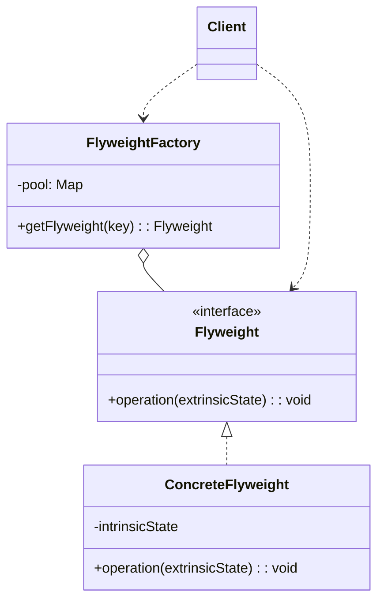
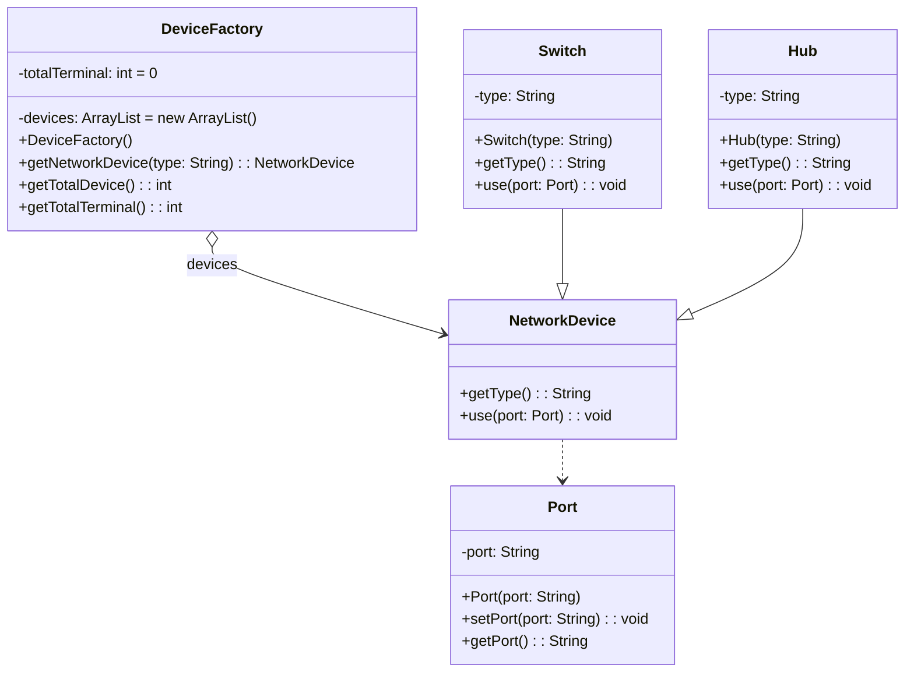
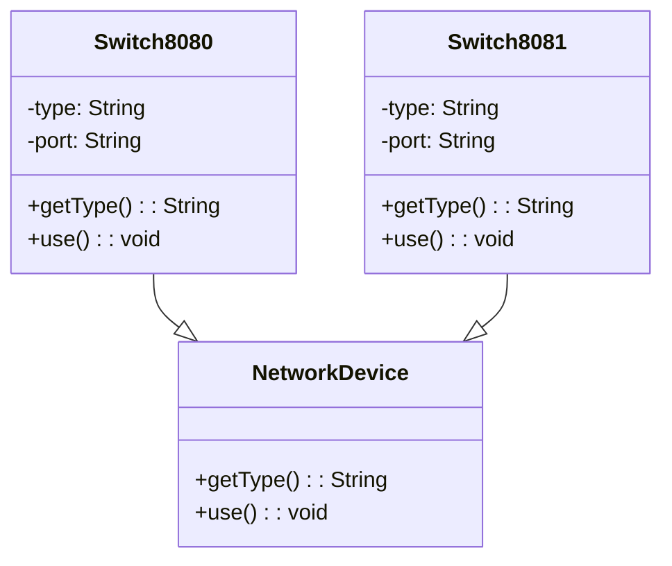

# 模式补全

> 这一节按 [[八面剖析以理解一个概念]] / ljg-learn 的思路整理为 Markdown 版本：先定锚，再用八个方向切开概念，最后压缩成公式、例子、类图和检验题。

## 定锚

享元模式（结构型）的通行定义：通过共享大量细粒度对象的内部状态，减少内存占用和对象创建成本。

常见误解：享元不是缓存一切；它要求区分可共享的内部状态和不可共享的外部状态。

核心词素：Flyweight 是拳击里的蝇量级，隐喻小而轻。中文“享元”强调共享元对象。

## 八刀

### 历史

它常见于文本编辑器字符、地图图标、游戏粒子。GoF 将共享细粒度对象的经验抽成模式。

### 辩证

反面是每个实例都保存完整状态。更高理解是：把对象拆成共享本质和上下文位置。

### 现象

多台终端计算机可以共享同一个网络设备，但它们使用的端口不同。网络设备本身是可共享的内部状态，而端口号则是随具体终端变化的外部状态，使用时再传入即可。

### 语言

Flyweight 是拳击里的蝇量级，隐喻小而轻。中文“享元”强调共享元对象。

### 形式

Flyweight(intrinsic).operation(extrinsic)。若外部状态管理复杂，省下的内存可能换来更高认知成本。

### 存在

它让人意识到对象身份不总等于对象状态，很多东西可以共享骨架。

### 美感

它美在轻：万千对象像同一个印章盖出的不同位置。

### 元反思

共享隐喻容易诱导过度缓存。换成“字体字模”隐喻，会更清楚哪些可共享、哪些必须外传。

## 内观

我是被共享的网络设备对象。设备型号、带宽、厂商这些稳定信息放在我这里；端口号这种随连接上下文变化的部分，请你在使用时从外部传给我。

八刀共同指向的深层结构：享元模式不是为了“炫技”，而是在某个变化点上建立边界，让稳定部分继续稳定，让变化部分有自己的位置。

## 压缩

公式：享元 = 内部状态共享 + 外部状态传入 + 工厂复用

一句话：享元模式通过拆分内外状态，让海量对象共享同一份稳定部分。

结构图：

```text
Client -> FlyweightFactory -> shared Flyweight
operation(extrinsicState)
```

## 动机/意图

当系统中存在海量细粒度对象，且这些对象包含大量重复状态时，逐个创建会浪费内存。享元模式的意图是把可共享的内部状态抽出来复用，把不可共享的外部状态由客户端在调用时传入。

## 结构/角色

- `Flyweight`：享元接口，声明接收外部状态的操作。
- `ConcreteFlyweight`：具体享元，保存可共享的内部状态。
- `FlyweightFactory`：享元工厂，缓存并复用享元对象。
- `UnsharedConcreteFlyweight`：非共享享元，可选角色，表示不能共享的对象。
- `Client`：客户端保存或计算外部状态，并从工厂取得共享对象。

## 典型 UML



## 使用场景

- 大量对象拥有相同或相似的内部状态。
- 内存占用成为主要问题，且对象数量很大。
- 对象状态可以明确分成内部状态和外部状态。
- 典型例子包括文本字符、地图标记、棋子、粒子、图标资源。

## 正例：TypeScript

`Port` 是外部状态类，`NetworkDevice` 是抽象享元，`Switch` 和 `Hub` 是具体享元，`DeviceFactory` 负责缓存共享设备并统计终端数量。多个终端访问同一种设备时，共享的是设备对象，不共享的是端口对象。

```ts
class Port {
  constructor(private port: string) {}

  setPort(port: string) {
    this.port = port
  }

  getPort() {
    return this.port
  }
}

abstract class NetworkDevice {
  abstract getType(): string
  abstract use(port: Port): void
}

class Switch extends NetworkDevice {
  constructor(private type: string) {
    super()
  }

  getType() {
    return this.type
  }

  use(port: Port) {
    console.log(`switch ${this.type} uses port ${port.getPort()}`)
  }
}

class Hub extends NetworkDevice {
  constructor(private type: string) {
    super()
  }

  getType() {
    return this.type
  }

  use(port: Port) {
    console.log(`hub ${this.type} uses port ${port.getPort()}`)
  }
}

class DeviceFactory {
  private devices: NetworkDevice[] = []
  private totalTerminal = 0

  getNetworkDevice(type: string): NetworkDevice {
    let device = this.devices.find((item) => item.getType() === type)
    if (!device) {
      device = type === "switch" ? new Switch(type) : new Hub(type)
      this.devices.push(device)
    }
    this.totalTerminal += 1
    return device
  }

  getTotalDevice() {
    return this.devices.length
  }

  getTotalTerminal() {
    return this.totalTerminal
  }
}

const factory = new DeviceFactory()
const port1 = new Port("8080")
const port2 = new Port("8081")

const device1 = factory.getNetworkDevice("switch")
device1.use(port1)

const device2 = factory.getNetworkDevice("switch")
device2.use(port2)

console.log(factory.getTotalDevice()) // 1
console.log(factory.getTotalTerminal()) // 2
```

## 正例：UML 类图



## 反例：TypeScript

反例也按这张图的反面来写：如果我们不把 `Port` 单独抽出来，而是把端口直接塞进 `Switch`、`Hub` 对象里，那么同一种网络设备只要端口不同，就没法共享。

```ts
abstract class NetworkDevice {
  abstract getType(): string
  abstract use(): void
}

class Switch extends NetworkDevice {
  constructor(
    private readonly type: string,
    private readonly port: string,
  ) {
    super()
  }

  getType() {
    return this.type
  }

  use() {
    console.log(`switch ${this.type} uses port ${this.port}`)
  }
}

const deviceA = new Switch("switch", "8080")
const deviceB = new Switch("switch", "8081")

deviceA.use()
deviceB.use()
```

## 反例：UML 类图



## 案例
很多网络设备都是支持共享的，如交换机、集线器等，多台终端计算机可以连接同一台网络设备，并通过该网络设备进行数据转发，如图所示，现用享元模式模拟共享网络设备的设计原理。

虽然网络设备可以共享，但是分配给每一个终端计算机的端口(Port)是不同的，因此多台计算机虽然可以共享同一个网络设备，但必须使用不同的端口。我们可以将端口从网络设备中抽取出来作为外部状态，需要时再进行设置。

## 掌握检验

1. 享元模式里的内部状态和外部状态分别是什么？
2. 享元工厂为什么是模式里的关键角色？
3. 什么情况下享元模式不值得使用？
