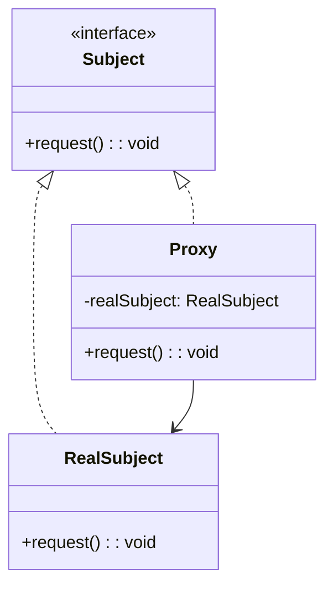
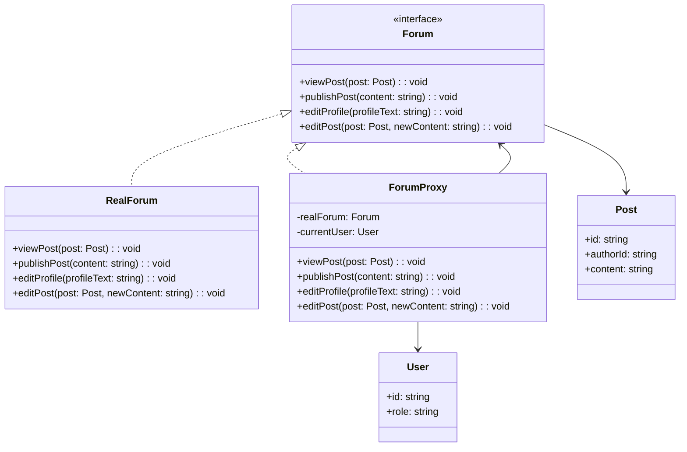
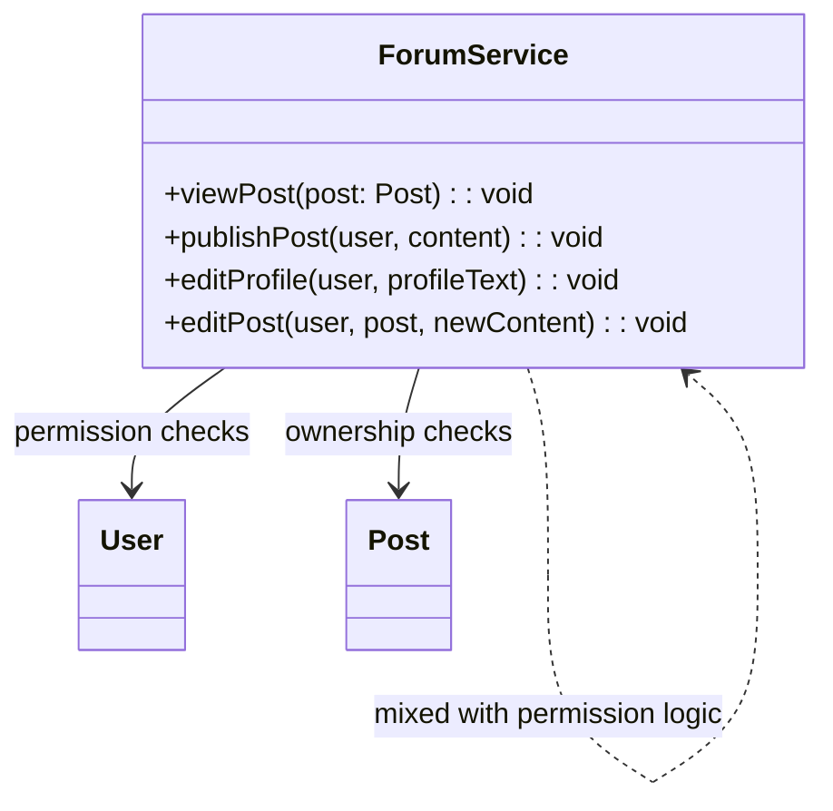

# 模式补全

> 这一节按 [[八面剖析以理解一个概念]] / ljg-learn 的思路整理为 Markdown 版本：先定锚，再用八个方向切开概念，最后压缩成公式、例子、类图和检验题。

## 定锚

代理模式（结构型）的通行定义：为真实对象提供一个替身，以控制访问、延迟加载、缓存、权限或远程调用。

常见误解：代理不是简单转发；代理的价值在于控制访问时机和访问规则。

核心词素：Proxy 是代行者。它站在真实对象之前，既像门卫，也像经纪人。

## 八刀

### 历史

它在远程对象、虚拟加载、安全控制中长期存在。现代前端里的 Proxy API 又让这个词更常见。

### 辩证

反面是客户端直接访问真实对象。更高理解是：访问本身也可以成为可设计的对象。

### 现象

图片懒加载时，页面先拿到占位图代理，真正图片等进入视口再加载。

### 语言

Proxy 是代行者。它站在真实对象之前，既像门卫，也像经纪人。

### 形式

Proxy implements Subject and has RealSubject。若代理加入过多业务，会让真实对象行为变得难预测。

### 存在

它让系统在对象前面加一道可控边界，访问不再是裸奔。

### 美感

它美在帘幕：真实对象在幕后，代理按需要拉开。

### 元反思

替身隐喻容易让人忽略透明性。换成“边界网关”隐喻，会更重视权限、缓存、监控等横切能力。

## 内观

我长得像真实对象。你以为在和它说话，其实先经过我。我决定是否、何时、怎样把请求交给它。

八刀共同指向的深层结构：代理模式不是为了“炫技”，而是在某个变化点上建立边界，让稳定部分继续稳定，让变化部分有自己的位置。

## 压缩

公式：代理 = 同接口替身 + 持有真实对象 + 访问控制

一句话：代理模式把对对象的访问变成一个可控制的边界。

结构图：

```text
Client -> Proxy -> RealSubject
```

## 动机/意图

当直接访问真实对象成本高、风险大，或需要附加控制逻辑时，客户端不应直接触碰真实对象。代理模式的意图是提供一个和真实对象同接口的替身，在访问前后加入权限、缓存、延迟加载、远程调用等控制。

## 结构/角色

- `Subject`：抽象主题，声明真实对象和代理共同实现的接口。
- `RealSubject`：真实主题，包含核心业务逻辑。
- `Proxy`：代理，持有或按需创建真实主题，并控制对它的访问。
- `Client`：客户端面向主题接口调用，通常不知道自己使用的是代理。

## 典型 UML



## 使用场景

- 延迟加载重对象，例如图片、文档、远程连接。
- 访问真实对象前需要权限校验、限流或审计。
- 需要缓存真实对象的结果。
- 本地对象代表远程服务，隐藏网络通信细节。

## 正例：TypeScript

```ts
class User {
  constructor(
    public readonly id: string,
    public readonly role: "guest" | "member",
  ) {}
}

class Post {
  constructor(
    public readonly id: string,
    public readonly authorId: string,
    public content: string,
  ) {}
}

interface Forum {
  viewPost(post: Post): void
  publishPost(content: string): void
  editProfile(profileText: string): void
  editPost(post: Post, newContent: string): void
}

class RealForum implements Forum {
  viewPost(post: Post) {
    console.log(`view post: ${post.content}`)
  }

  publishPost(content: string) {
    console.log(`publish post: ${content}`)
  }

  editProfile(profileText: string) {
    console.log(`edit profile: ${profileText}`)
  }

  editPost(post: Post, newContent: string) {
    post.content = newContent
    console.log(`edit post ${post.id}: ${post.content}`)
  }
}

class ForumProxy implements Forum {
  constructor(
    private readonly realForum: Forum,
    private readonly currentUser: User,
  ) {}

  viewPost(post: Post) {
    this.realForum.viewPost(post)
  }

  publishPost(content: string) {
    if (this.currentUser.role !== "member") {
      console.log("guest cannot publish post")
      return
    }

    this.realForum.publishPost(content)
  }

  editProfile(profileText: string) {
    if (this.currentUser.role !== "member") {
      console.log("guest cannot edit profile")
      return
    }

    this.realForum.editProfile(profileText)
  }

  editPost(post: Post, newContent: string) {
    if (this.currentUser.role !== "member") {
      console.log("guest cannot edit post")
      return
    }

    if (post.authorId !== this.currentUser.id) {
      console.log("cannot edit other user's post")
      return
    }

    this.realForum.editPost(post, newContent)
  }
}

const realForum = new RealForum()
const ownPost = new Post("post-1", "u100", "hello forum")
const otherPost = new Post("post-2", "u200", "other user's content")

const guest = new ForumProxy(realForum, new User("u001", "guest"))
guest.viewPost(ownPost)
guest.publishPost("I want to speak")

const member = new ForumProxy(realForum, new User("u100", "member"))
member.publishPost("new member post")
member.editProfile("new profile text")
member.editPost(ownPost, "updated by owner")
member.editPost(otherPost, "try to edit others")
```

## 正例：UML 类图



## 反例：TypeScript

```ts
class User {
  constructor(
    public readonly id: string,
    public readonly role: "guest" | "member",
  ) {}
}

class Post {
  constructor(
    public readonly id: string,
    public readonly authorId: string,
    public content: string,
  ) {}
}

class ForumService {
  viewPost(post: Post) {
    console.log(`view post: ${post.content}`)
  }

  publishPost(user: User, content: string) {
    if (user.role === "member") {
      console.log(`publish post: ${content}`)
      return
    }

    console.log("guest cannot publish post")
  }

  editProfile(user: User, profileText: string) {
    if (user.role === "member") {
      console.log(`edit profile: ${profileText}`)
      return
    }

    console.log("guest cannot edit profile")
  }

  editPost(user: User, post: Post, newContent: string) {
    if (user.role !== "member") {
      console.log("guest cannot edit post")
      return
    }

    if (post.authorId !== user.id) {
      console.log("cannot edit other user's post")
      return
    }

    post.content = newContent
    console.log(`edit post ${post.id}: ${post.content}`)
  }
}
```

## 反例：UML 类图



## 常见的几种代理

- 远程代理：隐藏掉被代理对象的细节
- 虚拟代理：代理当做真实的属性很多的被代理对象的虚拟对象，只提取用到的属性，以节约内存
- 动态代理：

## 案例

在一个论坛中已注册用户和游客的权限不同，已注册的用户拥有发帖、修改自己的注册信息、修改自己的帖子等功能；而游客只能看到别人发的帖子，没有其他权限。使用代理模式来设计该权限管理模块。
在本实例中我们使用代理模式中的保护代理，该代理用于控制对一个对象的访问，可以给不同的用户提供不同级别的使用权限

模拟应用远程代理来访问另外一个应用程序域中的对象，如果在远程实现了加减乘除等运算，在本地需要调用，那么可以考虑在本地设置一个代理。

## 掌握检验

1. 代理模式和装饰模式结构相似，意图有什么不同？
2. 虚拟代理、保护代理、缓存代理分别控制什么？
3. 代理怎样保持对客户端透明？
