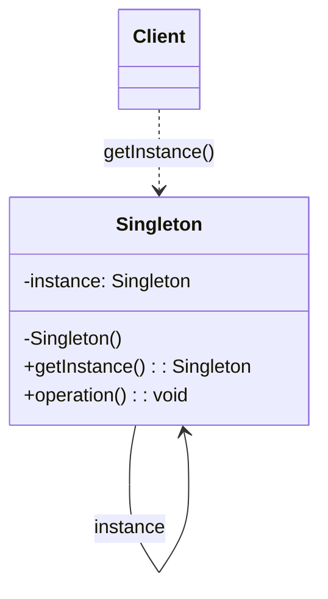
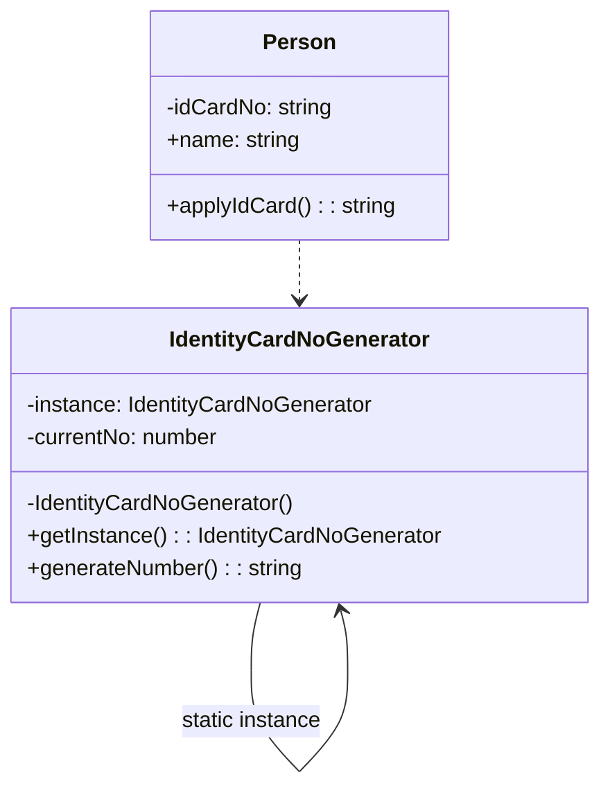
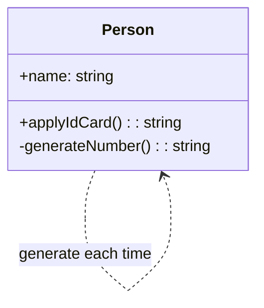

# 模式补全

> 这一节按 [[八面剖析以理解一个概念]] / ljg-learn 的思路整理为 Markdown 版本：先定锚，再用八个方向切开概念，最后压缩成公式、例子、类图和检验题。

## 定锚

单例模式（创建型）的通行定义：保证一个类只有一个实例，并提供全局访问点。

常见误解：单例不是全局变量的漂亮名字；滥用单例会隐藏依赖、污染测试。

核心词素：Singleton = single + ton，强调唯一性和访问入口。

## 八刀

### 历史

它来自日志器、配置中心、连接池等共享资源场景。后来因为全局状态副作用，成为最需要克制使用的模式之一。

### 辩证

反面是随处创建多个共享资源实例。更高理解是：单例只适合确实存在唯一语义的对象。

### 现象

像整栋楼只有一个总电闸，所有房间都可以找到它，但不能各自造一个。

### 语言

Singleton = single + ton，强调唯一性和访问入口。

### 形式

instance = Singleton.getInstance()。当对象有用户态、请求态或测试态变化时，这个公式会制造耦合。

### 存在

它让人正视“唯一资源”的存在，也提醒人警惕全局可变状态。

### 美感

它美在孤峰：所有路径最终汇到同一个实例。

### 元反思

我们用“唯一”隐喻理解它，容易忽略生命周期。换成“公共基础设施”隐喻，会更自然地考虑初始化、释放和测试替换。

## 内观

我只有一个。你可以找我，但不要把所有东西都塞给我。我的存在应该来自领域约束，而不是偷懒。

八刀共同指向的深层结构：单例模式不是为了“炫技”，而是在某个变化点上建立边界，让稳定部分继续稳定，让变化部分有自己的位置。

## 压缩

公式：单例 = 私有构造 + 静态实例 + 全局访问点

一句话：单例适合表达真正唯一的资源，不适合掩盖依赖传递。

结构图：

```text
Client -> Singleton.getInstance() -> instance
```

## 动机/意图

当某个对象代表系统中真正唯一的资源或协调中心时，多实例会导致状态冲突、重复连接或全局配置不一致。单例模式的意图是限制类只能产生一个实例，并提供一个稳定访问点。

## 结构/角色

- `Singleton`：单例类，隐藏构造入口，保存唯一实例。
- `getInstance()`：全局访问点，负责懒加载或返回已存在实例。
- `Client`：客户端通过访问点取得实例。
- `Instance`：唯一对象本身，承载全局状态或唯一资源。

## 典型 UML



## 使用场景

- 资源天然唯一，例如进程内配置中心、日志器、连接管理器。
- 多实例会破坏一致性或造成资源浪费。
- 需要延迟初始化一个重资源对象。
- 注意不要把单例当作全局变量替代品，尤其在测试和依赖注入场景中要谨慎。

## 正例：TypeScript

```ts
class IdentityCardNoGenerator {
  private static instance: IdentityCardNoGenerator | undefined
  private currentNo = 100000

  private constructor() {}

  static getInstance() {
    if (!this.instance) {
      this.instance = new IdentityCardNoGenerator()
    }
    return this.instance
  }

  generateNumber() {
    this.currentNo += 1
    return `ID${this.currentNo}`
  }
}

class Person {
  private idCardNo?: string

  constructor(public readonly name: string) {}

  applyIdCard() {
    if (!this.idCardNo) {
      const generator = IdentityCardNoGenerator.getInstance()
      this.idCardNo = generator.generateNumber()
    }

    return this.idCardNo
  }
}

const zhangSan = new Person("Zhang San")
const firstApply = zhangSan.applyIdCard()
const reissueApply = zhangSan.applyIdCard()

console.log(firstApply) // ID100001
console.log(reissueApply) // ID100001
```

## 正例：UML 类图



## 反例：TypeScript

```ts
class Person {
  constructor(public readonly name: string) {}

  applyIdCard() {
    return this.generateNumber()
  }

  private generateNumber() {
    return `ID${Math.floor(Math.random() * 1000000)}`
  }
}

const liSi = new Person("Li Si")
const firstApply = liSi.applyIdCard()
const reissueApply = liSi.applyIdCard()

console.log(firstApply) // 可能是 ID483920
console.log(reissueApply) // 可能又变成另一个号码
```

## 反例：UML 类图


## 案例

在现实生活中，居民身份证号码具有唯一性，同一个人不允许有多个身份证号码，第一次申请身份证时将给居民分配一个身份证号码，如果之后因为遗失等原因补办时，还是使用原来的身份证号码，不会产生新的号码。现使用单例模式模拟该场景

在操作系统中，打印池(Print Spooler)是一个用于管理打印任务的应用程序，通过打印池用户可以删除、中止或者改变打印任务的优先级，在一个系统中只允许运行一个打印池对象，如果重复创建打印池则抛出异常。现使用单例模式来模拟实现打印池的设计。


## 掌握检验

1. 如何判断一个对象是真的需要唯一实例？
2. 单例为什么会让单元测试变难？
3. 依赖注入容器里的 singleton 生命周期和单例模式有什么不同？
