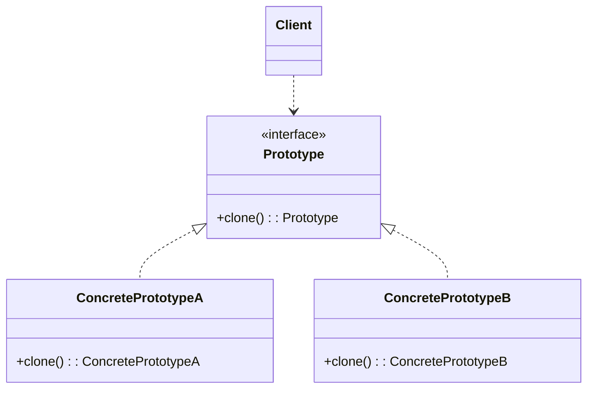
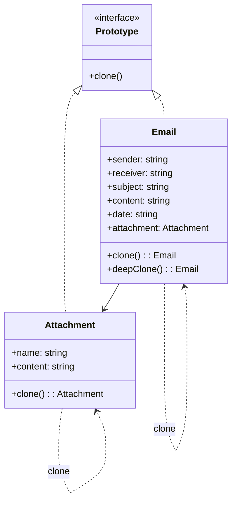
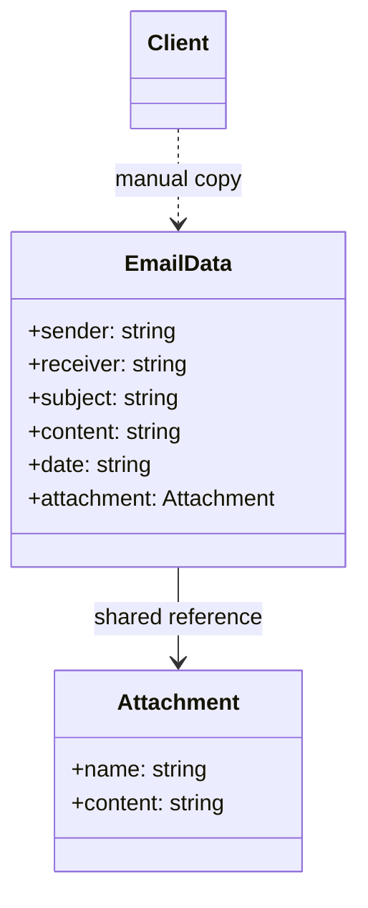

# 模式补全

> 这一节按 [[八面剖析以理解一个概念]] / ljg-learn 的思路整理为 Markdown 版本：先定锚，再用八个方向切开概念，最后压缩成公式、例子、类图和检验题。

## 定锚

原型模式（创建型）的通行定义：通过复制已有对象来创建新对象，避免重新走复杂构造流程。

常见误解：它不是简单浅拷贝；关键在于对象自己定义怎样复制才算正确。

核心词素：Prototype 的 proto 是先在场的模型；type 是类型。它用一个已成形的样本生成同类对象。

## 八刀

### 历史

它在 Smalltalk 等原型式系统中很自然，JavaScript 的原型链也让这种思想更显眼。GoF 把它收为创建型模式。

### 辩证

反面是每次都从零构造。更高理解是：当构造成本高或运行时类型才确定时，复制比创建更自然。

### 现象

像复制一份简历模板，再改姓名和经历。你不重新排版，只复制已有结构。

### 语言

Prototype 的 proto 是先在场的模型；type 是类型。它用一个已成形的样本生成同类对象。

### 形式

newObject = prototype.clone()。当对象含有外部资源、循环引用或共享状态时，clone 边界会变难。

### 存在

它让对象拥有自我繁殖能力，创建权从类转移到实例。

### 美感

它美在影印：一个复杂形状不再被重画，而是在纸上迅速显影。

### 元反思

我们用“复制”隐喻理解它，容易忽略复制语义。换成“谱系”隐喻，会更注意哪些状态该继承、哪些该重置。

## 内观

我是样本。你不必知道我怎么出生，只要让我 clone，我会给你一个合适的新我。

八刀共同指向的深层结构：原型模式不是为了“炫技”，而是在某个变化点上建立边界，让稳定部分继续稳定，让变化部分有自己的位置。

## 压缩

公式：原型 = 样本对象 + clone 规则 + 运行时复制

一句话：原型模式让对象从已有对象长出来，而不是每次从类构造器里硬造。

结构图：

```text
Client -> Prototype.clone() -> Copy
```

## 动机/意图

当对象创建成本高、构造过程复杂，或具体类型只能在运行时确定时，每次从类开始重新构造并不合适。原型模式的意图是让已有对象负责复制自身，用 `clone()` 生成结构和初始状态都合适的新对象。

## 结构/角色

- `Prototype`：原型接口，声明 `clone()`。
- `ConcretePrototype`：具体原型，实现复制规则，决定深拷贝、浅拷贝和状态重置边界。
- `Client`：客户端持有或查找原型，通过复制得到新对象。
- `PrototypeRegistry`：原型管理器，可选角色，用名称或 key 管理一组可复制原型。

## 典型 UML



## 使用场景

- 对象初始化昂贵，需要复用一个预配置模板。
- 运行时才知道具体对象类型，不希望客户端依赖具体构造器。
- 需要快速生成大量相似对象，只修改少量字段。
- 希望对象自己定义复制语义，避免外部误用浅拷贝。

## 正例：TypeScript

```ts
interface Prototype<T> {
  clone(): T
}

class Attachment implements Prototype<Attachment> {
  constructor(
    public name: string,
    public content: string,
  ) {}

  clone() {
    return new Attachment(this.name, this.content)
  }
}

class Email implements Prototype<Email> {
  constructor(
    public sender: string,
    public receiver: string,
    public subject: string,
    public content: string,
    public date: string,
    public attachment: Attachment,
  ) {}

  // 浅克隆：复制邮件本身，但共享附件对象
  clone() {
    return new Email(
      this.sender,
      this.receiver,
      this.subject,
      this.content,
      this.date,
      this.attachment,
    )
  }

  // 深克隆：连附件也一起复制
  deepClone() {
    return new Email(
      this.sender,
      this.receiver,
      this.subject,
      this.content,
      this.date,
      this.attachment.clone(),
    )
  }
}

const source = new Email(
  "alice@example.com",
  "team@example.com",
  "weekly report",
  "please check the report",
  "2026-06-24",
  new Attachment("report.pdf", "pdf-binary-data"),
)

const shallowCopied = source.clone()
shallowCopied.subject = "weekly report copy"
shallowCopied.attachment.name = "updated-report.pdf"

const deepCopied = source.deepClone()
deepCopied.subject = "weekly report deep copy"
deepCopied.attachment.name = "deep-report.pdf"
```

## 正例：UML 类图



## 反例：TypeScript

```ts
class Attachment {
  constructor(
    public name: string,
    public content: string,
  ) {}
}

const source = {
  sender: "alice@example.com",
  receiver: "team@example.com",
  subject: "weekly report",
  content: "please check the report",
  date: "2026-06-24",
  attachment: new Attachment("report.pdf", "pdf-binary-data"),
}

const copied = { ...source }
copied.subject = "weekly report copy"
copied.attachment.name = "updated-report.pdf"

// source.attachment.name 也会一起变化，因为这里只是随手做了浅拷贝
```

## 反例：UML 类图




## 案例

由于邮件对象包含的内容较多（如发送者、接收者、标题、内容、日期、附件等），某系统中现需要提供一个邮件复制功能，对于已经创建好的邮件对象，可以通过复制的方式创建一个新的邮件对象，如果需要改变某部分内容，无须修改原始的邮件对象，只需要修改复制后得到的邮件对象即可。使用原型模式设计该系统。在本实例中使用浅克隆实现邮件复制，即复制邮件(Email)的同时不复制附件(Attachment)。


使用深克隆实现邮件复制，即复制邮件的同时复制附件。
## 掌握检验

1. 原型模式适合什么样的创建成本？
2. 浅拷贝为什么可能破坏原型模式的语义？
3. JavaScript 的原型链和 GoF 原型模式有什么联系与区别？
