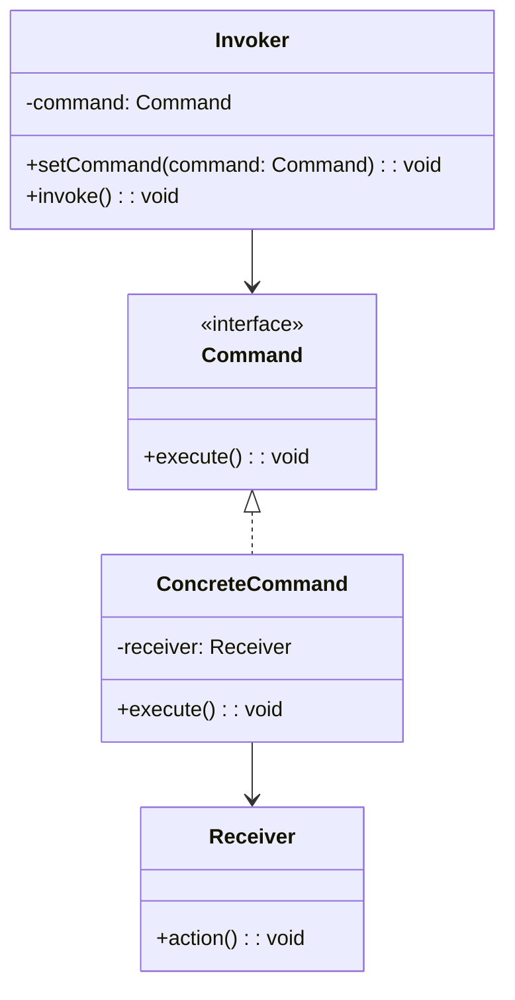
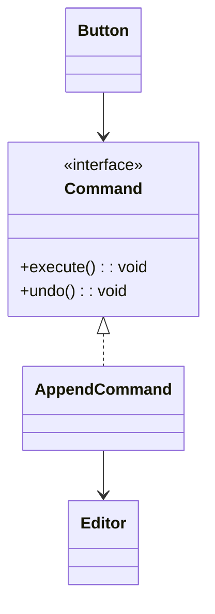
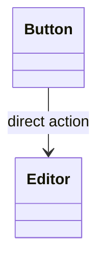

# 模式补全

> 这一节按 [[八面剖析以理解一个概念]] / ljg-learn 的思路整理为 Markdown 版本：先定锚，再用八个方向切开概念，最后压缩成公式、例子、类图和检验题。

## 定锚

命令模式（行为型）的通行定义：把请求封装成对象，使请求可以被参数化、排队、记录、撤销或重做。

常见误解：命令模式不是把函数包一层对象这么简单；关键是请求成为可管理的数据。

核心词素：Command 是命令、指令。它把“做某事”从一次调用变成一个对象。

## 八刀

### 历史

它常见于菜单按钮、事务队列、撤销重做。GoF 将“请求对象化”沉淀为模式。

### 辩证

反面是按钮直接调用业务对象。更高理解是：调用本身也能被存储、组合和回放。

### 现象

编辑器里点击加粗、撤销、重做，每个动作都可以作为命令进入历史栈。

### 语言

Command 是命令、指令。它把“做某事”从一次调用变成一个对象。

### 形式

Invoker -> Command.execute() -> Receiver。若命令没有生命周期需求，直接函数可能更简单。

### 存在

它让动作获得身份，系统因此能记住过去、安排未来。

### 美感

它美在把瞬间凝固成卡片：一张卡片就是一个可执行动作。

### 元反思

命令隐喻容易让人想到上级命令。换成“事务记录”隐喻，会更重视撤销、重放和日志。

## 内观

我是一次请求的实体。按钮不需要知道接收者怎么工作，只要执行我，必要时还能撤销我。

八刀共同指向的深层结构：命令模式不是为了“炫技”，而是在某个变化点上建立边界，让稳定部分继续稳定，让变化部分有自己的位置。

## 压缩

公式：命令 = execute 封装 + 接收者 + 调用者解耦

一句话：命令模式把动作对象化，让动作可以被排队、记录和撤销。

结构图：

```text
Invoker -> Command -> Receiver
```

## 动机/意图

当请求的发起者不应该直接知道接收者和具体操作时，可以把一次操作封装成对象。命令模式的意图是把“请求”对象化，使其可以被排队、记录、撤销、重做、组合或延迟执行。

## 结构/角色

- `Command`：命令接口，声明 `execute()`，也可以声明 `undo()`。
- `ConcreteCommand`：具体命令，保存接收者和执行所需参数。
- `Receiver`：接收者，真正执行业务动作。
- `Invoker`：调用者，触发命令但不关心具体执行细节。
- `Client`：客户端创建命令并把接收者绑定进去。

## 典型 UML



## 使用场景

- UI 按钮、菜单、快捷键需要绑定可替换动作。
- 需要撤销、重做、宏命令或命令历史。
- 请求需要进入队列、日志或事务系统。
- 调用者和真正执行业务的对象需要解耦。

## 正例：TypeScript

```ts
interface Command {
  execute(): void
  undo(): void
}

class Editor {
  text = ""

  append(value: string) {
    this.text += value
  }
}

class AppendCommand implements Command {
  constructor(private editor: Editor, private value: string) {}

  execute() {
    this.editor.append(this.value)
  }

  undo() {
    this.editor.text = this.editor.text.slice(0, -this.value.length)
  }
}
```

## 正例：UML 类图



## 反例：TypeScript

```ts
class Button {
  constructor(private editor: Editor) {}

  click() {
    this.editor.append("hello") // 无法记录、撤销、排队
  }
}
```

## 反例：UML 类图



## 案例

电视机是请求的接收者，遥控器是请求的发送者，遥控器上有一些按钮，不同的按钮对应电视机的不同操作。抽象命令角色由一个命令接口来扮演，有三个具体的命令类实现了抽象命令接口，这三个具体命令类分别代表三种操作：打开电视机、关闭电视机和切换频道。显然，电视机遥控器就是一个典型的命令模式应用实例。

为了用户使用方便，某系统提供了一系列功能键，用户可以自定义功能键的功能，如功能键FunctionButton可以用于退出系统(SystemExitClass)，也可以用于打开帮助界面(DisplayHelpClass)。用户可以通过修改配置文件来改变功能键的用途，现使用命令模式来设计该系统，使得功能键类与功能类之间解耦，相同的功能键可以对应不同的功能。

## 掌握检验

1. 命令模式为什么适合撤销/重做？
2. Invoker、Command、Receiver 分别负责什么？
3. 什么时候直接传函数比命令对象更合适？
