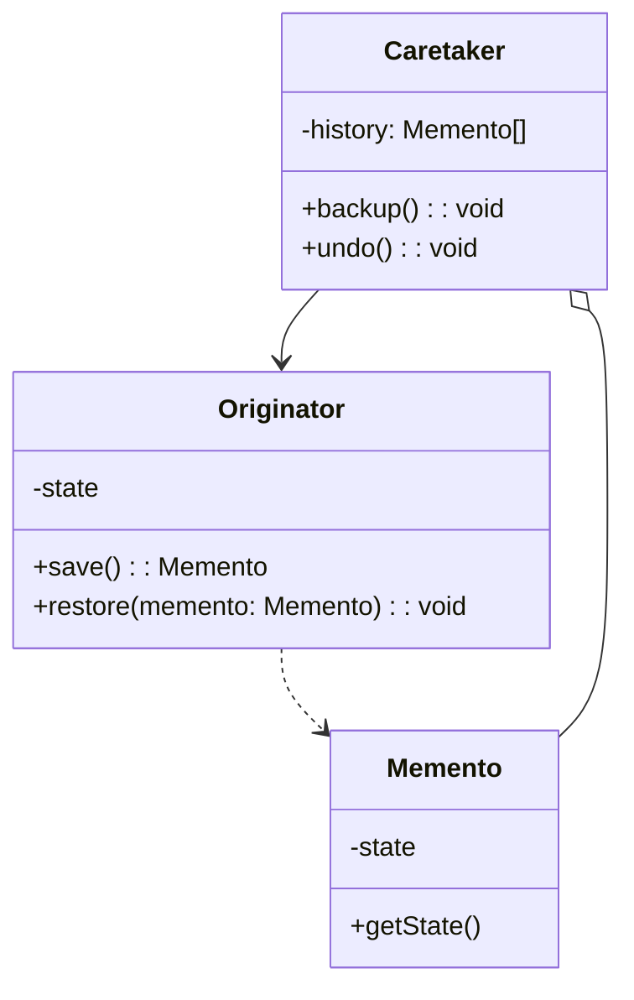
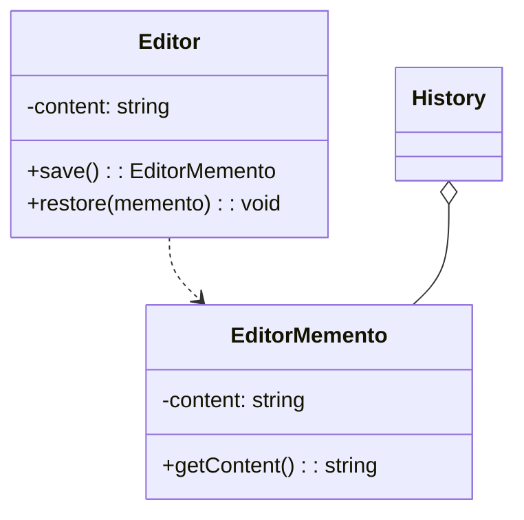
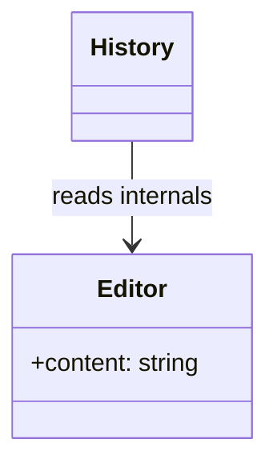

# 模式补全

> 这一节按 [[八面剖析以理解一个概念]] / ljg-learn 的思路整理为 Markdown 版本：先定锚，再用八个方向切开概念，最后压缩成公式、例子、类图和检验题。

## 定锚

备忘录模式（行为型）的通行定义：在不破坏封装的前提下捕获对象内部状态，并在之后恢复。

常见误解：备忘录不是随便暴露对象所有字段；它强调状态快照与封装边界。

核心词素：Memento 是纪念物、备忘物。它保存过去某一刻的状态。

## 八刀

### 历史

它常见于编辑器撤销、游戏存档、表单草稿。GoF 用它表达快照和恢复机制。

### 辩证

反面是外部对象直接读写内部字段。更高理解是：过去可以被保存，但内部仍要保密。

### 现象

写文章时按下保存快照，之后改坏了可以回到之前版本。

### 语言

Memento 是纪念物、备忘物。它保存过去某一刻的状态。

### 形式

memento = originator.save(); originator.restore(memento)。当状态巨大或频繁变化时，快照成本会很高。

### 存在

它让系统拥有记忆，同时不牺牲对象的边界。

### 美感

它美在琥珀：某一刻的状态被封存，等待未来重新发光。

### 元反思

快照隐喻容易忽略增量存储。换成“版本控制”隐喻，会更关注差异、压缩和历史管理。

## 内观

我是过去的一小块封存状态。外界可以保管我，却不能拆开我。需要时，我带对象回到那一刻。

八刀共同指向的深层结构：备忘录模式不是为了“炫技”，而是在某个变化点上建立边界，让稳定部分继续稳定，让变化部分有自己的位置。

## 压缩

公式：备忘录 = 原发器 + 状态快照 + 管理者

一句话：备忘录让对象能保存和恢复状态，同时不把内部结构摊开给外界。

结构图：

```text
Originator -> Memento
Caretaker stores Memento
```

## 动机/意图

当对象需要支持撤销、恢复或历史版本时，外部管理者如果直接读取内部字段，会破坏封装。备忘录模式的意图是在不暴露内部结构的前提下捕获对象状态，并在未来把对象恢复到某个历史时刻。

## 结构/角色

- `Originator`：原发器，拥有内部状态，负责创建和恢复备忘录。
- `Memento`：备忘录，保存原发器某一刻的状态，对外尽量保持不可见或只读。
- `Caretaker`：管理者，保存备忘录历史，但不解析其中内容。
- `Client`：客户端触发保存、撤销或恢复流程。

## 典型 UML



## 使用场景

- 编辑器撤销、游戏存档、表单草稿、配置回滚。
- 需要保存历史状态，但不能暴露对象内部字段。
- 状态快照可以接受一定存储成本。
- 需要把状态保存职责和历史管理职责分开。

## 正例：TypeScript

```ts
class EditorMemento {
  constructor(private readonly content: string) {}

  getContent() {
    return this.content
  }
}

class Editor {
  private content = ""

  type(text: string) {
    this.content += text
  }

  save() {
    return new EditorMemento(this.content)
  }

  restore(memento: EditorMemento) {
    this.content = memento.getContent()
  }
}
```

## 正例：UML 类图



## 反例：TypeScript

```ts
class History {
  snapshots: any[] = []

  save(editor: any) {
    this.snapshots.push({ content: editor.content })
  }
}
```

## 反例：UML 类图




## 案例

某系统提供了用户信息操作模块，用户可以修改自己的各项信息。为了使操作过程更加人性化，现使用备忘录模式对系统进行改进，使得用户在进行了错误操作之后可以恢复到操作之前的状态。


## 掌握检验

1. 备忘录模式为什么强调不破坏封装？
2. Originator、Memento、Caretaker 各自是什么？
3. 大对象频繁保存快照时，可以怎样优化？
