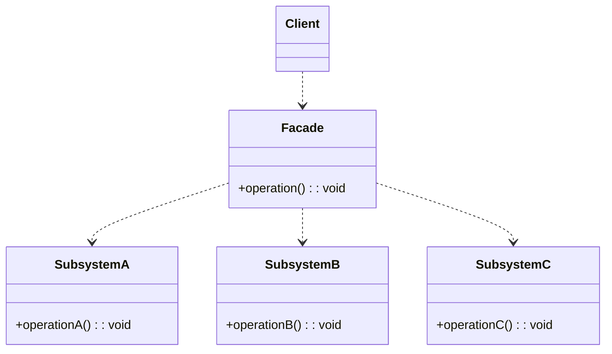
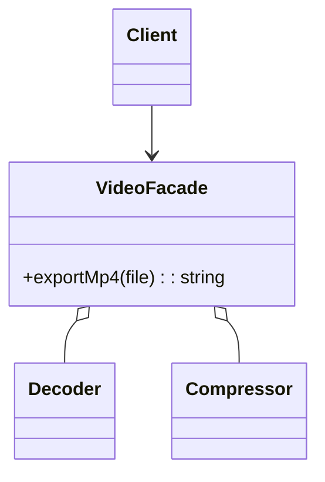
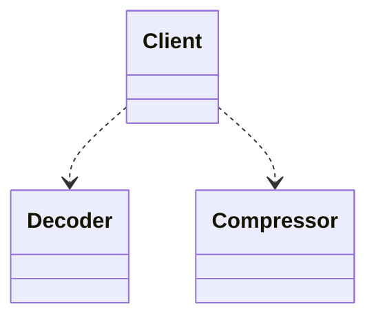

# 模式补全

> 这一节按 [[八面剖析以理解一个概念]] / ljg-learn 的思路整理为 Markdown 版本：先定锚，再用八个方向切开概念，最后压缩成公式、例子、类图和检验题。

## 定锚

外观模式（结构型）的通行定义：为复杂子系统提供一个简单统一的入口，降低客户端使用成本。

常见误解：外观不是为了隐藏所有能力；它提供常用路径，同时保留子系统可被高级使用的可能。

核心词素：Facade 是建筑正立面：外面看到一个整洁入口，里面可以很复杂。

## 八刀

### 历史

它来自分层系统和复杂库封装。GoF 将“统一入口简化调用”作为结构型模式。

### 辩证

反面是客户端直接编排多个子系统。更高理解是：把常见用例沉淀成稳定入口。

### 现象

一键导出视频时，你不想手动调用解码、滤镜、压缩、上传四个模块。

### 语言

Facade 是建筑正立面：外面看到一个整洁入口，里面可以很复杂。

### 形式

Client -> Facade -> Subsystems。若外观承担太多业务决策，会变成上帝类。

### 存在

它让复杂性退到幕后，让使用者先完成任务，再逐步理解内部。

### 美感

它美在门厅：把混乱走廊收束成一个清楚入口。

### 元反思

正立面隐喻容易让人只想遮丑。换成“快捷方式”隐喻，会更重视常用流程的准确表达。

## 内观

我是子系统的前台。你告诉我目标，我替你安排内部步骤。我简化入口，但不假装内部不存在。

八刀共同指向的深层结构：外观模式不是为了“炫技”，而是在某个变化点上建立边界，让稳定部分继续稳定，让变化部分有自己的位置。

## 压缩

公式：外观 = 统一入口 + 子系统编排 + 简化常用路径

一句话：外观模式把复杂子系统的常用调用收成一个好用入口。

结构图：

```text
Client -> Facade -> A/B/C subsystem
```

## 动机/意图

当一个子系统由多个类协作完成，客户端需要知道太多调用顺序和细节时，使用成本会很高。外观模式的意图是提供一个统一、简洁的入口，封装常用流程，降低客户端和复杂子系统之间的耦合。

## 结构/角色

- `Facade`：外观类，对外暴露简化接口，内部编排多个子系统。
- `SubsystemClass`：子系统类，负责具体功能，可以彼此协作。
- `Client`：客户端优先调用外观，而不是直接协调所有子系统。
- `AdditionalFacade`：可选角色，为不同客户端提供不同粒度的外观。

## 典型 UML



## 使用场景

- 子系统复杂，客户端只需要常用路径。
- 需要为一组底层 API 提供更稳定、更领域化的入口。
- 希望分层架构中上层只依赖少数入口。
- 初始化、关闭、事务或工作流需要统一编排。

## 正例：TypeScript

```ts
class Decoder {
  decode(file: string) {
    return "raw:" + file
  }
}

class Compressor {
  compress(raw: string) {
    return "zip:" + raw
  }
}

class VideoFacade {
  constructor(
    private decoder = new Decoder(),
    private compressor = new Compressor(),
  ) {}

  exportMp4(file: string) {
    const raw = this.decoder.decode(file)
    return this.compressor.compress(raw)
  }
}
```

## 正例：UML 类图



## 反例：TypeScript

```ts
function exportVideo(file: string) {
  const raw = new Decoder().decode(file)
  const compressed = new Compressor().compress(raw)
  return compressed
}
```

## 反例：UML 类图



## 案例

现在考察一个电源总开关的例子，以便进一步说明外观模式。为了使用方便，一个电源总开关可以控制四盏灯、一个风扇、一台空调和一台电视机的启动和关闭。通过该电源总开关可以同时控制上述所有电器设备，使用外观模式设计该系统。

某系统需要提供一个文件加密模块，加密流程包括三个操作，分别是读取源文件、加密、保存加密之后的文件。读取文件和保存文件使用流来实现，这三个操作相对独立，其业务代码封装在三个不同的类中。现在需要提供一个统一的加密外观类，用户可以直接使用该加密外观类完成文件的读取、加密和保存三个操作，而不需要与每一个类进行交互，使用外观模式设计该加密模块。

## 掌握检验

1. 外观模式降低的是哪一类复杂度？
2. 外观和适配器都改变入口，它们的动机有什么不同？
3. 外观类膨胀成上帝类时，应该如何拆？
