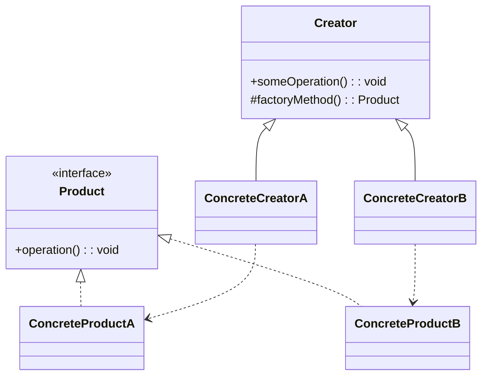
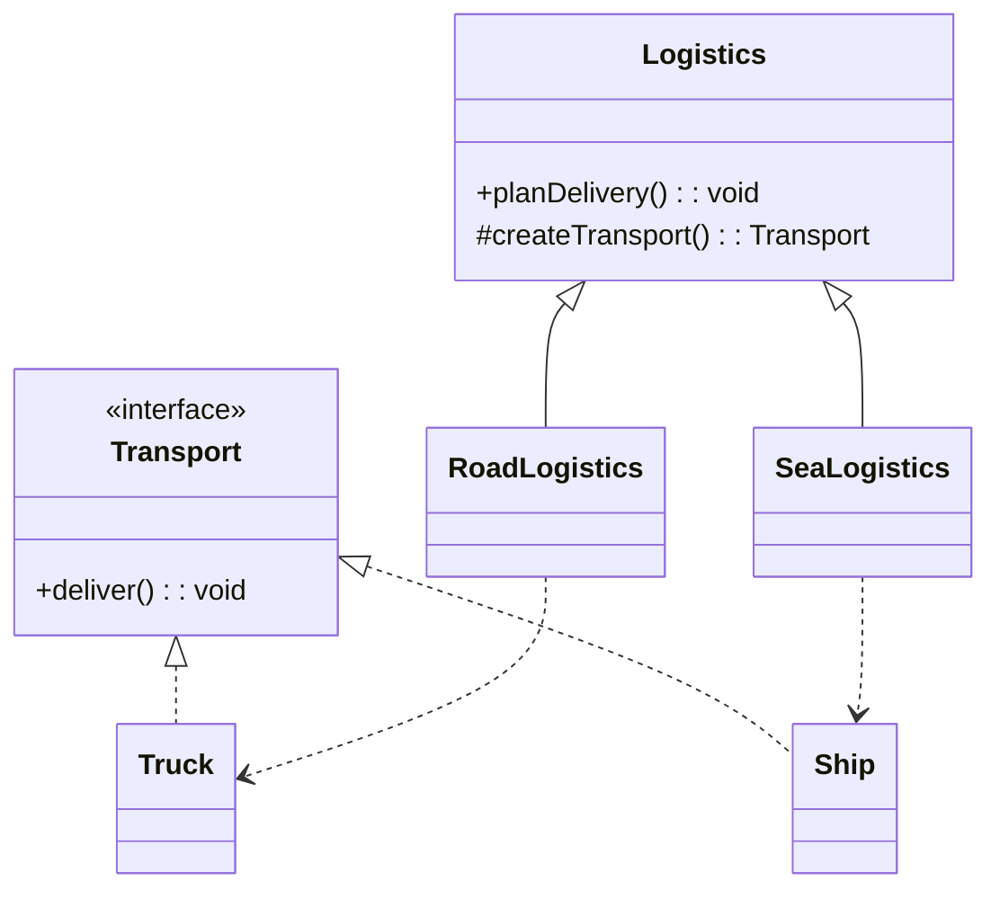
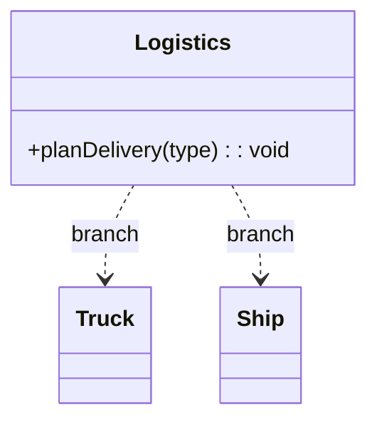

# 模式补全

> 这一节按 [[八面剖析以理解一个概念]] / ljg-learn 的思路整理为 Markdown 版本：先定锚，再用八个方向切开概念，最后压缩成公式、例子、类图和检验题。

## 定锚

工厂方法模式（创建型）的通行定义：把创建对象的步骤延迟到子类，由父类定义使用产品的流程，子类决定具体创建哪种产品。

常见误解：它不是为了少写 new，而是为了让新增产品通过新增工厂类完成。

核心词素：Factory Method 的 method 指一个可被覆写的创建钩子，重点是多态，而不是一个巨型工厂。

## 八刀

### 历史

它在面向对象框架中很早出现：父类掌握流程，子类填入变化点。GoF 将这种创建钩子固化成模式。

### 辩证

反面是简单工厂的集中分支。更高层的理解是：把 if 分支横向拆成一组多态工厂。

### 现象

像物流平台统一处理运输流程，但海运工厂造船、陆运工厂造卡车。流程稳定，交通工具变化。

### 语言

Factory Method 的 method 指一个可被覆写的创建钩子，重点是多态，而不是一个巨型工厂。

### 形式

Creator.operation() -> this.createProduct() -> Product。若产品之间必须成套出现，单个工厂方法会不够。

### 存在

它让扩展变成添加类，而不是修改中央判断。系统从“改旧代码”转向“挂新插件”。

### 美感

它美在把选择权下放：父类像乐谱，子类换乐器，旋律仍然成立。

### 元反思

工厂隐喻容易让人只盯创建。换成“模板里的插槽”，就能看到它和多态流程的关系。

## 内观

我是父类留下的创建空位。流程调用我，但不规定我产生谁。每个子类用自己的产品回答同一个问题。

八刀共同指向的深层结构：工厂方法模式不是为了“炫技”，而是在某个变化点上建立边界，让稳定部分继续稳定，让变化部分有自己的位置。

## 压缩

公式：工厂方法 = 稳定流程 + 抽象创建方法 + 子类产品选择

一句话：工厂方法把创建决定从中心分支搬到具体工厂的多态实现里。

结构图：

```text
Creator -> factoryMethod() -> Product
ConcreteCreator -> ConcreteProduct
```

## 动机/意图

当父类能确定一套稳定流程，却不能确定流程中应该创建哪一种具体产品时，可以把创建步骤定义成一个可被子类覆写的工厂方法。它的意图是让新增产品通过新增具体创建者完成，减少对既有创建逻辑的修改。

## 结构/角色

- `Product`：抽象产品，定义流程中要使用的对象接口。
- `ConcreteProduct`：具体产品，由具体创建者创建。
- `Creator`：抽象创建者，声明工厂方法，并通常在业务流程中调用它。
- `ConcreteCreator`：具体创建者，覆写工厂方法，返回对应具体产品。
- `Client`：客户端选择某个具体创建者，通过统一流程间接使用产品。

## 典型 UML



## 使用场景

- 框架或父类掌握流程，但产品类型需要由扩展方决定。
- 需要避免简单工厂中越来越大的 `if/switch`。
- 新增产品比修改中央工厂更符合开闭原则。
- 创建逻辑与某个业务流程绑定，而不是孤立的工具函数。

## 正例：TypeScript

```ts
interface Transport {
  deliver(): void
}

class Truck implements Transport {
  deliver() {
    console.log("deliver by truck")
  }
}

class Ship implements Transport {
  deliver() {
    console.log("deliver by ship")
  }
}

abstract class Logistics {
  planDelivery() {
    const transport = this.createTransport()
    transport.deliver()
  }

  protected abstract createTransport(): Transport
}

class RoadLogistics extends Logistics {
  protected createTransport(): Transport {
    return new Truck()
  }
}

class SeaLogistics extends Logistics {
  protected createTransport(): Transport {
    return new Ship()
  }
}
```

## 正例：UML 类图



## 反例：TypeScript

```ts
class Logistics {
  planDelivery(type: "road" | "sea") {
    const transport = type === "road" ? new Truck() : new Ship()
    transport.deliver()
  }
}
```

## 反例：UML 类图


## 案例

将原有的工厂进行分割，为每种品牌的电视机提供一个子工厂，海尔工厂专门负责生产海尔电视机，海信工厂专门负责生产海信电视机，如果需要生产TCL电视机或创维电视机，只需要对应增加一个新的TCL工厂或创维工厂即可，原有的工厂无须做任何修改，使得整个系统具有更加的灵活性和可扩展性。

某系统日志记录器要求支持多种日志记录方式，如文件记录、数据库记录等，且用户可以根据要求动态选择日志记录方式，现使用工厂方法模式设计该系统


## 掌握检验

1. 工厂方法和简单工厂最大的结构差异是什么？
2. 为什么父类可以使用产品，却不需要知道具体产品类？
3. 新增一种运输方式时，正例需要改哪些地方？
