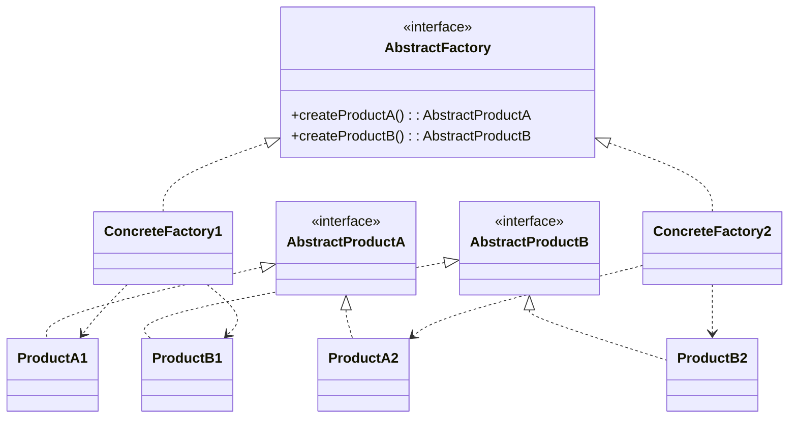
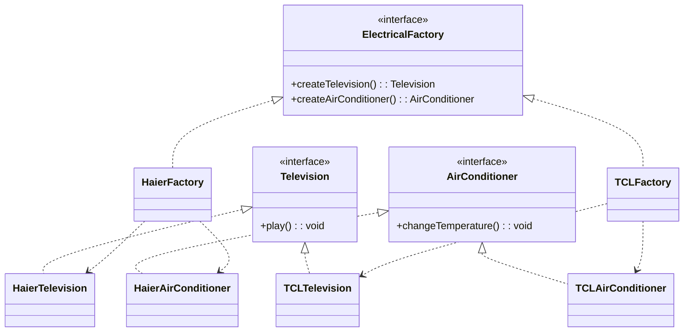
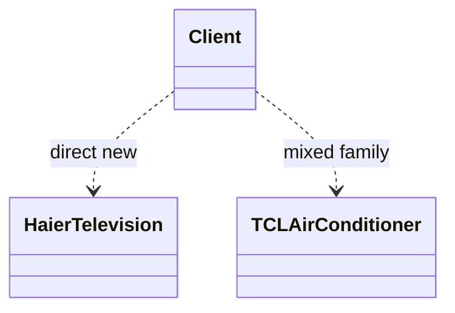

# 模式补全

> 这一节按 [[八面剖析以理解一个概念]] / ljg-learn 的思路整理为 Markdown 版本：先定锚，再用八个方向切开概念，最后压缩成公式、例子、类图和检验题。

## 定锚

抽象工厂模式（创建型）的通行定义：提供创建一族相关对象的接口，让同一产品族的对象一起变化、一起替换。

常见误解：它不是“很多工厂方法放一起”这么简单，核心是保证产品族兼容。

核心词素：Abstract 指面向接口；Factory 指创建；Family 是隐藏关键词：一族对象必须成套。

## 八刀

### 历史

它来自 GUI、数据库驱动等跨平台场景：按钮、输入框、菜单需要同时适配一个平台。GoF 将这种产品族切换整理成模式。

### 辩证

反面是到处混用具体产品。更高理解是：不是创建单个对象，而是创建一个一致的生态。

### 现象

换手机主题时，按钮、弹窗、字体一起换，而不是只换一个按钮。抽象工厂负责这套一致性。

### 语言

Abstract 指面向接口；Factory 指创建；Family 是隐藏关键词：一族对象必须成套。

### 形式

family = Factory.createA() + Factory.createB()。当只需要一种产品时，抽象工厂会显得过重。

### 存在

它让系统承认“对象不是孤立零件，而是互相配套的关系”。

### 美感

它美在整齐：一扇门打开后，里面所有家具都属于同一风格。

### 元反思

工厂隐喻遮住了“风格系统”。换成“主题包”隐喻，更容易理解产品族约束。

## 内观

我是产品族的边界。你通过我拿按钮，也通过我拿输入框。只要选定我，就不会混出半套 Mac 半套 Windows。

八刀共同指向的深层结构：抽象工厂模式不是为了“炫技”，而是在某个变化点上建立边界，让稳定部分继续稳定，让变化部分有自己的位置。

## 压缩

公式：抽象工厂 = 抽象创建接口 + 多个产品等级 + 同一产品族一致性

一句话：抽象工厂解决的是“一组相关对象必须一起替换”的问题。

结构图：

```text
Client -> AbstractFactory -> {ProductA, ProductB}
ConcreteFactoryX -> FamilyX
```

理解抽象工厂模式之前还需要理解两个概念：
- 产品等级结构：即产品的继承结构，多个具体产品集成于某个抽象产品类
- 产品族：由同一个工厂生产的，位于不同产品等级结构的一组产品

当系统所提供的工厂所需生产的具体产品并不是一个简单的对象，而是多个位于不同产品等级结构中属于不同类型的具体产品时需要使用抽象工厂模式


## 动机/意图

当系统需要创建一组相互配套的对象时，单独创建某一个产品会带来风格、协议或平台不一致的问题。抽象工厂的意图是通过一个工厂接口创建同一产品族中的多个产品，保证客户端拿到的是一整套兼容对象。

## 结构/角色

- `AbstractFactory`：抽象工厂，声明创建多个抽象产品的方法。
- `ConcreteFactory`：具体工厂，创建同一产品族下的具体产品。
- `AbstractProduct`：抽象产品，代表某一类产品等级结构。
- `ConcreteProduct`：具体产品，属于某个产品族，也属于某个产品等级。
- `Client`：客户端只依赖抽象工厂和抽象产品，不直接混用具体族。

## 典型 UML



## 使用场景

- 同一平台、主题、品牌或协议下的对象必须成套使用。
- 客户端需要在不同产品族之间整体切换。
- 希望禁止半套 A 族、半套 B 族的错误组合。
- 产品族稳定，但具体族可能不断新增，例如 GUI 组件、数据库驱动、云厂商适配。

## 正例：TypeScript

```ts
interface Television {
  play(): void
}

interface AirConditioner {
  changeTemperature(): void
}

class HaierTelevision implements Television {
  play() {
    console.log("haier television play")
  }
}

class TCLTelevision implements Television {
  play() {
    console.log("tcl television play")
  }
}

class HaierAirConditioner implements AirConditioner {
  changeTemperature() {
    console.log("haier air conditioner cool")
  }
}

class TCLAirConditioner implements AirConditioner {
  changeTemperature() {
    console.log("tcl air conditioner cool")
  }
}

interface ElectricalFactory {
  createTelevision(): Television
  createAirConditioner(): AirConditioner
}

class HaierFactory implements ElectricalFactory {
  createTelevision(): Television {
    return new HaierTelevision()
  }

  createAirConditioner(): AirConditioner {
    return new HaierAirConditioner()
  }
}

class TCLFactory implements ElectricalFactory {
  createTelevision(): Television {
    return new TCLTelevision()
  }

  createAirConditioner(): AirConditioner {
    return new TCLAirConditioner()
  }
}

function buildSmartHome(factory: ElectricalFactory) {
  const television = factory.createTelevision()
  const airConditioner = factory.createAirConditioner()

  television.play()
  airConditioner.changeTemperature()
}

buildSmartHome(new HaierFactory())
buildSmartHome(new TCLFactory())
```

## 正例：UML 类图



## 反例：TypeScript

```ts
function buildMixedHome() {
  const television: Television = new HaierTelevision()
  const airConditioner: AirConditioner = new TCLAirConditioner()

  television.play()
  airConditioner.changeTemperature()
}
```

## 反例：UML 类图



## 案例

一个电器工厂可以产生多种类型的电器，如海尔工厂可以生产海尔电视机、海尔空调等，TCL工厂可以生产TCL电视机、TCL空调等，相同品牌的电器构成一个产品族，而相同类型的电器构成了一个产品等级结构，现使用抽象工厂模式模拟该场景


某系统为了改进数据库操作的性能，自定义数据库连接对象Connection和语句对象Statement，可针对不同类型的数据库提供不同的连接对象和语句对象，如提供Oracle或SQL Server专用连接类和语句类，而且用户可以通过配置文件等方式根据实际需要动态更换系统数据库。使用抽象工厂模式设计该系统

## 掌握检验

1. 抽象工厂里的“产品族”和“产品等级”分别是什么？
2. 为什么抽象工厂能避免混用不兼容对象？
3. 当只新增一个产品类型时，抽象工厂的代价是什么？
