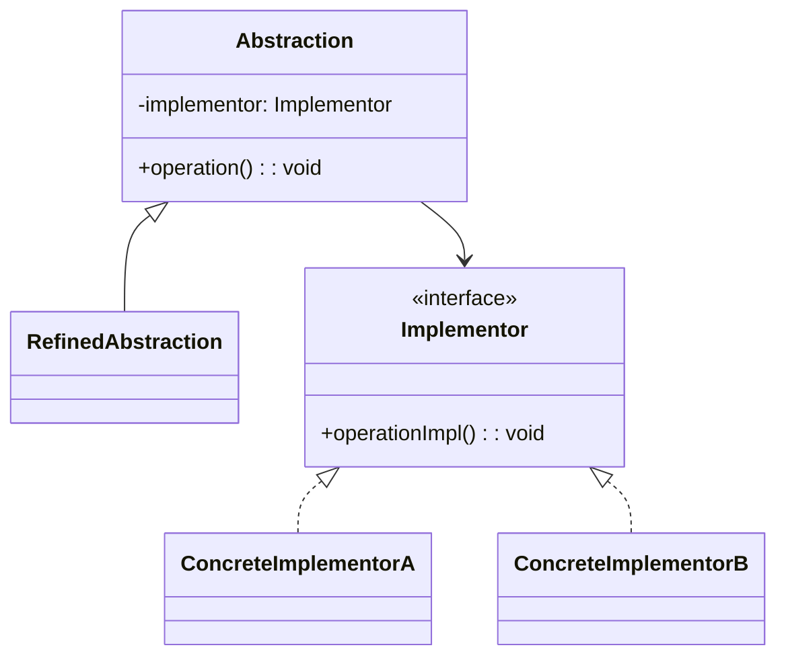
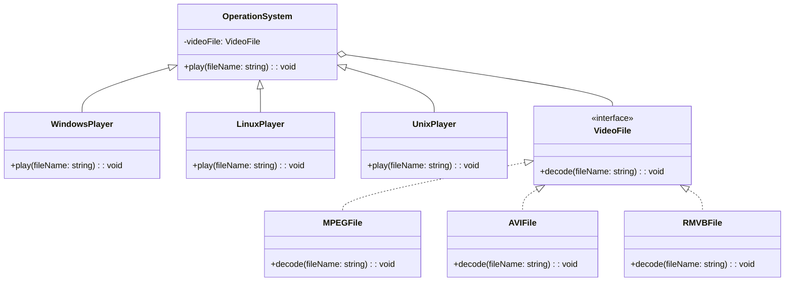
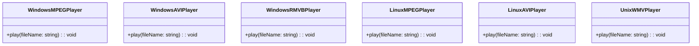

# 模式补全

> 这一节按 [[八面剖析以理解一个概念]] / ljg-learn 的思路整理为 Markdown 版本：先定锚，再用八个方向切开概念，最后压缩成公式、例子、类图和检验题。

## 定锚

桥接模式（结构型）的通行定义：把抽象部分和实现部分分离，让它们可以独立变化。

常见误解：桥接不是普通封装；它专门处理两个维度同时扩展导致的类爆炸。

核心词素：Bridge 的桥连接两岸：抽象层一岸，实现层一岸，中间靠组合通信。

## 八刀

### 历史

它来自图形、驱动、平台适配等多维变化场景。GoF 用它对抗继承层级膨胀。

### 辩证

反面是用继承枚举所有组合。更高理解是：把一个继承树拆成两个可组合维度。

### 现象

视频播放器需要同时面对两个变化维度：一边是操作系统平台（Windows、Linux、Unix），另一边是视频格式（MPEG、RMVB、AVI、WMV）。如果直接用继承硬拼，就会出现 WindowsMPEGPlayer、LinuxAVIPlayer、UnixRMVBPlayer 这一类组合爆炸。

### 语言

Bridge 的桥连接两岸：抽象层一岸，实现层一岸，中间靠组合通信。

### 形式

Abstraction has Implementor。若只有一个变化维度，桥接会显得过度设计。

### 存在

它让人从“分类继承”转向“维度组合”，系统因此更能呼吸。

### 美感

它美在横跨：两组变化各走各路，却在运行时轻轻合拢。

### 元反思

桥的隐喻容易让人只看连接。换成“坐标轴”隐喻，更容易看到它解决二维扩展。

## 内观

我把播放器的“平台”与“视频格式解码”拆开。平台负责“在哪里播”，格式负责“怎么解码”，二者彼此独立扩展，通过组合在运行时接起来。

八刀共同指向的深层结构：桥接模式不是为了“炫技”，而是在某个变化点上建立边界，让稳定部分继续稳定，让变化部分有自己的位置。

## 压缩

公式：桥接 = 抽象层组合实现层 + 两个维度独立扩展

一句话：桥接用组合拆掉多维继承爆炸。

结构图：

```text
Abstraction -> Implementor
RefinedAbstraction + ConcreteImplementor
```

## 动机/意图

当一个类同时沿着两个或多个维度变化时，用继承会产生组合爆炸。桥接模式的意图是把抽象维度和实现维度拆开，让抽象对象通过组合持有实现接口，从而使两个维度可以独立扩展。

## 结构/角色

- `Abstraction`：抽象层，定义高层业务接口，持有实现层引用。
- `RefinedAbstraction`：扩展抽象层，增加或改写高层行为。
- `Implementor`：实现层接口，定义底层能力。
- `ConcreteImplementor`：具体实现层，提供平台、渠道或设备相关实现。
- `Client`：客户端组合抽象层和实现层。

## 典型 UML



## 使用场景

- 抽象和实现都需要独立扩展，例如形状与颜色、消息类型与发送渠道。
- 多维继承导致类数量快速膨胀。
- 不希望抽象层绑定某个具体平台或技术实现。
- 需要在运行时切换实现，而不是在继承层级中固定死。

## 正例：TypeScript

这个场景里，“播放器平台”是抽象层，“视频文件格式”是实现层。平台和格式都可能独立扩展，所以让平台持有格式对象，而不是为每个组合都造一个子类。

```ts
interface VideoFile {
  decode(fileName: string): void
}

class MPEGFile implements VideoFile {
  decode(fileName: string) {
    console.log(`decode MPEG file: ${fileName}`)
  }
}

class AVIFile implements VideoFile {
  decode(fileName: string) {
    console.log(`decode AVI file: ${fileName}`)
  }
}

class RMVBFile implements VideoFile {
  decode(fileName: string) {
    console.log(`decode RMVB file: ${fileName}`)
  }
}

abstract class OperationSystem {
  constructor(protected videoFile: VideoFile) {}

  abstract play(fileName: string): void
}

class WindowsPlayer extends OperationSystem {
  play(fileName: string) {
    console.log("run on Windows")
    this.videoFile.decode(fileName)
  }
}

class LinuxPlayer extends OperationSystem {
  play(fileName: string) {
    console.log("run on Linux")
    this.videoFile.decode(fileName)
  }
}

class UnixPlayer extends OperationSystem {
  play(fileName: string) {
    console.log("run on Unix")
    this.videoFile.decode(fileName)
  }
}

const player = new WindowsPlayer(new AVIFile())
player.play("movie.avi")
```

## 正例：UML 类图



## 反例：TypeScript

反例里把“平台”和“格式”直接揉进同一层继承或同一级具体类中。每多一个平台或格式，都要新增一批组合类，扩展成本会成倍增长。

```ts
class WindowsMPEGPlayer {
  play(fileName: string) {
    console.log(`Windows play MPEG: ${fileName}`)
  }
}

class WindowsAVIPlayer {
  play(fileName: string) {
    console.log(`Windows play AVI: ${fileName}`)
  }
}

class LinuxMPEGPlayer {
  play(fileName: string) {
    console.log(`Linux play MPEG: ${fileName}`)
  }
}

class LinuxAVIPlayer {
  play(fileName: string) {
    console.log(`Linux play AVI: ${fileName}`)
  }
}

class UnixRMVBPlayer {
  play(fileName: string) {
    console.log(`Unix play RMVB: ${fileName}`)
  }
}
```

## 反例：UML 类图



## 案例

现需要提供大中小3种型号的画笔，能够绘制5种不同颜色，如果使用蜡笔，我们需要准备3*5=15支蜡笔，也就是说必须准备15个具体的蜡笔类。而如果使用毛笔的话，只需要3种型号的毛笔，外加5个颜料盒，用3+5=8个类就可以实现15支蜡笔的功能。本实例使用桥接模式来模拟毛笔的使用过程

如果需要开发一个跨平台视频播放器，可以在不同操作系统平台（如Windows、Linux、Unix等）上播放多种格式的视频文件，常见的视频格式包括MPEG、RMVB、AVI、WMV等。现使用桥接模式设计该播放器。

## 掌握检验

1. 桥接模式解决的“两个变化维度”是什么意思？
2. 桥接和适配器都用了组合，它们面对的问题有何不同？
3. 如何判断当前是需要桥接，而不是继续继承？
