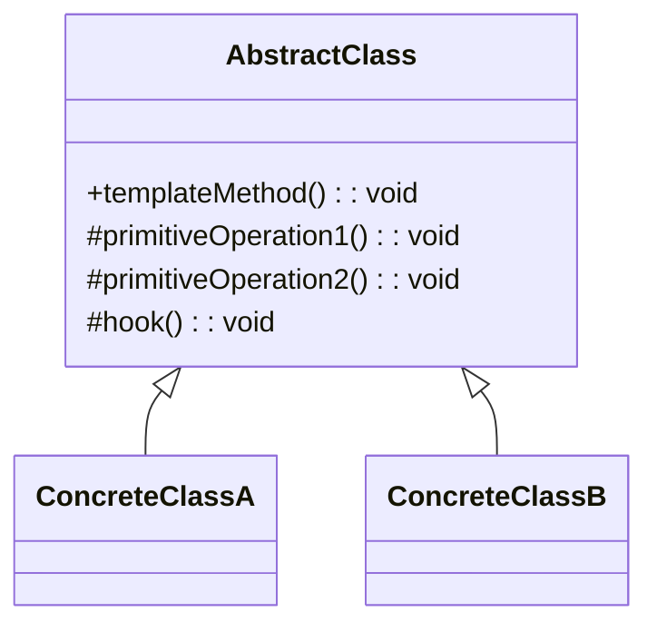
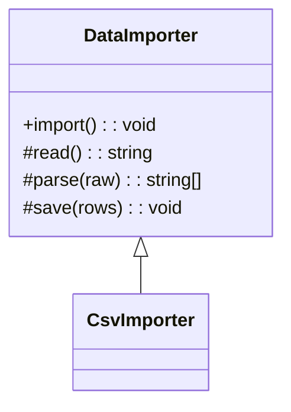
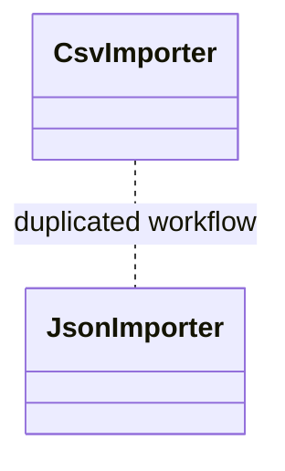

# 模式补全

> 这一节按 [[八面剖析以理解一个概念]] / ljg-learn 的思路整理为 Markdown 版本：先定锚，再用八个方向切开概念，最后压缩成公式、例子、类图和检验题。

## 定锚

模板方法模式（行为型）的通行定义：在父类中定义算法骨架，把某些步骤延迟到子类实现。

常见误解：模板方法不是复制粘贴流程；它要求稳定骨架和可变步骤被清晰分开。

核心词素：Template 是模板，Method 是方法。它像表格，固定栏目，具体内容由子类填。

## 八刀

### 历史

它在框架设计中极常见：生命周期、测试流程、数据导入流程。GoF 将这种反向调用归纳成模式。

### 辩证

反面是每个子类完整复制流程。更高理解是：复用流程，不复用每个步骤的细节。

### 现象

泡茶和泡咖啡都要烧水、冲泡、倒杯、加料；冲泡和加料不同，流程相同。

### 语言

Template 是模板，Method 是方法。它像表格，固定栏目，具体内容由子类填。

### 形式

templateMethod() = step1 + primitiveStep + hook。若骨架不稳定，父类会频繁变化。

### 存在

它让框架先说“顺序如此”，扩展者只回答“这一步怎么做”。

### 美感

它美在骨架：一套动作姿态固定，细节各有风味。

### 元反思

模板隐喻容易强调填空。换成“生命周期”隐喻，会更理解框架为什么控制调用顺序。

## 内观

我是父类里的流程。我按固定顺序调用步骤，有些步骤我自己完成，有些留给子类。

八刀共同指向的深层结构：模板方法模式不是为了“炫技”，而是在某个变化点上建立边界，让稳定部分继续稳定，让变化部分有自己的位置。

## 压缩

公式：模板方法 = 稳定算法骨架 + 抽象步骤 + 钩子方法

一句话：模板方法把流程顺序固定下来，把变化步骤留给子类。

结构图：

```text
Base.template()
  -> fixedStep
  -> subclassStep
```

## 动机/意图

当多个子类共享同一套算法流程，但其中若干步骤各不相同时，复制整段流程会造成重复和顺序不一致。模板方法模式的意图是在父类中固定算法骨架，把可变步骤延迟到子类或钩子方法实现。

## 结构/角色

- `AbstractClass`：抽象类，定义模板方法和若干基本步骤。
- `templateMethod()`：模板方法，按固定顺序调用步骤，通常不让子类改写。
- `PrimitiveOperation`：抽象基本操作，由子类实现。
- `Hook`：钩子方法，可选扩展点，子类可以选择性覆写。
- `ConcreteClass`：具体类，实现可变步骤。

## 典型 UML



## 使用场景

- 多个流程步骤顺序相同，但部分步骤实现不同。
- 框架需要控制生命周期顺序，让扩展者填充局部行为。
- 希望把公共流程收回父类，避免子类复制粘贴。
- 需要通过钩子方法提供可选扩展点。

## 正例：TypeScript

```ts
abstract class DataImporter {
  import() {
    const raw = this.read()
    const rows = this.parse(raw)
    this.save(rows)
  }

  protected abstract read(): string
  protected abstract parse(raw: string): string[]

  protected save(rows: string[]) {
    console.log("save", rows.length)
  }
}

class CsvImporter extends DataImporter {
  protected read() {
    return "a,b,c"
  }

  protected parse(raw: string) {
    return raw.split(",")
  }
}
```

## 正例：UML 类图



## 反例：TypeScript

```ts
class CsvImporter {
  import() {
    const raw = "a,b,c"
    const rows = raw.split(",")
    console.log("save", rows.length)
  }
}

class JsonImporter {
  import() {
    const raw = "[1,2]"
    const rows = JSON.parse(raw)
    console.log("save", rows.length)
  }
}
```

## 反例：UML 类图



## 案例

在银行办理业务时，一般都包含几个基本步骤，首先需要取号排队，然后办理具体业务，最后需要对银行工作人员进行评分。无论具体业务是取款、存款还是转账，其基本流程都一样。现使用模板方法模式模拟银行业务办理流程。


## 掌握检验

1. 模板方法里的模板方法为什么通常不希望被子类覆写？
2. 抽象步骤和钩子方法有什么区别？
3. 模板方法和策略模式都能复用算法，它们的扩展方向有什么不同？
