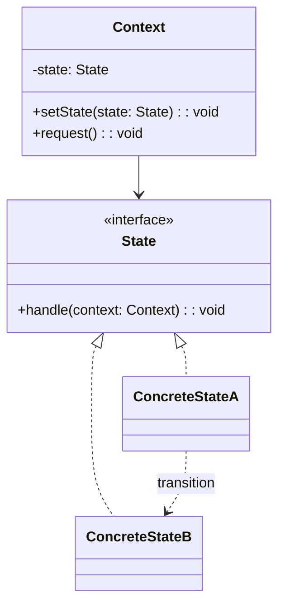
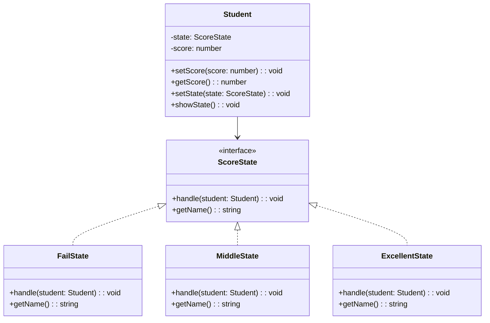
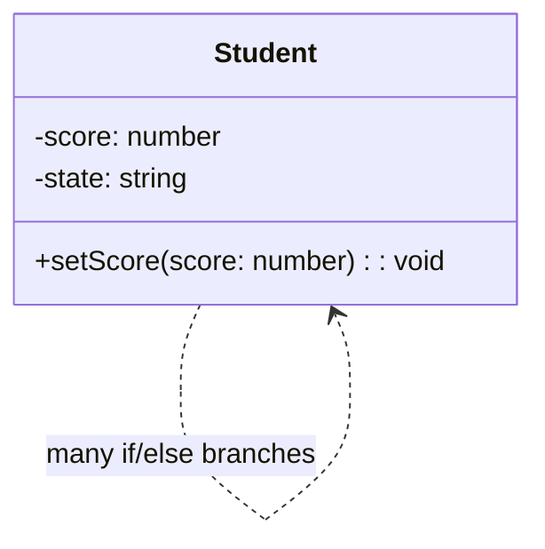

# 模式补全

> 这一节按 [[八面剖析以理解一个概念]] / ljg-learn 的思路整理为 Markdown 版本：先定锚，再用八个方向切开概念，最后压缩成公式、例子、类图和检验题。

## 定锚

状态模式（行为型）的通行定义：让对象在内部状态改变时改变行为，看起来像换了一个类。

常见误解：状态模式不是给字段起 enum 名；关键是把状态相关行为封装到状态对象中。

核心词素：State 强调状态即行为的上下文。它的隐喻是角色切换，而不是变量值。

## 八刀

### 历史

它常见于订单、播放器、连接状态、工作流。GoF 用它替换状态分支膨胀。

### 辩证

反面是 Context 里到处 switch 状态。更高理解是：每个状态对象负责自己允许的行为和迁移。

### 现象

订单待支付时可以取消，已发货时不能取消但可以确认收货。状态不同，动作含义不同。

### 语言

State 强调状态即行为的上下文。它的隐喻是角色切换，而不是变量值。

### 形式

context.request() -> state.handle(context)。若状态很少且稳定，模式会显得重。

### 存在

它让对象承认自己会变，并让变化后的行为有独立位置。

### 美感

它美在换挡：同一辆车，档位不同，油门响应完全不同。

### 元反思

状态机隐喻容易只画节点。换成“人格切换”隐喻，会更重视每个状态自己的行为边界。

## 内观

我是当前状态。Context 把请求交给我，我决定能不能做、怎么做、下一步去哪。

八刀共同指向的深层结构：状态模式不是为了“炫技”，而是在某个变化点上建立边界，让稳定部分继续稳定，让变化部分有自己的位置。

## 压缩

公式：状态 = Context + State 接口 + 具体状态行为 + 状态迁移

一句话：状态模式把状态分支拆成状态对象，让行为随状态自然切换。

结构图：

```text
Context -> State.handle()
StateA -> StateB
```

## 动机/意图

当对象行为随内部状态变化而变化时，把所有状态分支堆在一个类中会让状态转换越来越难维护。状态模式的意图是把每种状态封装成对象，让上下文把状态相关行为委托给当前状态对象。

## 结构/角色

- `Context`：上下文，保存当前状态，并把请求委托给状态对象。
- `State`：状态接口，声明状态相关行为。
- `ConcreteState`：具体状态，实现该状态下的行为，并可触发状态迁移。
- `Client`：客户端操作上下文，不直接操纵复杂状态分支。

## 典型 UML



## 使用场景

- 对象行为强烈依赖状态，例如订单、播放器、连接、审批流。
- 状态分支很多，且每个状态下行为不同。
- 状态转换规则需要集中在状态对象中表达。
- 希望新增状态时尽量少改上下文主流程。

## 正例：TypeScript

这个例子里，`Student` 是上下文对象，成绩状态分成 `FailState`、`MiddleState` 和 `ExcellentState`。当分数变化时，学生对象会把请求交给当前状态，再由状态对象决定是否切换到新的状态并输出对应结果。

```ts
interface ScoreState {
  handle(student: Student): void
  getName(): string
}

class Student {
  private state: ScoreState

  constructor(
    public readonly name: string,
    private score: number,
  ) {
    this.state = new FailState()
    this.state.handle(this)
  }

  setScore(score: number) {
    this.score = score
    this.state.handle(this)
  }

  getScore() {
    return this.score
  }

  setState(state: ScoreState) {
    this.state = state
  }

  showState() {
    console.log(`${this.name} score=${this.score}, state=${this.state.getName()}`)
  }
}

class FailState implements ScoreState {
  handle(student: Student) {
    const score = student.getScore()
    if (score >= 60 && score < 90) {
      student.setState(new MiddleState())
    } else if (score >= 90) {
      student.setState(new ExcellentState())
    } else {
      student.setState(this)
    }
    student.showState()
  }

  getName() {
    return "不及格"
  }
}

class MiddleState implements ScoreState {
  handle(student: Student) {
    const score = student.getScore()
    if (score < 60) {
      student.setState(new FailState())
    } else if (score >= 90) {
      student.setState(new ExcellentState())
    } else {
      student.setState(this)
    }
    student.showState()
  }

  getName() {
    return "中等"
  }
}

class ExcellentState implements ScoreState {
  handle(student: Student) {
    const score = student.getScore()
    if (score < 60) {
      student.setState(new FailState())
    } else if (score < 90) {
      student.setState(new MiddleState())
    } else {
      student.setState(this)
    }
    student.showState()
  }

  getName() {
    return "优秀"
  }
}

const student = new Student("Alice", 58)
student.setScore(75)
student.setScore(95)
student.setScore(59)
```

## 正例：UML 类图



## 反例：TypeScript

反例里把所有状态判断都堆在学生类内部。随着状态规则变多、行为变复杂，这个类会越来越臃肿，所有修改都得回到同一个地方继续加分支。

```ts
class Student {
  private state = "不及格"

  constructor(
    public readonly name: string,
    private score: number,
  ) {}

  setScore(score: number) {
    this.score = score

    if (this.score < 60) {
      this.state = "不及格"
    } else if (this.score >= 60 && this.score < 90) {
      this.state = "中等"
    } else {
      this.state = "优秀"
    }

    console.log(`${this.name} score=${this.score}, state=${this.state}`)
  }
}
```

## 反例：UML 类图



## 案例

•在某论坛系统中，用户可以发表留言，发表留言将增加积分；用户也可以回复留言，回复留言也将增加积分；用户还可以下载文件，下载文件将扣除积分。该系统用户分为三个等级，分别是新手、高手和专家，这三个等级对应三种不同的状态，这三种状态分别定义如下：

Ÿ(1) 如果积分小于100分，则为新手状态，用户可以发表留言、回复留言，但是不能下载文件。如果积分大于等于1000分，则转换为专家状态；如果积分大于等于100分，则转换为高手状态。

Ÿ(2) 如果积分大于等于100分但小于1000分，则为高手状态，用户可以发表留言、回复留言，还可以下载文件，而且用户在发表留言时可以获取双倍积分。如果积分小于100分，则转换为新手状态；如果积分大于等于1000分，则转换为专家状态；如果下载文件后积分小于0，则不能下载该文件。

Ÿ(3) 如果积分大于等于1000分，则为专家状态，用户可以发表留言、回复留言和下载文件，用户除了在发表留言时可以获取双倍积分外，下载文件只扣除所需积分的一半。如果积分小于100分，则转换为新手状态；如果积分小于1000分，但大于等于100，则转换为高手状态；如果下载文件后积分小于0，则不能下载该文件。


在某银行系统定义的账户有三种状态：

Ÿ(1) 如果账户(Account)中余额(balance)大于等于0，此时账户的状态为绿色(GreenState)，即正常状态，表示既可以向该账户存款(deposit)也可以从该账户取款(withdraw)；

Ÿ(2) 如果账户中余额小于0，并且大于等于-1000，则账户的状态为黄色(YellowState)，即欠费状态，此时既可以向该账户存款也可以从该账户取款；

Ÿ(3) 如果账户中余额小于-1000，那么账户的状态为红色(RedState)，即透支状态，此时用户只能向该账户存款，不能再从中取款。

•现用状态模式来实现状态的转化问题，用户只需要执行简单的存款和取款操作，系统根据余额数量自动转换到相应的状态。

## 掌握检验

1. 状态模式和策略模式都委托对象，区别是什么？
2. 状态迁移应该放在 Context 还是 State 中？各有什么取舍？
3. 什么时候 enum + switch 已经足够？
