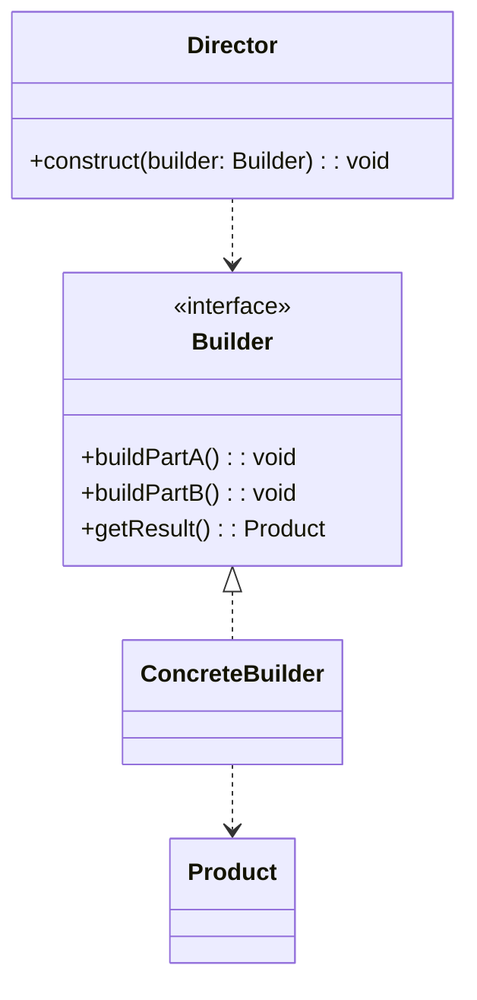
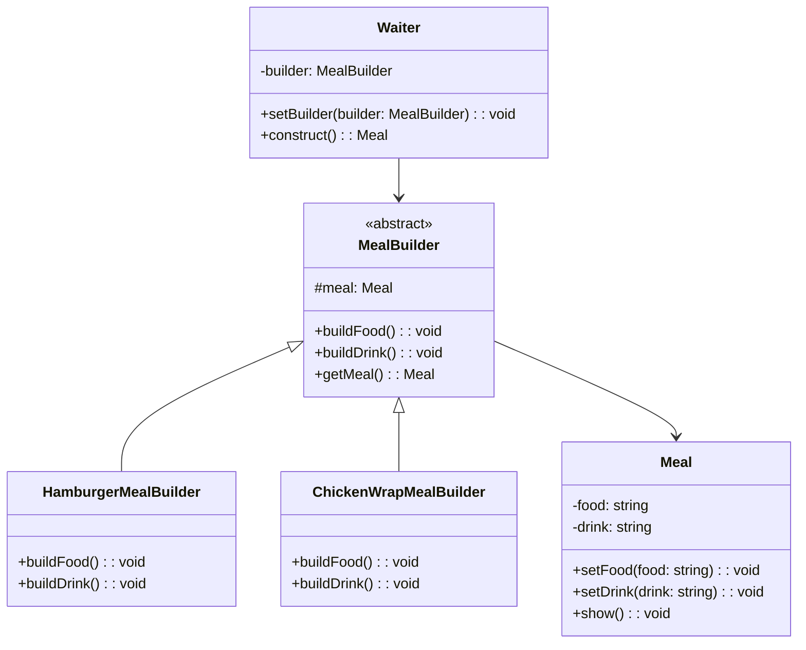
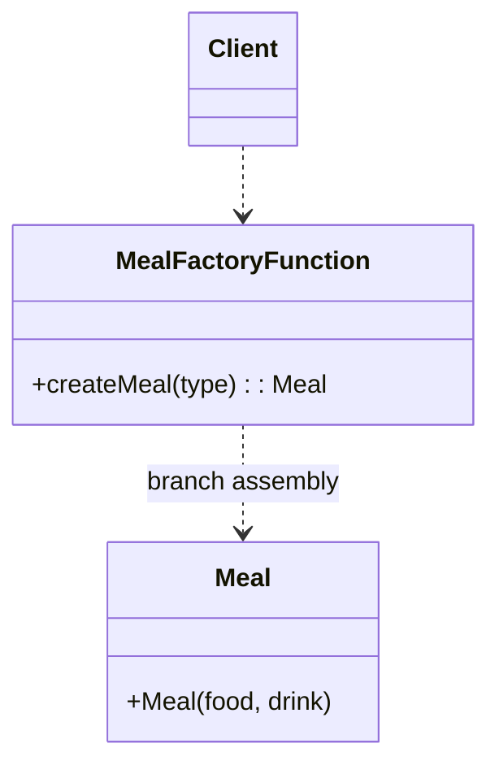

# 模式补全

> 这一节按 [[八面剖析以理解一个概念]] / ljg-learn 的思路整理为 Markdown 版本：先定锚，再用八个方向切开概念，最后压缩成公式、例子、类图和检验题。

## 定锚

建造者模式（生成器模式）（创建型）的通行定义：把复杂对象的构建过程拆成多个步骤，让同样的构建过程可以产生不同表示。

常见误解：它不是链式调用的同义词；链式 API 只是常见外观，核心是分步骤构建复杂对象。

核心词素：Builder 强调 build 的过程性：对象不是一下子 new 出来，而是被一步步组装。

## 八刀

### 历史

它来自复杂对象构造参数过多、构造顺序重要的场景。GoF 版本还强调 Director 对构建步骤的编排。

### 辩证

反面是超长构造函数和到处散落的配置拼装。更高理解是：把构建过程本身对象化。

### 现象

像装修房子，先定地板、再定墙面、再定灯光。不同套餐共享步骤，但最终风格不同。

### 语言

Builder 强调 build 的过程性：对象不是一下子 new 出来，而是被一步步组装。

### 形式

object = builder.stepA().stepB().build()。当对象构造很简单时，它会变成仪式感过重。

### 存在

它让开发者把“创建完成的一瞬间”扩展成“可管理的创建过程”。

### 美感

它美在层层成形：像模型从骨架到外壳，一步一步出现完整结构。

### 元反思

我们常用“施工队”理解它，这会遮住不可变对象和校验的重要性。换成“编译流水线”隐喻，会更重视最终 build 的边界。

## 内观

我是对象成形前的工作台。你把选项交给我，我负责顺序、默认值和最终校验。build 之前，一切都还可以调整。

八刀共同指向的深层结构：建造者模式（生成器模式）不是为了“炫技”，而是在某个变化点上建立边界，让稳定部分继续稳定，让变化部分有自己的位置。

## 压缩

公式：建造者 = 分步配置 + 构建边界 + 复杂对象

一句话：建造者把复杂构造从一个巨大构造函数里拆成可读、可控的步骤。

结构图：

```text
Client -> Builder steps -> build() -> Product
```

## 动机/意图

当一个对象构造参数很多、步骤有顺序、默认值复杂，或需要在最后统一校验时，直接使用构造函数会变得难读且脆弱。生成器模式的意图是把复杂对象的构建过程拆成清晰步骤，并把最终产物的创建边界收束到 `build()`。

## 结构/角色

- `Product`：最终被构建出来的复杂对象。
- `Builder`：抽象建造者，声明构建各部分的方法和结果获取方法。
- `ConcreteBuilder`：具体建造者，保存中间状态，按步骤组装产品。
- `Director`：指挥者，可选角色，负责按固定顺序调用建造步骤。
- `Client`：客户端配置建造者，或让指挥者组织构建过程。

## 典型 UML



## 使用场景

- 构造函数参数过多，且参数之间存在约束。
- 同一构建流程可以生成不同表示或不同配置的对象。
- 需要把构建过程、默认值和最终校验集中管理。
- 创建对象时有多个可选步骤，链式配置能显著提升可读性。

## 正例：TypeScript

```ts
class Meal {
  private food = ""
  private drink = ""

  setFood(food: string) {
    this.food = food
  }

  setDrink(drink: string) {
    this.drink = drink
  }

  show() {
    console.log(`meal: ${this.food} + ${this.drink}`)
  }
}

abstract class MealBuilder {
  protected meal = new Meal()

  abstract buildFood(): void
  abstract buildDrink(): void

  getMeal() {
    return this.meal
  }
}

class HamburgerMealBuilder extends MealBuilder {
  buildFood() {
    this.meal.setFood("hamburger")
  }

  buildDrink() {
    this.meal.setDrink("cola")
  }
}

class ChickenWrapMealBuilder extends MealBuilder {
  buildFood() {
    this.meal.setFood("chicken wrap")
  }

  buildDrink() {
    this.meal.setDrink("juice")
  }
}

class Waiter {
  constructor(private builder: MealBuilder) {}

  setBuilder(builder: MealBuilder) {
    this.builder = builder
  }

  construct() {
    this.builder.buildFood()
    this.builder.buildDrink()
    return this.builder.getMeal()
  }
}

const waiter = new Waiter(new HamburgerMealBuilder())
const mealA = waiter.construct()
mealA.show()

waiter.setBuilder(new ChickenWrapMealBuilder())
const mealB = waiter.construct()
mealB.show()
```

## 正例：UML 类图



## 反例：TypeScript

```ts
class Meal {
  constructor(
    public food: string,
    public drink: string,
  ) {}
}

function createMeal(type: "hamburger" | "chickenWrap") {
  if (type === "hamburger") {
    return new Meal("hamburger", "cola")
  }

  return new Meal("chicken wrap", "juice")
}
```

## 反例：UML 类图



## 案例

建造者模式可以用于描述KFC如何创建套餐：套餐是一个复杂对象，它一般包含主食（如汉堡、鸡肉卷等）和饮料（如果汁、可乐等）等组成部分，不同的套餐有不同的组成部分，而KFC的服务员可以根据顾客的要求，一步一步装配这些组成部分，构造一份完整的套餐，然后返回给顾客。


## 掌握检验

1. 建造者模式和普通链式调用有什么区别？
2. 什么时候超长构造函数应该被替换为 Builder？
3. build 方法为什么适合放最终校验？
