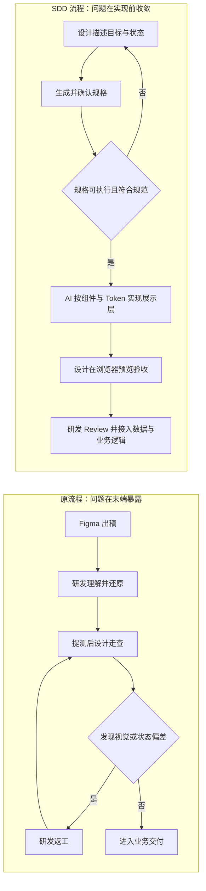
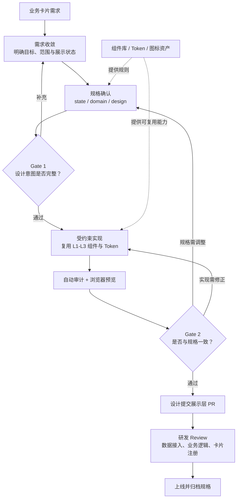
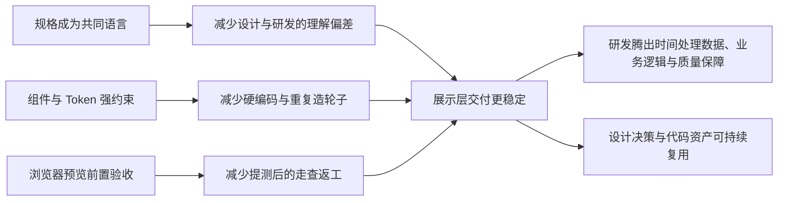

磁力小牛 UI：让设计师自己交付卡片

> 我们希望把卡片交付从"Figma 贴图还原"升级为"规格驱动实现"：设计师先沉淀需求、状态和设计 token，AI 在明确边界内生成展示层代码，研发负责 Review 和数据接入。

## 一、现在的问题

磁力小牛需要持续交付大量业务卡片——主动推送（Reach）、会话卡片（Chat）、诊断结果、成长任务…… 当前每张卡片的交付链路存在四个反复出现的问题：

|           |                                          |                     |
| --------- | ---------------------------------------- | ------------------- |
| 问题        | 具体表现                                     | 代价                  |
| 交付物是贴图    | 设计师通过 Figma 出稿，研发用 AI 依据贴图还原，icon 需要手动拆取 | 还原度低，icon 散落各处，无法复用 |
| 没有组件规范约束  | 每张卡片设计师自行发挥，按钮、间距、颜色各做各的                 | 同类卡片风格不一，改一处要改十处    |
| 设计决策无文字依据 | token 选哪个、间距多少靠口头同步，没有可查的规格              | 研发每次自行判断，返工成本高      |
| 走查占用时间多   | 还原度低导致反复打回，一张卡片走查 2～3 轮是常态               | 走查成为交付瓶颈，时间消耗不可控    |

## 二、参考模式对比

内部已有两个团队做过类似探索：

### 品牌团队：灵创（对话式生成 + HTML 交付）

参考链接：[https://aicode.corp.kuaishou.com/internal-deploy/17596](https://aicode.corp.kuaishou.com/internal-deploy/17596)

设计师在平台上对话式描述需求，AI 生成完整页面（含 KPI 卡片、图表、表格），直接交付 HTML 链接，无需研发介入。优点是交付快；局限是生成结果难以进入代码库持续维护，也缺少组件规范约束。

### DSP 团队：LinoKit（自研组件库 + 设计约束）

参考链接：[https://lui2.frontend-cloud.corp.kuaishou.com/#message](https://lui2.frontend-cloud.corp.kuaishou.com/#message)

DSP 团队自研了组件库 LinoKit，建立了 Figma 规范与代码组件的对齐关系，提供交互式文档站和实时 props 测试面板。优点是有设计约束、组件可持续维护；局限是设计师仍依赖研发排期，走查流程没有本质变化。

### 对比

|   |   |   |   |
|---|---|---|---|
|维度|灵创|LinoKit|磁力小牛 SDD|
|设计师能否自主驱动展示层|能（生成即交付）|不能（依赖研发）|能|
|组件规范约束|弱|强|强|
|可持续迭代|弱|强|强|
|设计决策可追溯|无|无|有|
|适用场景|一次性展示页面|通用组件库|业务卡片持续交付|

磁力小牛 SDD 的思路是：在 LinoKit 式组件约束的基础上，让设计师可以自主驱动展示层交付，同时把每次设计决策沉淀成可追溯的规格文档。

## 三、方案：SDD 五步流程

SDD（Spec-Driven Development）的核心是：先把设计意图写成规格，AI 只在规格范围内实现，研发在清晰边界内做 Review 和数据接入。

边界说明：SDD 只覆盖展示层组件交付，不处理接口调用、业务状态机、权限判断和上线发布决策。

```
Step 1  描述需求        设计师用自然语言说清楚做什么、为什么做
           ↓ GATE 1：需求是否说清楚？
Step 2  生成规格        AI 产出状态模型、复用边界、token 决策三份文档
           ↓ GATE 2：规格是否可执行？（未通过不允许进入实现）
Step 3  多方案评审      AI 按规格生成多个视觉方向，提供浏览器预览链接，团队可视化选定
Step 4  展示层实现      AI 严格按定稿规格实现，只做展示层，自动审计
           ↓ GATE 3：结果是否与规格一致？
Step 5  提 PR 交研发    研发 Review + 数据层对接 + 注册卡片 + 合并上线
```

## 四、角色怎么变

设计师：从"出图 → 等待 → 走查"变为展示层的主导者，驱动需求、确认规格、参与多方案评审、做最终验收。

研发：从"AI 还原 + 走查返工"变为聚焦更高价值的工作——Review 清晰边界的展示层 PR、连接数据层、注册卡片到消息系统、处理权限和业务逻辑。

AI：从"无约束自行发挥"变为在确认规格内执行，产物可审计。

|   |   |   |
|---|---|---|
|角色|之前|之后|
|设计师|Figma 出图 → 等研发 → 走查打回 → 再等|驱动展示层：需求 → 规格 → 多方案评审 → 验收 → 提 PR|
|AI|无约束还原，结果偏离规范|规格边界内执行，不做展示层以外的事|
|研发|AI 还原度低、icon 手动拆、走查返工|Review 明确范围 + 数据层对接 + 卡片注册|

研发收到设计师提的 PR 时，附带完整的规格文档（需求背景、状态模型、token 决策、实现清单），不再需要反问"这个颜色用的什么""这个状态怎么处理"。

## 五、为什么现在可以做

这套流程能落地，是因为@ad/esp-robot-ui已有完整的基础设施：

- 三层组件体系：L1 原子 → L2 分子 → L3 业务卡片，AI 有明确的复用边界可遵守
    
- Design Token：颜色/间距/圆角通过 CSS 变量统一管理，AI 不需要猜 token
    
- 图标管控：所有图标资产统一在src/icons/，不再依赖手动从 Figma 拆取
    

有这套约束，AI 才不会"自行发挥"——组件在哪里、token 怎么用、图标怎么引入，都有规则可查。

## 六、预期收益

| 核心收益 | 当前 | SDD 试点预期 |
| --- | --- | --- |
| 小牛研发工作量 | 展示层 UI 实现、样式调整与走查返工主要由研发承担 | 约 **70%～85%** 的展示层工作前移至设计侧；研发聚焦 Review、数据接入与业务逻辑 |
| 设计工作量 | Figma 出图后等待实现，提测后再做 2～3 轮走查 | 以规格、可预览组件和自验收替代大量静态出图与末端走查，走查目标收敛至 **1 轮内** |
| 交付周期 | 新卡片受研发排期和返工轮次制约 | 设计师可自主驱动展示层，不再因视觉实现等待研发排期 |
| 长期维护 | 图标、样式与设计决策散落，后续修改需要逐处排查 | Token、组件和规格统一沉淀；变更可复用、可审计、可回溯 |

> [!note] 数据口径
> “70%～85%”指原本由小牛研发承担的**展示层 UI 实现、样式调整和视觉走查返工**工作量；接口、业务状态机、权限、数据接入和最终 Code Review 仍由研发负责。该比例为试点预期，需通过 Reach / Chat 卡片试点记录实际工时后再固化。

## 七、下一步

选 1～2 张典型卡片（建议 Reach 主动推送或 Chat 会话卡片各一张）作为试点，走完完整的 SDD 五步流程，验证：

1. 规格文档能否有效替代口头对齐
    
2. 多方案浏览器评审能否减少末端走查
    
3. 研发 Review 成本是否明显下降
    

试点完成后形成模板，推广到其他卡片的持续交付。

## 附录：SDD 命令速查

|   |   |   |
|---|---|---|
|步骤|命令|说明|
|启动变更|/sdd start|初始化状态，确认基线|
|脑暴需求|/sdd brainstorming|需求不清晰时引导收敛|
|写需求|/sdd proposal|需求清晰时直接结构化|
|生成规格|/sdd spec|产出 state / domain / design 三份文档|
|展示层实现|/sdd build|AI 按规格实现，生成 impl-plan|
|自动验证|/sdd verify|审计 + 浏览器预览|
|提 PR 归档|/sdd close|建分支、push、归档 OpenSpec|

文档生成时间：2026-07-30 | 对应代码库：esp-robot/packages/robot-ui

## 八、给管理者的一页总结：把“设计走查”前移为“规格确认”

**这不是让设计师替代研发，也不是让 AI 自由生成页面。** 磁力小牛 UI Designer SDD 要解决的是展示层交付中反复出现的协作损耗：设计意图只存在于 Figma 和口头沟通中，研发需要猜测并还原，问题直到提测走查才被发现，最终以多轮返工收尾。

流程升级后，设计师在实现前确认可执行规格，AI 在组件库和 Token 的边界内完成展示层代码，研发接手已经过设计验收的 PR，专注数据、业务逻辑和工程质量。设计决策、代码实现和最终页面因此有了同一条可追溯链路。

### 1. 从“末端找错”变为“前置确认”



变化的关键不在于“用 AI 写得更快”，而在于把原本靠走查发现的问题，提前变成实现前可讨论、可确认的状态模型、复用边界和 Token 决策。这样，返工有明确的回退点：规格不对就改规格；实现不对就按规格修正，而不是在设计稿、聊天记录和代码之间来回猜测。

### 2. 新流程如何形成可控交付



这套机制依赖现有三层组件体系、CSS Token 和统一图标资产。它们把“设计偏好”转换为 AI 可遵守、研发可 Review、后续迭代可复用的规则；SDD 则把这些规则嵌入每次卡片交付的关键门禁中。

### 3. 角色变化：把时间放在不可替代的工作上

| 角色 | 原流程中的主要时间消耗 | SDD 后的主要职责 | 直接结果 |
| --- | --- | --- | --- |
| 设计师 | 绘制静态稿、等待实现、末端逐项走查 | 约束需求与状态、确认规格、验收展示层 | 设计意图在实现前被固化，减少反复解释 |
| AI | 根据贴图猜测布局、样式和图标 | 在已确认的组件、Token、规格边界内执行 | 产物可审计，减少无约束生成 |
| 研发 | 还原视觉细节、拆图标、承接多轮样式返工 | Review 展示层、接入数据、处理状态机和业务逻辑 | 聚焦高复杂度和高风险工作 |

研发仍然保留代码 Review、数据接入、权限与业务状态机的责任；设计师获得的是展示层交付的主导权。这一边界既避免把业务风险交给生成式工具，也避免让研发继续承担本可前置消除的视觉沟通成本。

### 4. 收益不是单点提速，而是交付链路缩短



| 收益维度 | 原来的损耗 | 试点后应验证的结果 |
| --- | --- | --- |
| 设计效率 | 大量时间花在静态 Figma 出稿与反复说明 | 以规格和可预览组件替代部分静态交付，缩短从想法到可验证页面的时间 |
| 研发效率 | 视觉还原、图标拆取、走查返工占用排期 | 展示层由设计师自主驱动，研发聚焦 Review 与业务接入 |
| 质量与维护 | 样式和状态散落在卡片中，设计决策不可追溯 | Token、组件复用与规格归档使每次变更可审计、可回溯 |
| 协作成本 | 设计语言与代码实现之间反复翻译 | 规格、React 组件和浏览器预览成为双方共享的交付语言 |

### 5. 管理上应看什么：先用试点验证，再规模化推广

建议先选择 Reach 主动推送与 Chat 会话卡片各 1 张，覆盖不同展示复杂度。试点不以“AI 生成了多少代码”为成功标准，而以交付质量和协作效率为准：

1. 走查是否由当前的 2～3 轮收敛到 1 轮内；
2. 设计师是否能独立完成展示层规格确认、预览验收与 PR 提交；
3. 研发是否减少了视觉还原和样式返工，将时间转向数据接入与业务风险处理；
4. 新增样式是否全部通过既有 Token、组件和图标资产表达，并能在后续卡片中复用；
5. 需求背景、状态、设计决策和实现是否能够从归档规格中完整回溯。

> [!success] 试点成功的定义
> 不只是“做出一张卡片”，而是验证一条可复制的交付机制：设计能驱动展示层、研发能放心接手业务层、每次决策都沉淀为下一次可复用的资产。
