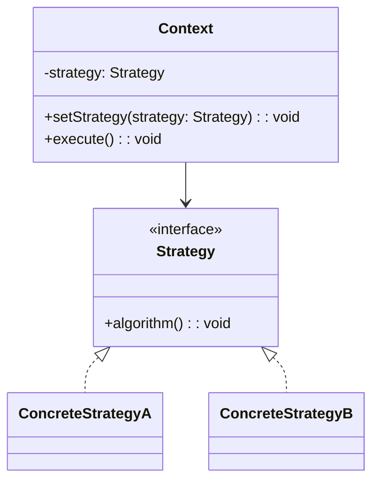
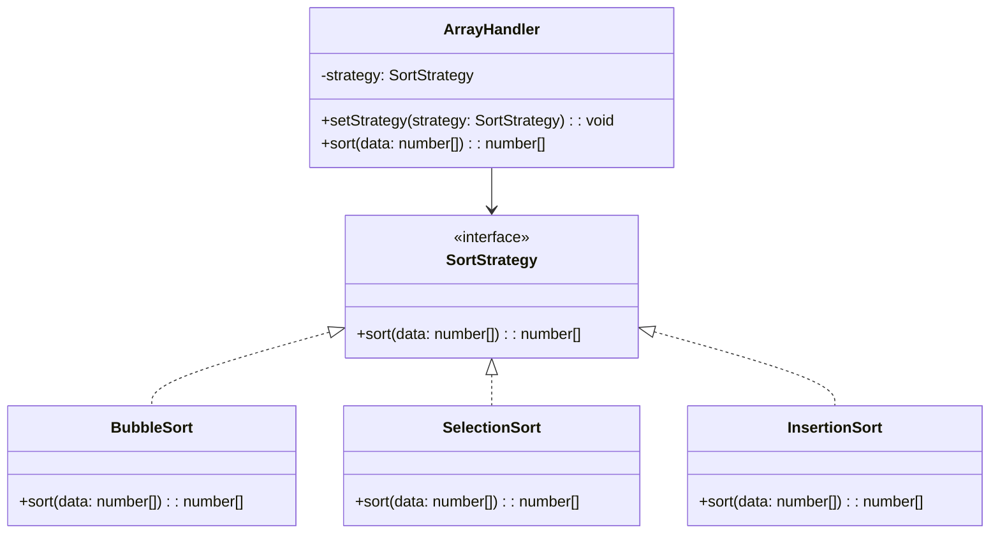
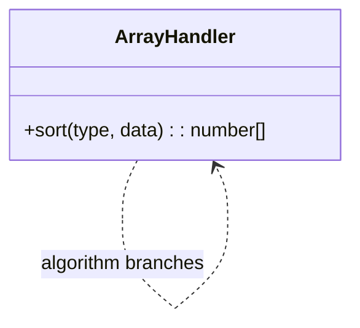

# 模式补全

> 这一节按 [[八面剖析以理解一个概念]] / ljg-learn 的思路整理为 Markdown 版本：先定锚，再用八个方向切开概念，最后压缩成公式、例子、类图和检验题。

## 定锚

策略模式（行为型）的通行定义：定义一组可互换算法，把它们封装起来，让客户端在运行时选择。

常见误解：策略不是把每个 if 都拆成类；它适合算法族稳定、选择规则清楚的场景。

核心词素：Strategy 是策略、方法。关键词是可替换算法，而不是状态迁移。

## 八刀

### 历史

它来自排序、压缩、支付、折扣等算法切换场景。GoF 用它对抗条件分支和继承复用。

### 辩证

反面是一个函数里塞满算法分支。更高理解是：算法是一等对象，可以被注入。

### 现象

同一笔订单，会员折扣、满减折扣、新人折扣都能套用同一个结算入口。

### 语言

Strategy 是策略、方法。关键词是可替换算法，而不是状态迁移。

### 形式

result = strategy.execute(input)。若算法之间需要共享复杂状态，策略边界会变模糊。

### 存在

它让人把“怎么做”从“谁在做”里拆出来。

### 美感

它美在换刀片：同一把刀架，根据材料换不同刀片。

### 元反思

策略隐喻容易让人想到高层计划。换成“算法插件”隐喻，更能把握它的代码形态。

## 内观

我是一个可替换算法。上下文把数据交给我，我给出结果。需要新算法时，别改上下文，换我就行。

八刀共同指向的深层结构：策略模式不是为了“炫技”，而是在某个变化点上建立边界，让稳定部分继续稳定，让变化部分有自己的位置。

## 压缩

公式：策略 = Strategy 接口 + 多个算法实现 + Context 注入

一句话：策略模式把可变算法封装成可替换对象。

结构图：

```text
Context -> Strategy.execute()
StrategyA/StrategyB
```

## 动机/意图

当同一问题有多种算法或策略，而客户端需要在运行时选择其中一种时，把所有分支写在上下文里会使代码越来越硬。策略模式的意图是把可变算法封装成独立对象，让上下文通过统一接口委托执行。

## 结构/角色

- `Strategy`：策略接口，声明算法入口。
- `ConcreteStrategy`：具体策略，实现某一种算法。
- `Context`：上下文，持有策略对象，并把可变行为委托给策略。
- `Client`：客户端选择并注入合适策略。

## 典型 UML



## 使用场景

- 多种算法可互换，例如排序、计价、路由、压缩、校验。
- 需要消除上下文中的复杂条件分支。
- 算法需要在运行时切换。
- 希望把算法测试、扩展和维护从主流程中拆出来。

## 正例：TypeScript

```ts
interface SortStrategy {
  sort(data: number[]): number[]
}

class BubbleSort implements SortStrategy {
  sort(data: number[]) {
    const result = [...data]

    for (let i = 0; i < result.length - 1; i++) {
      for (let j = 0; j < result.length - 1 - i; j++) {
        if (result[j] > result[j + 1]) {
          ;[result[j], result[j + 1]] = [result[j + 1], result[j]]
        }
      }
    }

    return result
  }
}

class SelectionSort implements SortStrategy {
  sort(data: number[]) {
    const result = [...data]

    for (let i = 0; i < result.length - 1; i++) {
      let minIndex = i

      for (let j = i + 1; j < result.length; j++) {
        if (result[j] < result[minIndex]) {
          minIndex = j
        }
      }

      if (minIndex !== i) {
        ;[result[i], result[minIndex]] = [result[minIndex], result[i]]
      }
    }

    return result
  }
}

class InsertionSort implements SortStrategy {
  sort(data: number[]) {
    const result = [...data]

    for (let i = 1; i < result.length; i++) {
      const current = result[i]
      let j = i - 1

      while (j >= 0 && result[j] > current) {
        result[j + 1] = result[j]
        j--
      }

      result[j + 1] = current
    }

    return result
  }
}

class ArrayHandler {
  constructor(private strategy: SortStrategy) {}

  setStrategy(strategy: SortStrategy) {
    this.strategy = strategy
  }

  sort(data: number[]) {
    return this.strategy.sort(data)
  }
}

const handler = new ArrayHandler(new BubbleSort())
console.log(handler.sort([5, 3, 8, 1, 2]))

handler.setStrategy(new SelectionSort())
console.log(handler.sort([5, 3, 8, 1, 2]))

handler.setStrategy(new InsertionSort())
console.log(handler.sort([5, 3, 8, 1, 2]))
```

## 正例：UML 类图



## 反例：TypeScript

```ts
class ArrayHandler {
  sort(type: "bubble" | "selection" | "insertion", data: number[]) {
    const result = [...data]

    if (type === "bubble") {
      for (let i = 0; i < result.length - 1; i++) {
        for (let j = 0; j < result.length - 1 - i; j++) {
          if (result[j] > result[j + 1]) {
            ;[result[j], result[j + 1]] = [result[j + 1], result[j]]
          }
        }
      }
    } else if (type === "selection") {
      for (let i = 0; i < result.length - 1; i++) {
        let minIndex = i

        for (let j = i + 1; j < result.length; j++) {
          if (result[j] < result[minIndex]) {
            minIndex = j
          }
        }

        if (minIndex !== i) {
          ;[result[i], result[minIndex]] = [result[minIndex], result[i]]
        }
      }
    } else if (type === "insertion") {
      for (let i = 1; i < result.length; i++) {
        const current = result[i]
        let j = i - 1

        while (j >= 0 && result[j] > current) {
          result[j + 1] = result[j]
          j--
        }

        result[j + 1] = current
      }
    }

    return result
  }
}
```

## 反例：UML 类图



## 案例

某系统提供了一个用于对数组数据进行操作的类，该类封装了对数组的常见操作，如查找数组元素、对数组元素进行排序等。现以排序操作为例，使用策略模式设计该数组操作类，使得客户端可以动态地更换排序算法，可以根据需要选择冒泡排序或选择排序或插入排序，也能够灵活地增加新的排序算法

旅游出行方式可以有多种，如可以乘坐飞机旅游，也可以乘火车旅游，如果有兴趣自行车游也是一种极具乐趣的出行方式。不同的旅游出行方式有不同的实现过程，客户根据自己的需要选择一种合适的旅游方式。在本实例中我们用策略模式来模拟这一过程。

## 掌握检验

1. 策略模式中的 Context 应不应该知道具体策略类？
2. 策略模式和状态模式最大的区别是什么？
3. 如何在前端表单校验中使用策略模式？
