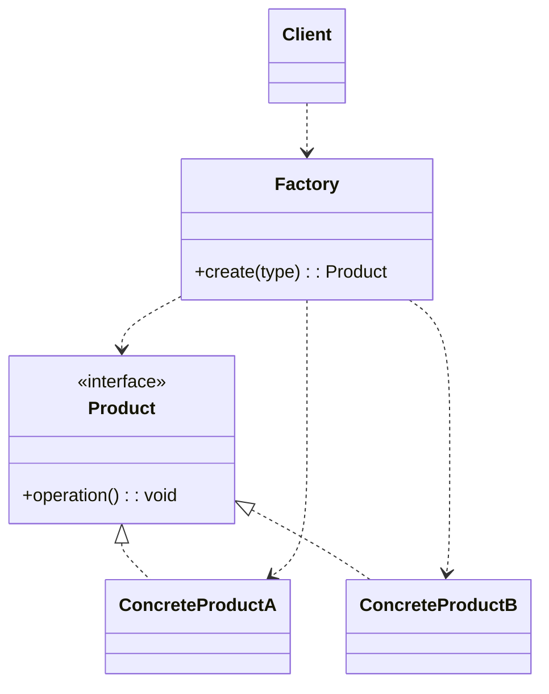
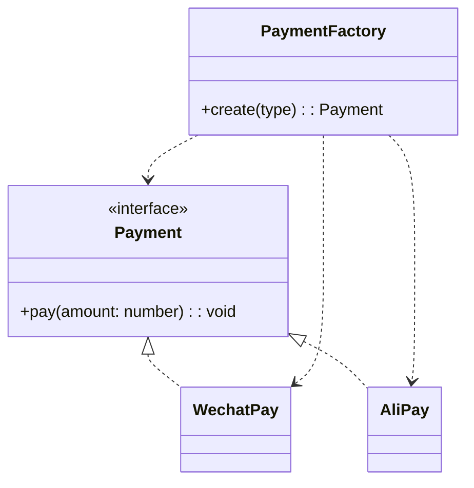
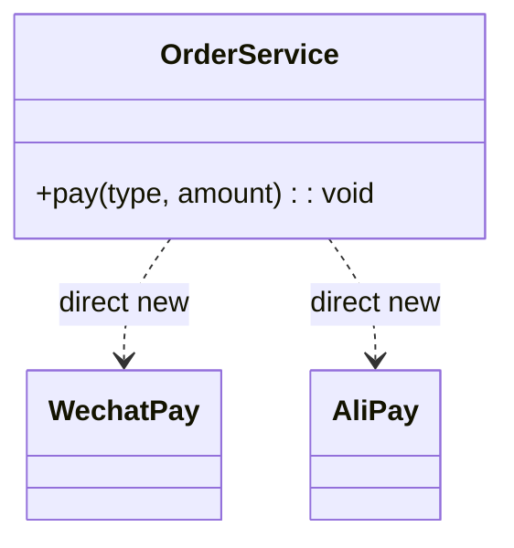

# 模式补全

> 这一节按 [[八面剖析以理解一个概念]] / ljg-learn 的思路整理为 Markdown 版本：先定锚，再用八个方向切开概念，最后压缩成公式、例子、类图和检验题。

## 定锚

简单工厂模式（创建型）的通行定义：把对象创建集中到一个工厂函数或工厂类中，客户端只提交类型参数，不直接拼装具体类。

常见误解：它不是 GoF 正式模式，也不是万能解耦；新增产品时通常仍要修改工厂。

核心词素：简单=一个入口；工厂=把原料变成产品；模式的隐喻是收银台点单，而不是顾客进厨房。

## 八刀

### 历史

它来自对构造逻辑重复的朴素整理，后来常作为学习工厂方法、抽象工厂的第一阶梯。它拐成今天的意思，是因为大家先需要一个低成本入口来隐藏 new。

### 辩证

反面是客户端到处 new 具体类。更高一层的理解是：简单工厂牺牲一部分开闭原则，换来创建逻辑的集中管理。

### 现象

像点奶茶时说“少冰拿铁”，你不关心机器怎么打奶泡。业务代码也只说我要哪种对象，不关心构造细节。

### 语言

简单=一个入口；工厂=把原料变成产品；模式的隐喻是收银台点单，而不是顾客进厨房。

### 形式

product = Factory.create(type, options)。当 type 分支无限膨胀，或产品族之间有组合约束时，这个公式会失效。

### 存在

它让人先从“我会创建对象”转向“我会隔离创建原因”。开发者开始意识到 new 本身也是依赖。

### 美感

它美在把凌乱的门口收成一个柜台：所有创建请求从一个窗口进入，秩序马上出现。

### 元反思

我们常用“工厂”隐喻理解它，这会遮住它对开闭原则的伤害。换成“前台分诊”隐喻，就更容易看到它适合小规模分流。

## 内观

我是创建入口。你告诉我类型，我替你决定具体对象。我让客户端少知道一点，但我自己会越来越胖，所以我需要节制。

八刀共同指向的深层结构：简单工厂模式不是为了“炫技”，而是在某个变化点上建立边界，让稳定部分继续稳定，让变化部分有自己的位置。

## 压缩

公式：简单工厂 = 类型参数 + 集中分支 + 隐藏 new

一句话：简单工厂把“要创建谁”的判断收进一个地方，让客户端先从具体类里松手。

结构图：

```text
Client -> Factory(type) -> Product
```

## 动机/意图

当客户端散落着大量 `new ConcreteProduct()` 和类型判断时，创建逻辑会和业务逻辑纠缠在一起。简单工厂的意图是把“根据条件选择并创建哪一个具体产品”的责任集中到一个工厂入口，让客户端只依赖抽象产品或统一返回类型。

## 结构/角色

- `Product`：抽象产品，定义客户端真正需要使用的能力。
- `ConcreteProduct`：具体产品，实现抽象产品接口。
- `Factory`：简单工厂，接收类型参数或配置，内部决定实例化哪个具体产品。
- `Client`：客户端，只向工厂请求产品，不直接依赖具体产品的构造细节。

## 典型 UML



## 使用场景

- 产品种类较少，创建分支还可控。
- 客户端不想知道具体类名、构造参数或初始化顺序。
- 创建逻辑需要集中管理，例如统一校验、日志、默认配置。
- 系统处在早期阶段，暂时不值得引入工厂方法或抽象工厂。

## 正例：TypeScript

```ts
interface Payment {
  pay(amount: number): void
}

class WechatPay implements Payment {
  pay(amount: number) {
    console.log("wechat pay", amount)
  }
}

class AliPay implements Payment {
  pay(amount: number) {
    console.log("alipay pay", amount)
  }
}

class PaymentFactory {
  static create(type: "wechat" | "ali"): Payment {
    if (type === "wechat") return new WechatPay()
    return new AliPay()
  }
}

const payment = PaymentFactory.create("wechat")
payment.pay(100)
```

## 正例：UML 类图



## 反例：TypeScript

```ts
class OrderService {
  pay(type: string, amount: number) {
    if (type === "wechat") new WechatPay().pay(amount)
    if (type === "ali") new AliPay().pay(amount)
  }
}
```

## 反例：UML 类图



## 掌握检验

1. 简单工厂为什么不完全符合开闭原则？
2. 什么时候简单工厂已经不够，需要升级为工厂方法或抽象工厂？
3. 如果分支越来越多，你会把变化拆到哪里？
