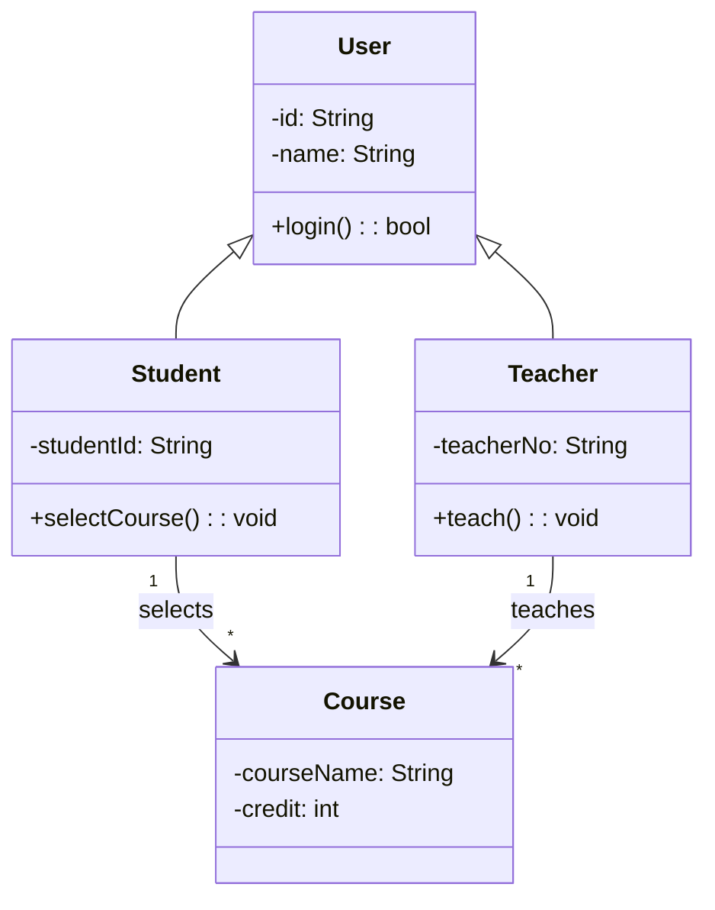

# 类图

类图是 UML 中最常见的结构图之一，用来描述系统中**类、类的属性、类的方法，以及类与类之间的静态关系**。

它常用于：

- 表达领域中的核心概念
- 分析系统的静态结构
- 辅助面向对象设计
- 为后续编码提供蓝图

## 类图的基本组成

一个类通常画成一个长方形，分为三层：

1. 第一层：类名
2. 第二层：属性
3. 第三层：操作（方法）

例如：

```text
+----------------------+
| Student              |
+----------------------+
| -name: String        |
| -studentId: String   |
+----------------------+
| +selectCourse(): void|
| +dropCourse(): void  |
+----------------------+
```

## 类框怎么画

### 1. 先写类名

- 类名一般写在最上方，通常用名词
- 类名应尽量反映业务中的核心对象，如 `Student`、`Course`、`Teacher`

### 2. 再补属性

属性通常写成：

```text
可见性 属性名: 类型
```

例如：

```text
-name: String
-age: int
```

常见可见性符号：

- `+`：public
- `-`：private
- `#`：protected
- `~`：package

### 3. 再补操作

操作通常写成：

```text
可见性 方法名(参数列表): 返回值类型
```

例如：

```text
+login(username: String, password: String): bool
+getScore(courseId: String): int
```

## 类与类之间的关系怎么画

### 关联 Association

- 表示一个类知道或使用另一个类
- 画法：**实线**
- 可以加箭头表示单向关联
- 线两端可标注多重性

例如：学生选课程


```text
Student -------- Course
```

### 单向关联怎么理解

- 单向关联表示：**一个类知道另一个类，但反过来不一定知道**
- 画法：**实线 + 普通箭头**
- 箭头指向“被知道 / 被访问”的那个类
- 适合描述“一个对象长期持有或引用另一个对象”的情况

例如：订单知道用户，但用户对象未必直接保存订单对象

```text
Order --------> User
```

这表示：

- `Order` 中可能有一个 `user: User`
- 但 `User` 中不一定有 `orders: Order[]`
- 所以它不是双向关联，而是**单向关联**

### 聚合 Aggregation

- 表示整体和部分的关系
- 部分可以脱离整体单独存在
- 画法：**空心菱形 + 实线**
- 菱形靠近“整体”

例如：班级和学生

```text
Class <>-------- Student
```

### 组合 Composition

- 也是整体和部分的关系
- 但部分不能脱离整体独立存在
- 画法：**实心菱形 + 实线**
- 菱形靠近“整体”

例如：订单和订单项

```text
Order ◆-------- OrderItem
```

### 继承 Generalization / 泛化关系

- 表示一般与特殊的关系
- 子类继承父类
- 画法：**实线 + 空心三角箭头**
- 箭头指向父类

例如：

```text
Student --------|> User
Teacher --------|> User
```

### 实现 Realization

- 表示类实现接口
- 画法：**虚线 + 空心三角箭头**
- 箭头指向接口

例如：

```text
WechatPay - - - -|> Payable
```

### 依赖 Dependency

- 表示一个类临时使用另一个类
- 一般体现在方法参数、局部变量、返回值中
- 画法：**虚线箭头**

例如：

```text
OrderService - - - -> PaymentService
```

## 多重性怎么标

多重性用来表示一个对象可以对应多少个另一个对象，常见写法有：

- `1`：恰好一个
- `0..1`：零个或一个
- `*`：零个或多个
- `1..*`：一个或多个
- `m..n`：最少 m 个，最多 n 个

例如：

- 一个学生可以选多门课程：`Student 1 ---- * Course`
- 一门课程可以被多个学生选：`Course * ---- * Student`

### 单向关联 + 多重性示例

如果把“关联方向”和“数量关系”放在一起看，会更接近真实业务建模。

例如：一个部门可以管理多个员工，但员工对象未必需要直接持有部门对象引用，或者我们当前只关心“部门能找到员工”，不关心“员工反查部门”。

```text
Department 1 --------> * Employee
```

这张图表示：

- `Department` 到 `Employee` 是**单向关联**
- 一个 `Department` 可以关联多个 `Employee`
- 每个 `Employee` 在这张图里只是被部门管理的对象
- 由于箭头只有一个方向，所以当前模型强调的是“部门知道员工”，而不是“两边彼此都知道”

如果把它写成代码，往往会更像这样：

```ts
class Employee {
  constructor(public name: string) {}
}

class Department {
  private employees: Employee[] = []

  addEmployee(employee: Employee) {
    this.employees.push(employee)
  }
}
```

这里 `Department` 持有 `Employee[]`，但 `Employee` 没有 `department` 字段，这就是一个很典型的“单向关联 + 一对多”的例子。

## 类图的画法步骤

### 概念类图的画法

概念类图偏向需求分析，重点是“业务里有什么对象，以及对象之间有什么关系”。

1. 先从题目、需求描述、用例中找名词
2. 抽取候选类，如学生、教师、课程、成绩单
3. 删除无意义或过细的类
4. 为类补充关键属性
5. 找出类之间的关系
6. 标注多重性

概念类图通常**不强调方法细节**，更重视业务概念和关系。

### 设计类图的画法

设计类图偏向软件实现，重点是“系统准备怎么编码”。

1. 在概念类图基础上细化类
2. 增加属性类型、方法参数、返回值
3. 区分实体类、边界类、控制类
4. 根据顺序图或用例补充方法
5. 明确继承、实现、依赖等设计关系

设计类图通常比概念类图更贴近代码结构。

## 画类图时的常见原则

- 类名尽量用名词，方法名尽量用动词
- 不要一开始就把所有细节都画满，先确定核心类
- 能用关联就不要误画成聚合或组合
- 聚合和组合都表示整体部分关系，但组合更强，生命周期绑定更紧
- 继承只在“是一个”的关系明显成立时使用
- 依赖通常表示临时使用，不等于长期持有

## 一个简单示例



## 一句话记忆

类图 = **类 + 属性 + 方法 + 类之间关系**。

如果考试或作业要求“画类图”，通常按下面这个顺序最稳：

1. 找类
2. 写属性
3. 写方法
4. 连关系
5. 标多重性

## 相关笔记

- [[UML的五种图形机制]]
