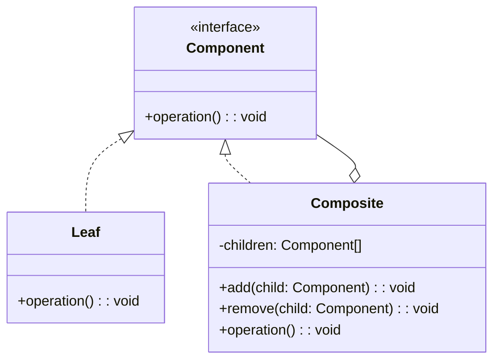
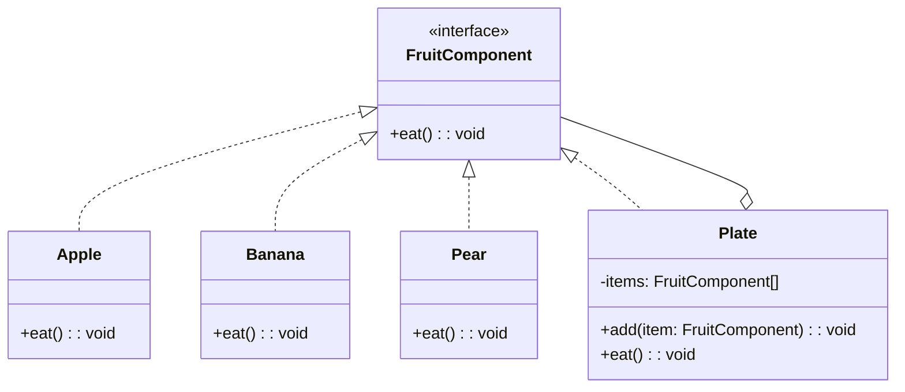
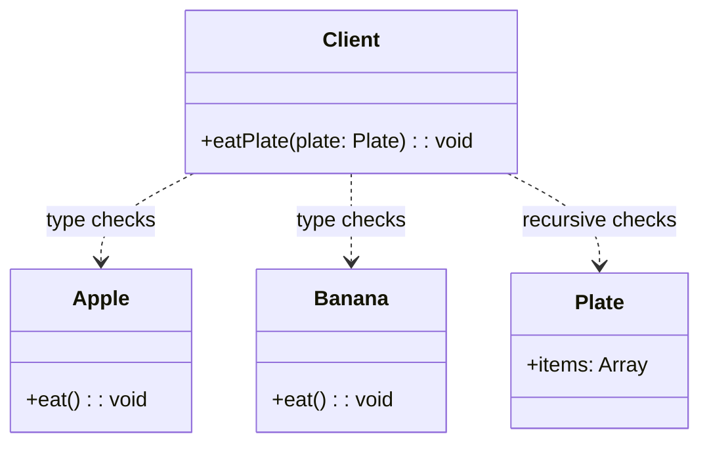

# 模式补全

> 这一节按 [[八面剖析以理解一个概念]] / ljg-learn 的思路整理为 Markdown 版本：先定锚，再用八个方向切开概念，最后压缩成公式、例子、类图和检验题。

## 定锚

组合模式（结构型）的通行定义：把对象组织成树形结构，让客户端以一致方式处理单个对象和对象组合。

常见误解：组合模式不是普通数组嵌套；关键是叶子和容器共享同一个组件接口。

核心词素：Composite 来自 compose，意思是组合成整体。它的隐喻是一棵树，而不是一堆列表。

## 八刀

### 历史

它常见于 GUI、文件系统、菜单树。GoF 将“部分-整体一致处理”提炼为模式。

### 辩证

反面是客户端分别判断叶子和容器。更高理解是：让树节点自己承担递归结构。

### 现象

水果盘里既可以直接放苹果、香蕉、梨子，也可以继续放一个小水果盘。如果我们对“大水果盘”执行一次“吃”，本质上就是递归地把里面所有水果都吃掉，而不必区分当前拿到的是单个水果还是另一个水果盘。

### 语言

Composite 来自 compose，意思是组合成整体。它的隐喻是一棵树，而不是一堆列表。

### 形式

Component.operation(); Composite.children.forEach(operation)。当叶子和容器行为差异过大，共用接口会变别扭。

### 存在

它让人用递归眼光看对象：整体和部分共享同一种语言。

### 美感

它美在分形：一片叶子和一棵树都回应同一个动作。

### 元反思

树的隐喻很强，但会遮住权限、父引用、环检测等工程问题。换成“组织结构”隐喻，会更注意边界。

## 内观

我是“水果组件”的统一接口。苹果、香蕉、梨子用我表达“自己怎么被吃”，水果盘也用我表达“我如何把里面的水果一个个吃掉”。客户端看到的始终都是同一个 `eat()` 动作。

八刀共同指向的深层结构：组合模式不是为了“炫技”，而是在某个变化点上建立边界，让稳定部分继续稳定，让变化部分有自己的位置。

## 压缩

公式：组合 = 统一组件接口 + 叶子 + 容器递归

一句话：组合模式让客户端像处理一个对象一样处理一整棵对象树。

结构图：

```text
Component
|- Leaf
`- Composite -> Component*
```

## 动机/意图

当业务对象天然呈树形结构时，客户端如果分别处理单个对象和容器对象，代码会充满类型判断。组合模式的意图是用统一的组件接口表示叶子和容器，让客户端以一致方式处理局部和整体。

## 结构/角色

- `Component`：抽象组件，定义叶子和组合对象的公共接口。
- `Leaf`：叶子节点，没有子节点，完成真正的基本行为。
- `Composite`：组合节点，保存子组件集合，并把请求递归委托给子节点。
- `Client`：客户端面向 `Component` 编程，不关心拿到的是叶子还是树。

## 典型 UML



## 使用场景

- 对象结构是树，例如文件目录、组织架构、菜单、UI 组件树。
- 客户端希望统一处理单个对象和对象集合。
- 对整体执行操作时，需要递归传播到子节点。
- 需要在运行时动态添加、删除、组合节点。

## 正例：TypeScript

在这个例子里，`FruitComponent` 是统一抽象，`Apple`、`Banana`、`Pear` 是叶子对象，`Plate` 是组合对象。对 `Plate` 调用 `eat()` 时，它会把请求递归地下发给内部的水果或小水果盘。

```ts
interface FruitComponent {
  eat(): void
}

class Apple implements FruitComponent {
  eat() {
    console.log("eat apple")
  }
}

class Banana implements FruitComponent {
  eat() {
    console.log("eat banana")
  }
}

class Pear implements FruitComponent {
  eat() {
    console.log("eat pear")
  }
}

class Plate implements FruitComponent {
  private items: FruitComponent[] = []

  constructor(private name: string) {}

  add(item: FruitComponent) {
    this.items.push(item)
  }

  eat() {
    console.log(`start eating from ${this.name}`)
    this.items.forEach((item) => item.eat())
  }
}

const smallPlate = new Plate("small plate")
smallPlate.add(new Apple())
smallPlate.add(new Pear())

const bigPlate = new Plate("big plate")
bigPlate.add(new Banana())
bigPlate.add(smallPlate)

bigPlate.eat()
```

## 正例：UML 类图



## 反例：TypeScript

反例里客户端自己区分“这是水果还是水果盘”，一旦层级变深，遍历逻辑就会不断膨胀。树结构的递归责任没有落在对象本身，而是泄漏到了外部调用方。

```ts
class Apple {
  eat() {
    console.log("eat apple")
  }
}

class Banana {
  eat() {
    console.log("eat banana")
  }
}

class Plate {
  items: Array<Apple | Banana | Plate> = []
}

function eatPlate(plate: Plate) {
  plate.items.forEach((item) => {
    if (item instanceof Plate) {
      eatPlate(item)
    } else {
      item.eat()
    }
  })
}
```

## 反例：UML 类图



## 适用场景

- 需要表示一个对象整体或部分层次，在具有整体和部分的层次结构中，希望通过一种方式忽略整体与部分的差异，可以一致地对待它们。
- 让客户能够忽略不同对象层次的变化，客户端可以针对抽象构件编程，无须关心对象层次结构的细节。
- 对象的结构是动态的并且复杂程度不一样，但客户需要一致地处理它们。
## 案例

在水果盘(Plate)中有一些水果，如苹果(Apple)、香蕉(Banana)、梨子(Pear)，当然大水果盘中还可以有小水果盘，现需要对盘中的水果进行遍历（吃），当然如果对一个水果盘执行“吃”方法，实际上就是吃其中的水果。使用组合模式模拟该场景


文件有不同类型，不同类型的文件其浏览方式有所区别，如文本文件和图片文件的浏览方式就不相同。对文件夹的浏览实际上就是对其中所包含文件的浏览，而客户端可以一致地对文件和文件夹进行操作，无须关心它们的区别。使用组合模式来模拟文件的浏览操作。


## 掌握检验

1. 组合模式为什么适合树形结构？
2. 叶子节点和组合节点共享接口会带来什么好处和代价？
3. 透明式组合和安全式组合有什么区别？
