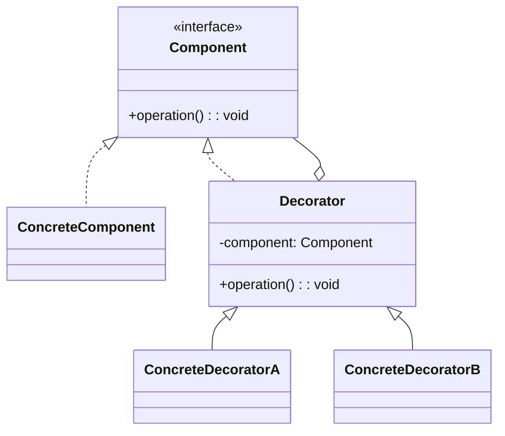
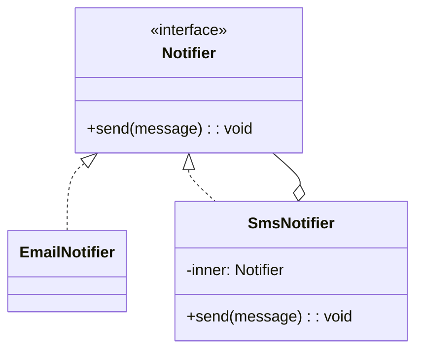
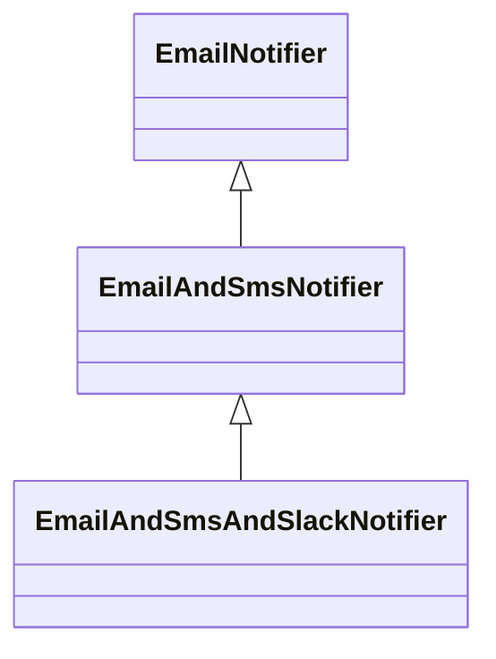

# 模式补全

> 这一节按 [[八面剖析以理解一个概念]] / ljg-learn 的思路整理为 Markdown 版本：先定锚，再用八个方向切开概念，最后压缩成公式、例子、类图和检验题。

## 定锚

装饰模式（结构型）的通行定义：在不改变原对象的前提下，用包装对象动态叠加职责。

常见误解：装饰不是继承的换皮；它强调运行时组合和层层包装。

核心词素：Decorator 来自 decorate，装饰不是替换主体，而是在主体外面加一层可拆卸能力。

## 八刀

### 历史

它常见于 Java I/O、前端中间件和 UI 包装。GoF 用它解决继承扩展数量爆炸。

### 辩证

反面是为每种组合写子类。更高理解是：职责可以像积木一样叠加。

### 现象

一杯咖啡可以加奶、加糖、加冰，每个配料包一层，不必造所有排列组合的咖啡类。

### 语言

Decorator 来自 decorate，装饰不是替换主体，而是在主体外面加一层可拆卸能力。

### 形式

Decorator implements Component and has Component。若装饰层依赖顺序复杂，会增加理解成本。

### 存在

它让对象能力变成可叠加的外衣，而不是固化在血统里。

### 美感

它美在套娃式的轻盈：每一层只多做一点点。

### 元反思

装饰隐喻容易让人以为只是 UI 外观。换成“管道过滤器”隐喻，会更看清行为增强。

## 内观

我包住一个同类对象。调用进来时，我先做一点事，再把请求交给里面那层。

八刀共同指向的深层结构：装饰模式不是为了“炫技”，而是在某个变化点上建立边界，让稳定部分继续稳定，让变化部分有自己的位置。

## 压缩

公式：装饰 = 同接口包装 + 持有组件 + 动态增强

一句话：装饰模式用对象组合给能力加层，而不是用继承穷举组合。

结构图：

```text
Client -> Decorator -> Decorator -> Component
```

## 动机/意图

当对象能力需要在运行时灵活叠加时，用继承枚举所有组合会迅速失控。装饰模式的意图是让装饰器和被装饰对象实现同一接口，通过一层层包装动态增加职责。

## 结构/角色

- `Component`：抽象组件，定义核心接口。
- `ConcreteComponent`：具体组件，被装饰的基础对象。
- `Decorator`：抽象装饰器，持有一个组件引用，并实现同一接口。
- `ConcreteDecorator`：具体装饰器，在调用组件前后增加新行为。
- `Client`：客户端按组件接口使用对象，可自由组合装饰层。

## 典型 UML



## 使用场景

- 需要在运行时给对象叠加职责，例如缓存、压缩、加密、日志。
- 功能组合很多，用继承会产生大量子类。
- 不希望修改原始类，也不想影响其他对象实例。
- 需要保持和原对象相同的接口，让客户端无感使用。

## 正例：TypeScript

```ts
interface Notifier {
  send(message: string): void
}

class EmailNotifier implements Notifier {
  send(message: string) {
    console.log("email", message)
  }
}

class SmsNotifier implements Notifier {
  constructor(private inner: Notifier) {}

  send(message: string) {
    this.inner.send(message)
    console.log("sms", message)
  }
}

const notifier = new SmsNotifier(new EmailNotifier())
notifier.send("deploy done")
```

## 正例：UML 类图



## 反例：TypeScript

```ts
class EmailAndSmsAndSlackNotifier {
  send(message: string) {
    console.log("email", message)
    console.log("sms", message)
    console.log("slack", message)
  }
}
```

## 反例：UML 类图



## 案例

变形金刚在变形之前是一辆汽车，它可以在陆地上移动。当它变成机器人之后除了能够在陆地上移动之外，还可以说话；如果需要，它还可以变成飞机，除了在陆地上移动还可以在天空中飞翔。

某系统提供了一个数据加密功能，可以对字符串进行加密。最简单的加密算法通过对字母进行移位来实现，同时还提供了稍复杂的逆向输出加密，还提供了更为高级的求模加密。用户先使用最简单的加密算法对字符串进行加密，如果觉得还不够可以对加密之后的结果使用其他加密算法进行二次加密，当然也可以进行第三次加密。现使用装饰模式设计该多重加密系统


## 掌握检验

1. 装饰模式为什么要求装饰器和被装饰者实现同一接口？
2. 装饰模式和代理模式都包对象，区别是什么？
3. 装饰层顺序会影响结果吗？举一个例子。
