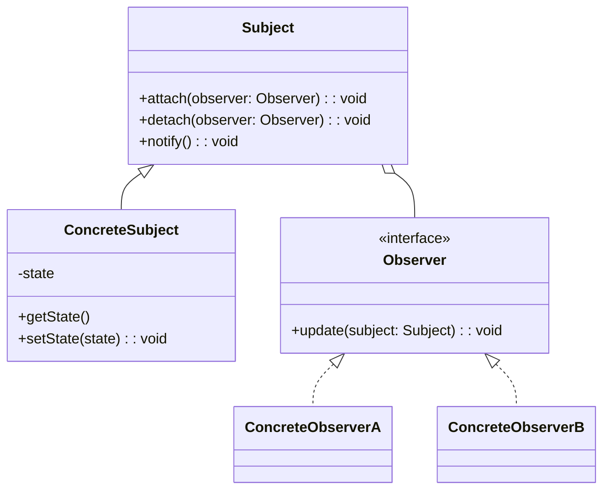
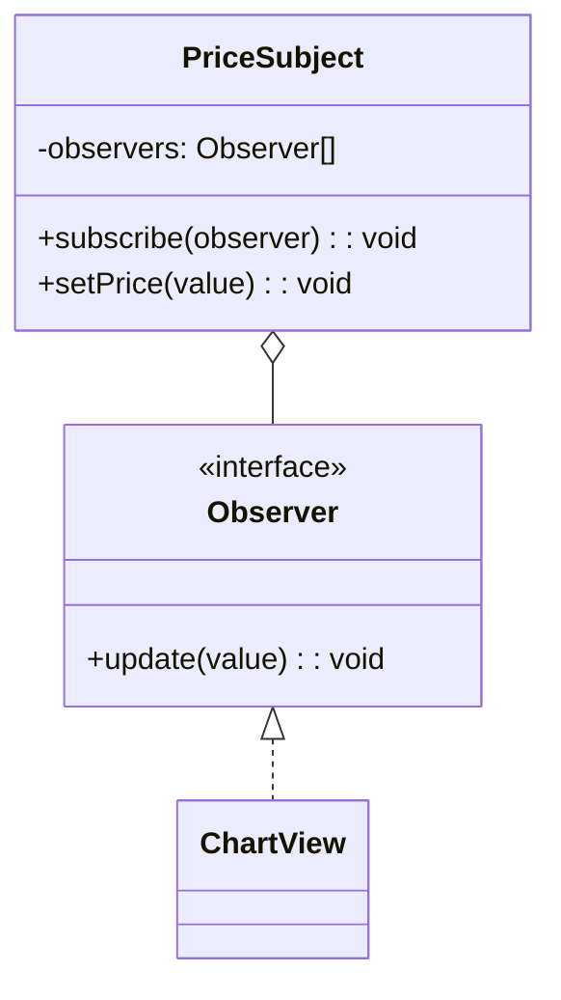
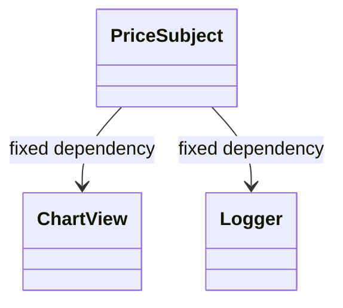

# 解释


**观察者模式** 定义了一种**一对多**的依赖关系。当一个对象（被观察者）的状态发生改变时，所有依赖于它的对象（观察者）都会得到**通知**并**自动更新**。

- **一句话本质：** **“别呼叫我，我会呼叫你” (Don't call us, we'll call you)。**

**A1. 要素 (Components)**

1. **Subject (目标/被观察者)**：核心数据源。它手里拿着一份“名单”，记录了谁在关注它。
2. **Observer (观察者)**：订阅者。它必须提供一个统一的接口（如 `update` 方法），供 Subject 随时调用。
3. **ConcreteSubject & ConcreteObserver**：具体的实现类。
    

**A2. 结构 (Structure)**

- **注册 (Subscribe/Attach)**：Observer 告诉 Subject：“把你加进我的关注列表”。
- **通知 (Notify)**：Subject 遍历名单，逐个调用 Observer 的 `update()` 方法。
- **注销 (Unsubscribe/Detach)**：Observer 告诉 Subject：“取关，别烦我了”。
    

**A3. 系统 (System Function)**

当零件组合，该系统实现了**“解耦 (Decoupling)”**： Subject 只知道观察者实现了 `Observer` 接口，**完全不在乎**观察者具体是谁（是邮件服务？是前端UI？还是日志系统？）。这使得双方可以独立扩展，互不影响。


# Typscript 的实现

```ts
interface Subscribe {
    update:()=>void
}
class Target {
    private observers :Subscribe[]= []
    
    public subscribe = function (subscriber:Subscribe){
        const isExit = this.observers.includes(subscriber)
        if(isExit) return console.log('当前已经订阅了')
        
        this.observers.push(subscriber)
        console.log('订阅成功')
    }
    public unsubscribe = function(subscriber:Subscribe) {
     const subscriberIndex = this.observers.indexOf(subscriber);
        if(subscriberIndex === -1) return console.log('没有当前订阅者，退订失败')
        this.observers.slice(subscriberIndex,1)
        console.log('取消订阅成功')
    }
    
    public notify = function (){
        this.observers.forEach( subscriber => {
           subscriber.update() 
        });
    }
}
class Observer implements Subscribe {
    public name :string
    constructor(name:string) {
        this.name = name
    }
    update(): void {
    console.log(`[观察者收到通知-${this.name}]`);
  }
}

const target  = new Target()
const mio = new Observer('mio')
const yui = new Observer('yui')

//观察者订阅
target.subscribe(mio)
target.subscribe(yui)

target.notify()
```


# 具体案例参考

[[构建自己的Redux]]
[[构建自己的Tanstack Quary]]


# reference

https://refactoringguru.cn/design-patterns/observer

# 模式补全

> 这一节按 [[八面剖析以理解一个概念]] / ljg-learn 的思路整理为 Markdown 版本：先定锚，再用八个方向切开概念，最后压缩成公式、例子、类图和检验题。

## 定锚

观察者模式（行为型）的通行定义：定义对象间一对多依赖，当主题状态变化时，所有观察者自动收到通知。

常见误解：观察者不是发布订阅的完全同义词；观察者通常主题知道观察者，发布订阅多通过事件总线解耦。

核心词素：Observer 是观察者，Subject 是被观察对象。关键词是订阅、通知、更新。

## 八刀

### 历史

它来自 GUI 事件、MVC 更新和 Smalltalk。现代响应式系统、状态管理也大量使用它。

### 辩证

反面是主题主动调用固定对象。更高理解是：变化源只宣布变化，响应者自己扩展。

### 现象

公众号发文章，所有关注者收到推送；公众号不需要知道每个关注者之后怎么处理。

### 语言

Observer 是观察者，Subject 是被观察对象。关键词是订阅、通知、更新。

### 形式

Subject.notify() -> Observer.update()。当通知链过深或同步触发过多时，会出现调试困难。

### 存在

它让对象从命令别人变成宣布事实，系统因此更松散。

### 美感

它美在涟漪：一个状态变化向外扩散，各处自行回应。

### 元反思

观察隐喻容易让人以为观察者被动无害。换成“回调网络”隐喻，会更重视顺序、取消和错误隔离。

## 内观

我是主题的关注者。主题变化时叫我一声，我用自己的方式更新。主题不需要认识我的具体身份。

八刀共同指向的深层结构：观察者模式不是为了“炫技”，而是在某个变化点上建立边界，让稳定部分继续稳定，让变化部分有自己的位置。

## 压缩

公式：观察者 = Subject 维护订阅列表 + Observer.update + 状态变化通知

一句话：观察者模式让变化源和响应者解耦，通过订阅列表传播变化。

结构图：

```text
Subject -> Observer*
state change -> notify
```

## 动机/意图

当一个对象状态变化后，需要通知多个依赖者，但又不希望变化源知道每个依赖者的具体类型时，直接调用会形成紧耦合。观察者模式的意图是通过订阅和通知机制，让主题与观察者之间保持松耦合的一对多联动。

## 结构/角色

- `Subject`：主题，维护观察者列表，提供订阅、取消订阅和通知方法。
- `ConcreteSubject`：具体主题，保存状态，在状态变化时通知观察者。
- `Observer`：观察者接口，声明接收通知的 `update()`。
- `ConcreteObserver`：具体观察者，实现状态变化后的响应逻辑。
- `Client`：客户端建立主题和观察者的订阅关系。

## 典型 UML



## 使用场景

- 一个对象变化需要触发多个对象响应，例如事件系统、数据绑定、消息订阅。
- 变化源不应依赖具体响应者。
- 观察者可以动态加入或退出。
- 需要把状态变化传播和具体处理逻辑解耦。

## 正例：TypeScript

```ts
interface Observer {
  update(value: number): void
}

class PriceSubject {
  private observers: Observer[] = []

  subscribe(observer: Observer) {
    this.observers.push(observer)
  }

  setPrice(value: number) {
    this.observers.forEach((observer) => observer.update(value))
  }
}

class ChartView implements Observer {
  update(value: number) {
    console.log("render chart", value)
  }
}
```

## 正例：UML 类图



## 反例：TypeScript

```ts
class PriceSubject {
  chart = new ChartView()
  logger = new Logger()

  setPrice(value: number) {
    this.chart.render(value)
    this.logger.write(value)
  }
}
```

## 反例：UML 类图



## 案例

假设猫是老鼠和狗的观察目标，老鼠和狗是观察者，猫叫老鼠跑，狗也跟着叫，使用观察者模式描述该过程。


## 掌握检验

1. 观察者模式和发布订阅模式的差别是什么？
2. 为什么 Subject 只依赖 Observer 接口？
3. 观察者通知是同步还是异步？这会带来什么影响？
