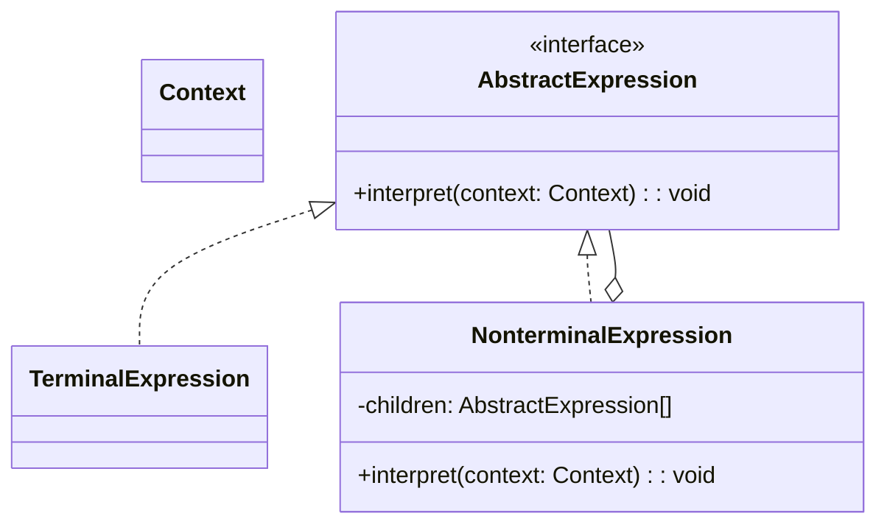
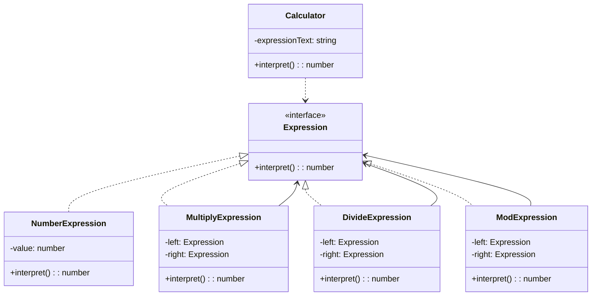
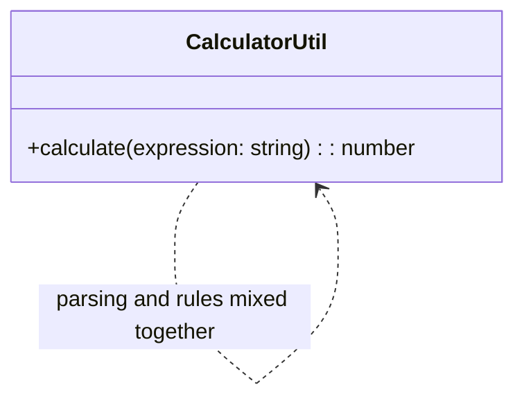

# 模式补全

> 这一节按 [[八面剖析以理解一个概念]] / ljg-learn 的思路整理为 Markdown 版本：先定锚，再用八个方向切开概念，最后压缩成公式、例子、类图和检验题。

## 定锚

解释器模式（行为型）的通行定义：给定一种语言，定义它的文法表示，并提供一个解释器来解释语言中的句子。

常见误解：解释器模式不是“把字符串丢进 `eval`”；它强调把语法规则拆成一组可组合的表达式对象。

核心词素：Interpreter 的重点不是翻译自然语言，而是“按文法规则解释输入”。

## 八刀

### 历史

它常见于 SQL 片段解析、规则引擎、简单脚本语言和数学表达式求值。GoF 将“文法规则对象化”的做法提炼成解释器模式。

### 辩证

反面是把一长串语法判断塞进一个函数里。更高理解是：不是直接写流程判断，而是把“语言规则”变成一组类。

### 现象

用户输入 `3*4/2%4`，系统需要把它拆成数字和运算符，再按既定规则一步步解释，最终得到结果 `2`。

### 语言

Interpreter 的重点不是翻译自然语言，而是“按文法规则解释输入”。

### 形式

Expression.interpret(context)。如果文法太复杂，解释器类会迅速变多，这时更适合 parser generator 或 AST 工具链。

### 存在

它让程序承认“规则本身也值得建模”，而不是永远把规则写死在分支里。

### 美感

它美在语法变对象：原本平铺在字符串里的规则，被折叠成一棵可以递归执行的表达式树。

### 元反思

“解释器”这个词容易让人联想到很重的编程语言实现。换成“表达式求值器”隐喻，会更容易把握它在业务系统里的轻量用途。

## 内观

我是一个语法规则对象。你把上下文交给我，我只解释我负责的那一小段，然后把结果交给更大的表达式继续组合。

八刀共同指向的深层结构：解释器模式不是为了“炫技”，而是在某个变化点上建立边界，让稳定部分继续稳定，让变化部分有自己的位置。

## 压缩

公式：解释器 = 文法规则类 + 上下文 + 递归解释

一句话：解释器模式把“字符串里的规则”拆成“对象之间的组合解释”。

结构图：

```text
Context -> Expression.interpret()
TerminalExpression / NonterminalExpression
```

## 动机/意图

当某个领域问题可以用一套简单文法表达，并且需要反复解释执行这些表达式时，把规则写成过程代码会难以扩展。解释器模式的意图是把文法中的每条规则表示成一个表达式类，通过组合表达式对象解释句子。

## 结构/角色

- `AbstractExpression`：抽象表达式，声明解释方法。
- `TerminalExpression`：终结符表达式，解释文法中不可再分的基本符号。
- `NonterminalExpression`：非终结符表达式，组合其他表达式并解释复合规则。
- `Context`：上下文，保存输入、变量表或解释过程中需要的全局信息。
- `Client`：客户端构建语法树，并触发解释。

## 典型 UML



## 使用场景

- 领域规则可以用简单、稳定的文法描述。
- 需要构建小型 DSL、查询表达式、公式解释器或规则引擎。
- 文法规则数量有限，复杂度不会膨胀到需要完整编译器。
- 需要把规则扩展为独立类，而不是堆叠条件判断。

## 正例：TypeScript

这个例子里，我们只支持整数之间的乘法、除法和取模运算。做法是先把输入串解析成一组终结符表达式和非终结符表达式，再按从左到右的顺序逐步解释。

```ts
interface Expression {
  interpret(): number
}

class NumberExpression implements Expression {
  constructor(private readonly value: number) {}

  interpret() {
    return this.value
  }
}

class MultiplyExpression implements Expression {
  constructor(
    private readonly left: Expression,
    private readonly right: Expression,
  ) {}

  interpret() {
    return this.left.interpret() * this.right.interpret()
  }
}

class DivideExpression implements Expression {
  constructor(
    private readonly left: Expression,
    private readonly right: Expression,
  ) {}

  interpret() {
    return Math.floor(this.left.interpret() / this.right.interpret())
  }
}

class ModExpression implements Expression {
  constructor(
    private readonly left: Expression,
    private readonly right: Expression,
  ) {}

  interpret() {
    return this.left.interpret() % this.right.interpret()
  }
}

class Calculator {
  constructor(private readonly expressionText: string) {}

  interpret() {
    const tokens = this.expressionText.match(/\d+|[*/%]/g)
    if (!tokens || tokens.length === 0) {
      throw new Error("invalid expression")
    }

    let current: Expression = new NumberExpression(Number(tokens[0]))

    for (let i = 1; i < tokens.length; i += 2) {
      const operator = tokens[i]
      const right = new NumberExpression(Number(tokens[i + 1]))

      if (operator === "*") {
        current = new MultiplyExpression(current, right)
      } else if (operator === "/") {
        current = new DivideExpression(current, right)
      } else if (operator === "%") {
        current = new ModExpression(current, right)
      } else {
        throw new Error(`unsupported operator: ${operator}`)
      }
    }

    return current.interpret()
  }
}

const calculator = new Calculator("3*4/2%4")
console.log(calculator.interpret()) // 2
```

## 正例：UML 类图



## 反例：TypeScript

反例里没有把文法规则建模成对象，而是把解析和计算全部揉进一个过程函数里。以后如果要继续扩展括号、加减法、优先级或者变量支持，这个函数会越长越难维护。

```ts
function calculate(expression: string) {
  const tokens = expression.match(/\d+|[*/%]/g)
  if (!tokens || tokens.length === 0) {
    throw new Error("invalid expression")
  }

  let result = Number(tokens[0])

  for (let i = 1; i < tokens.length; i += 2) {
    const operator = tokens[i]
    const value = Number(tokens[i + 1])

    if (operator === "*") {
      result *= value
    } else if (operator === "/") {
      result = Math.floor(result / value)
    } else if (operator === "%") {
      result %= value
    }
  }

  return result
}
```

## 反例：UML 类图


## 案例

现需要构造一个语言解释器，使得系统可以执行整数间的乘、除和求模运算。如用户输入表达式“3 * 4 / 2 % 4”，输出结果为2。使用解释器模式实现该功能


## 掌握检验

1. 解释器模式里的“终结符表达式”和“非终结符表达式”分别是什么？
2. 为什么说解释器模式适合“小而稳定的文法”，不适合特别复杂的语法系统？
3. 如果要支持加减法和括号，当前这套设计会先碰到什么扩展压力？
