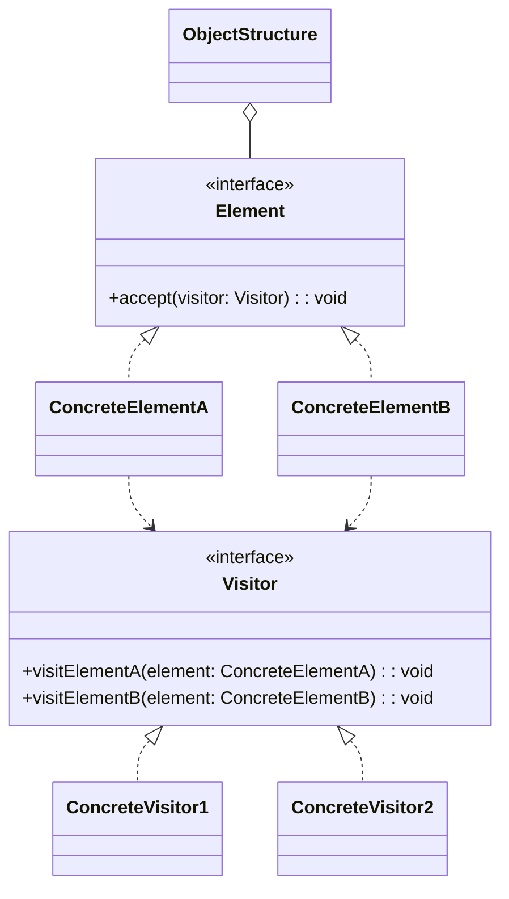
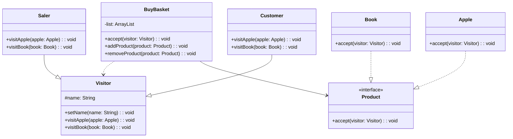
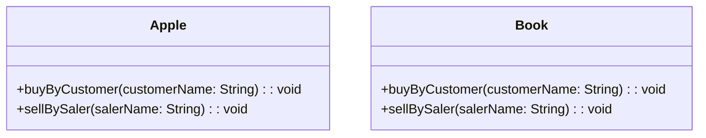

# 模式补全

> 这一节按 [[八面剖析以理解一个概念]] / ljg-learn 的思路整理为 Markdown 版本：先定锚，再用八个方向切开概念，最后压缩成公式、例子、类图和检验题。

## 定锚

访问者模式（行为型）的通行定义：把作用于对象结构中各元素的操作封装成访问者，使新增操作不必修改元素类。

常见误解：访问者不是为了让代码更短；它用复杂结构换取新增操作的开放性。

核心词素：Visitor 是来访者。元素接待访问者，访问者带来一套外部操作。

## 八刀

### 历史

它常见于 AST 编译器、文档导出、报表统计。GoF 将“双分派”场景命名为访问者模式。

### 辩证

反面是每个元素类里塞满各种操作。更高理解是：对象结构稳定、操作常变时，把操作搬出去。

### 现象

一棵语法树可以被类型检查、格式化、代码生成；节点稳定，访问动作不断新增。

### 语言

Visitor 是来访者。元素接待访问者，访问者带来一套外部操作。

### 形式

element.accept(visitor); visitor.visitElement(element)。若元素类型频繁新增，访问者接口会频繁变化。

### 存在

它让数据结构和外部操作分居，两者通过 accept 礼貌相见。

### 美感

它美在巡游：访问者穿过对象森林，每到一处执行相应仪式。

### 元反思

访问隐喻容易弱化双分派。换成“海关盖章”隐喻，会更容易看到元素决定接待哪一种 visit。

## 内观

我是访问者。我不拥有元素，却能对不同元素执行不同操作。元素通过 accept 告诉我它是谁。

八刀共同指向的深层结构：访问者模式不是为了“炫技”，而是在某个变化点上建立边界，让稳定部分继续稳定，让变化部分有自己的位置。

## 压缩

公式：访问者 = 稳定元素结构 + Visitor 操作族 + accept 双分派

一句话：访问者模式适合对象结构稳定、操作经常新增的场景。

结构图：

```text
Element.accept(Visitor)
Visitor.visitConcreteElement
```

## 动机/意图

当对象结构相对稳定，但需要不断为这些对象新增操作时，把所有操作塞进元素类会让元素越来越臃肿。访问者模式的意图是把操作封装到访问者中，通过 `accept()` 和 `visit()` 完成双分派，让新增操作主要通过新增访问者实现。

## 结构/角色

- `Visitor`：访问者接口，为每一种具体元素声明访问方法。
- `ConcreteVisitor`：具体访问者，实现某一组操作。
- `Element`：元素接口，声明 `accept(visitor)`。
- `ConcreteElement`：具体元素，在 `accept()` 中回调访问者对应的访问方法。
- `ObjectStructure`：对象结构，保存元素集合，并让访问者遍历访问。
- `Client`：客户端创建访问者并交给对象结构。

## 典型 UML



## 使用场景

- 对象结构稳定，但对结构中元素的操作经常新增。
- 需要对一组异构对象执行统计、导出、格式化、编译等外部操作。
- 希望把操作从元素类中移出，保持元素职责单纯。
- 典型例子包括 AST、文档对象模型、报表结构和复杂对象树。

## 正例：TypeScript

这次按图里的购物篮案例来写：`Product` 是元素抽象，`Apple` 和 `Book` 是具体元素；`Visitor` 是访问者抽象，`Customer` 和 `Saler` 是具体访问者；`BuyBasket` 负责收集商品并统一让访问者访问。由于 TypeScript 不像 UML 那样天然强调同名重载，这里用 `visitApple` / `visitBook` 来表达图中的 `visit(Apple)` / `visit(Book)`。

```ts
abstract class Visitor {
  protected name = ""

  setName(name: string) {
    this.name = name
  }

  abstract visitApple(apple: Apple): void
  abstract visitBook(book: Book): void
}

class Customer extends Visitor {
  visitApple(apple: Apple) {
    console.log(`${this.name} buys apple: ${apple.getName()}`)
  }

  visitBook(book: Book) {
    console.log(`${this.name} buys book: ${book.getName()}`)
  }
}

class Saler extends Visitor {
  visitApple(apple: Apple) {
    console.log(`${this.name} sells apple: ${apple.getName()}`)
  }

  visitBook(book: Book) {
    console.log(`${this.name} sells book: ${book.getName()}`)
  }
}

interface Product {
  accept(visitor: Visitor): void
}

class Apple implements Product {
  constructor(private readonly name: string) {}

  getName() {
    return this.name
  }

  accept(visitor: Visitor) {
    visitor.visitApple(this)
  }
}

class Book implements Product {
  constructor(private readonly name: string) {}

  getName() {
    return this.name
  }

  accept(visitor: Visitor) {
    visitor.visitBook(this)
  }
}

class BuyBasket {
  private list: Product[] = []

  addProduct(product: Product) {
    this.list.push(product)
  }

  removeProduct(product: Product) {
    this.list = this.list.filter((item) => item !== product)
  }

  accept(visitor: Visitor) {
    this.list.forEach((product) => product.accept(visitor))
  }
}

const basket = new BuyBasket()
basket.addProduct(new Apple("red apple"))
basket.addProduct(new Book("design patterns"))

const customer = new Customer()
customer.setName("Alice")

const saler = new Saler()
saler.setName("Bob")

basket.accept(customer)
basket.accept(saler)
```

## 正例：UML 类图



## 反例：TypeScript

反例里没有访问者，而是把“顾客视角”和“销售员视角”的处理都塞进商品类里。这样每多一种访问角色，`Apple` 和 `Book` 都要继续加新方法。

```ts
class Apple {
  buyByCustomer(customerName: string) {
    console.log(`${customerName} buys apple`)
  }

  sellBySaler(salerName: string) {
    console.log(`${salerName} sells apple`)
  }
}

class Book {
  buyByCustomer(customerName: string) {
    console.log(`${customerName} buys book`)
  }

  sellBySaler(salerName: string) {
    console.log(`${salerName} sells book`)
  }
}
```

## 反例：UML 类图




## 案例

顾客在超市中将选择的商品，如苹果、图书等放在购物车中，然后到收银员处付款。在购物过程中，顾客需要对这些商品进行访问，以便确认这些商品的质量，之后收银员计算价格时也需要访问购物车内顾客所选择的商品。此时，购物车作为一个ObjectStructure（对象结构）用于存储各种类型的商品，而顾客和收银员作为访问这些商品的访问者，他们需要对商品进行检查和计价。不同类型的商品其访问形式也可能不同，如苹果需要过秤之后再计价，而图书不需要。使用访问者模式来设计该购物过程。


某高校奖励审批系统可以实现教师奖励和学生奖励的审批(AwardCheck)，如果教师发表论文数超过10篇或者学生论文超过2篇可以评选科研奖，如果教师教学反馈分大于等于90分或者学生平均成绩大于等于90分可以评选成绩优秀奖，使用访问者模式设计该系统，以判断候选人集合中的教师或学生是否符合某种获奖要求
## 掌握检验

1. 访问者模式为什么适合 AST 这类结构？
2. 访问者模式新增元素类型时为什么痛苦？
3. 双分派在访问者模式中体现在哪里？
