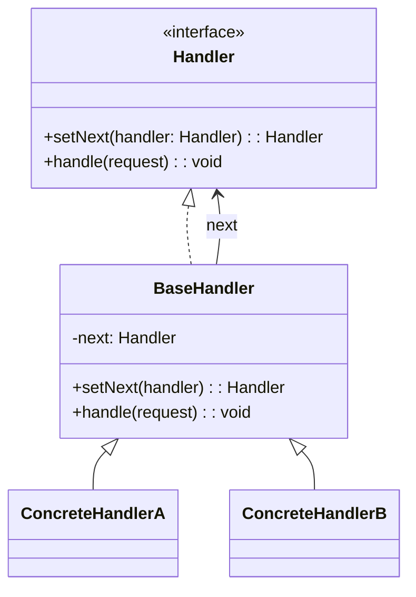
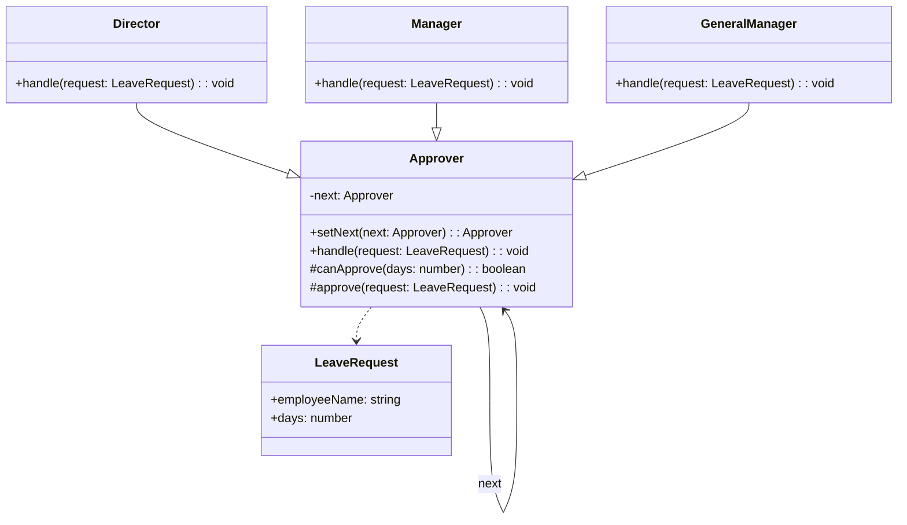
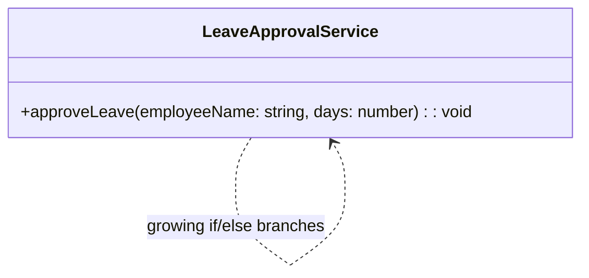

# 模式补全

> 这一节按 [[八面剖析以理解一个概念]] / ljg-learn 的思路整理为 Markdown 版本：先定锚，再用八个方向切开概念，最后压缩成公式、例子、类图和检验题。

## 定锚

责任链模式（行为型）的通行定义：把请求沿着处理者链传递，直到某个处理者处理它或链条结束。

常见误解：责任链不是 if else 的机械换皮；它让处理节点可插拔、可重排。

核心词素：Chain of Responsibility 的重点是 chain：责任不是集中点，而是一条路径。

## 八刀

### 历史

它常见于 GUI 事件冒泡、审批流、中间件。GoF 将这种传递式处理抽成行为型模式。

### 辩证

反面是一个函数处理所有分支。更高理解是：请求处理权可以在对象之间流动。

### 现象

报销单先到组长，再到经理，再到财务；金额不同，停在不同节点。

### 语言

Chain of Responsibility 的重点是 chain：责任不是集中点，而是一条路径。

### 形式

handler.handle(request) or next.handle(request)。若链路不透明，调试会变困难。

### 存在

它让系统承认“不是每个对象都该知道所有规则”，每个节点只守自己的门。

### 美感

它美在接力：请求像火炬，从一只手传到下一只手。

### 元反思

链条隐喻会让人默认线性。换成“管道”隐喻，会更关注顺序、短路和错误传播。

## 内观

我只处理我能处理的请求。处理不了，我把它交给下一个。责任沿着链移动，直到找到位置。

八刀共同指向的深层结构：责任链模式不是为了“炫技”，而是在某个变化点上建立边界，让稳定部分继续稳定，让变化部分有自己的位置。

## 压缩

公式：责任链 = 处理者接口 + next 指针 + 可传递请求

一句话：责任链把集中判断拆成一串可组合的处理节点。

结构图：

```text
Request -> HandlerA -> HandlerB -> HandlerC
```

## 动机/意图

当一个请求可能由多个对象中的某一个处理，或者需要经过一串处理步骤时，集中分支会变得僵硬。责任链模式的意图是把处理者串成链，请求沿链传递，直到被处理或走完整条链。

## 结构/角色

- `Handler`：处理者接口，声明处理请求和设置下一个节点的方法。
- `BaseHandler`：基础处理者，可选角色，保存 `next` 并提供默认传递逻辑。
- `ConcreteHandler`：具体处理者，判断自己能否处理请求，不能则转交下一个。
- `Client`：客户端组装链条并把请求交给链首。
- `Request`：请求对象，携带处理所需的数据。

## 典型 UML



## 使用场景

- 请求处理者不固定，需要运行时动态组合顺序。
- 多个处理步骤可串联，例如鉴权、校验、限流、日志。
- 希望发送者和接收者解耦。
- 处理逻辑需要短路，某个节点处理后不再继续传递。

## 正例：TypeScript

这个场景里，请假单会沿着“主任 -> 经理 -> 总经理”这条链往后传。每个审批人只关心自己能否处理当前天数，处理不了就交给下一个；如果超过 30 天，则由总经理节点给出明确拒绝信息。

```ts
class LeaveRequest {
  constructor(
    public readonly employeeName: string,
    public readonly days: number,
  ) {}
}

abstract class Approver {
  private next?: Approver

  setNext(next: Approver) {
    this.next = next
    return next
  }

  handle(request: LeaveRequest) {
    if (this.canApprove(request.days)) {
      this.approve(request)
      return
    }
    if (this.next) {
      this.next.handle(request)
      return
    }
    console.log(`${request.employeeName} leave request is rejected`)
  }

  protected abstract canApprove(days: number): boolean
  protected abstract approve(request: LeaveRequest): void
}

class Director extends Approver {
  protected canApprove(days: number) {
    return days < 3
  }

  protected approve(request: LeaveRequest) {
    console.log(`director approves ${request.employeeName}'s ${request.days} day(s) leave`)
  }
}

class Manager extends Approver {
  protected canApprove(days: number) {
    return days >= 3 && days < 10
  }

  protected approve(request: LeaveRequest) {
    console.log(`manager approves ${request.employeeName}'s ${request.days} day(s) leave`)
  }
}

class GeneralManager extends Approver {
  protected canApprove(days: number) {
    return days >= 10 && days < 30
  }

  protected approve(request: LeaveRequest) {
    console.log(`general manager approves ${request.employeeName}'s ${request.days} day(s) leave`)
  }

  override handle(request: LeaveRequest) {
    if (request.days >= 30) {
      console.log(`general manager rejects ${request.employeeName}'s leave request`)
      return
    }
    super.handle(request)
  }
}

const director = new Director()
const manager = new Manager()
const generalManager = new GeneralManager()

director.setNext(manager).setNext(generalManager)

director.handle(new LeaveRequest("Alice", 2))
director.handle(new LeaveRequest("Bob", 7))
director.handle(new LeaveRequest("Cindy", 20))
director.handle(new LeaveRequest("David", 35))
```

## 正例：UML 类图



## 反例：TypeScript

反例里所有审批规则都挤在一个函数里。只要审批层级、阈值或拒绝规则一变，就必须回到这个中心函数继续堆分支。

```ts
function approveLeave(employeeName: string, days: number) {
  if (days < 3) {
    console.log(`director approves ${employeeName}'s leave`)
  } else if (days >= 3 && days < 10) {
    console.log(`manager approves ${employeeName}'s leave`)
  } else if (days >= 10 && days < 30) {
    console.log(`general manager approves ${employeeName}'s leave`)
  } else {
    console.log(`general manager rejects ${employeeName}'s leave request`)
  }
}
```

## 反例：UML 类图


## 案例

某OA系统需要提供一个假条审批的模块，如果员工请假天数小于3天，主任可以审批该假条；如果员工请假天数大于等于3天，小于10天，经理可以审批；如果员工请假天数大于等于10天，小于30天，总经理可以审批；如果超过30天，总经理也不能审批，提示相应的拒绝信息。


## 掌握检验

1. 责任链和普通 if else 的本质差别是什么？
2. 责任链中请求一定要被处理吗？
3. Express/Koa 中间件为什么像责任链？
