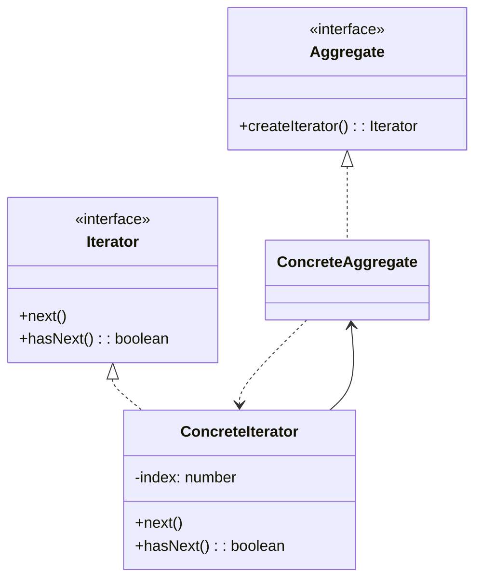
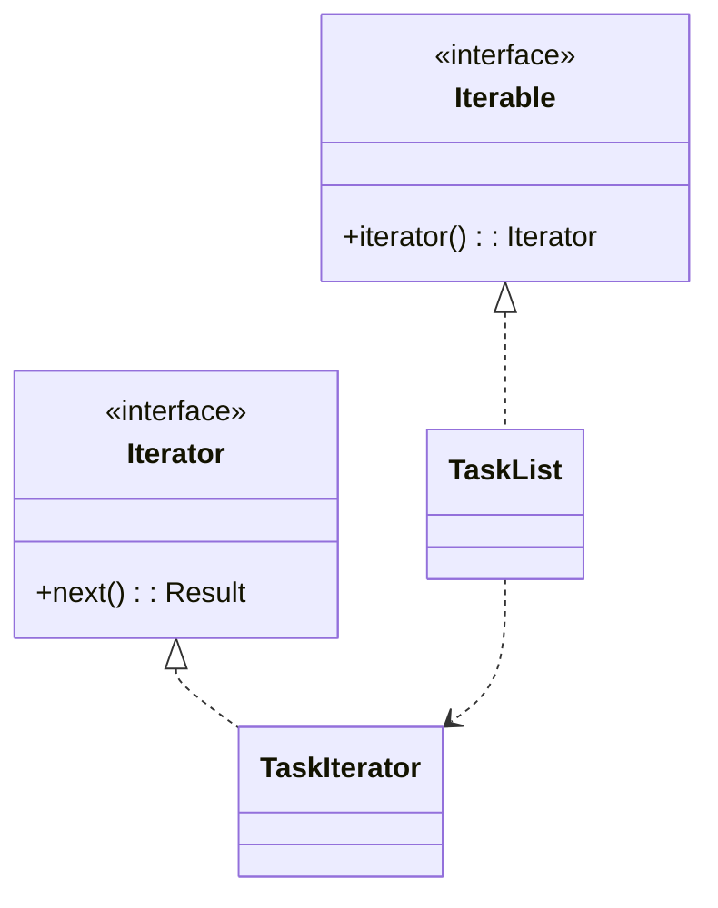
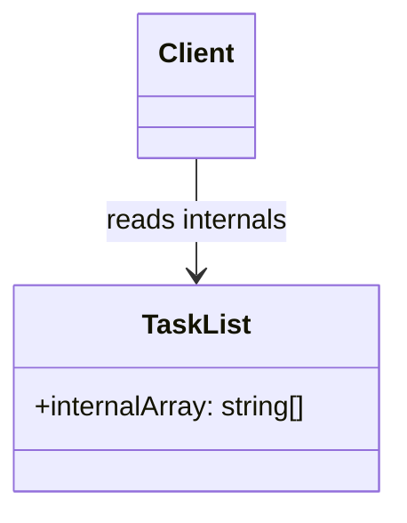

# 模式补全

> 这一节按 [[八面剖析以理解一个概念]] / ljg-learn 的思路整理为 Markdown 版本：先定锚，再用八个方向切开概念，最后压缩成公式、例子、类图和检验题。

## 定锚

迭代器模式（行为型）的通行定义：在不暴露集合内部结构的前提下，顺序访问集合元素。

常见误解：迭代器不只是 for 循环；它把遍历状态和集合结构解耦。

核心词素：Iterator 来自 iterate，重复前进。它的核心动作是 next。

## 八刀

### 历史

它是集合库的基础模式，现代 JavaScript 的 Symbol.iterator 直接内建了这种思想。

### 辩证

反面是客户端知道集合内部数组、树或链表。更高理解是：遍历是一种协议，不是结构暴露。

### 现象

你排队取号，只关心下一个是谁，不需要知道队伍底层用数组还是链表存。

### 语言

Iterator 来自 iterate，重复前进。它的核心动作是 next。

### 形式

iterator.next() -> { value, done }。当遍历需要随机访问或复杂查询时，单一迭代器可能不足。

### 存在

它让集合保留隐私，也让访问者获得稳定步伐。

### 美感

它美在节拍：一步一步，集合内部的复杂被 next 的节奏压平。

### 元反思

行走隐喻容易让人只想线性遍历。换成“游标”隐喻，会更注意当前位置和遍历状态。

## 内观

我是集合递给你的游标。我知道现在走到哪里，也知道何时结束。你不需要拆开集合看。

八刀共同指向的深层结构：迭代器模式不是为了“炫技”，而是在某个变化点上建立边界，让稳定部分继续稳定，让变化部分有自己的位置。

## 压缩

公式：迭代器 = 遍历协议 + 内部状态 + 集合封装

一句话：迭代器把“怎么遍历”从集合内部结构里抽出来。

结构图：

```text
Client -> Iterator.next() -> Aggregate items
```

## 动机/意图

当客户端需要遍历集合，但不应该知道集合底层是数组、树、链表还是分页数据源时，直接暴露内部结构会破坏封装。迭代器模式的意图是提供统一遍历协议，把遍历状态从集合结构中分离出来。

## 结构/角色

- `Iterator`：迭代器接口，声明 `next()`、`hasNext()` 或语言内置迭代协议。
- `ConcreteIterator`：具体迭代器，记录当前位置并访问集合元素。
- `Aggregate`：聚合对象，声明创建迭代器的方法。
- `ConcreteAggregate`：具体聚合，保存元素集合并返回对应迭代器。
- `Client`：客户端通过迭代器顺序访问元素。

## 典型 UML



## 使用场景

- 需要隐藏集合内部结构，同时提供顺序访问能力。
- 同一集合需要多种遍历方式。
- 遍历状态不应污染集合对象本身。
- 需要适配语言内置迭代协议，例如 JavaScript 的 `Symbol.iterator`。

## 正例：TypeScript

```ts
class TaskList implements Iterable<string> {
  private tasks: string[] = []

  add(task: string) {
    this.tasks.push(task)
  }

  [Symbol.iterator]() {
    let index = 0
    const tasks = this.tasks
    return {
      next(): IteratorResult<string> {
        if (index < tasks.length) return { value: tasks[index++], done: false }
        return { value: undefined, done: true }
      },
    }
  }
}
```

## 正例：UML 类图



## 反例：TypeScript

```ts
const taskList = { internalArray: ["a", "b"] }
for (let i = 0; i < taskList.internalArray.length; i++) {
  console.log(taskList.internalArray[i])
}
```

## 反例：UML 类图



## 案例

电视机遥控器就是一个迭代器的实例，通过它可以实现对电视机频道集合的遍历操作，本实例我们将模拟电视机遥控器的实现。

## 掌握检验

1. 迭代器如何保护集合内部结构？
2. JavaScript 的 Symbol.iterator 如何体现迭代器模式？
3. 外部迭代器和内部迭代器有什么区别？
