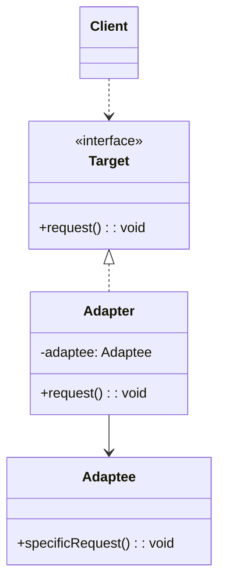
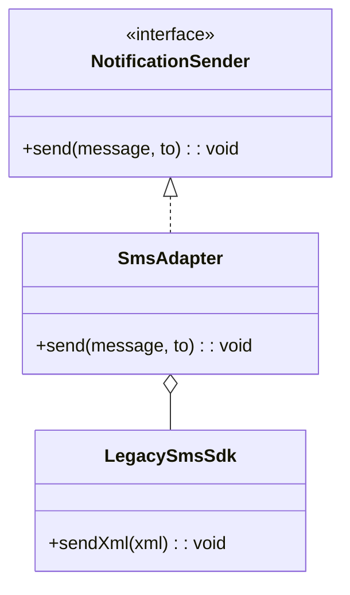
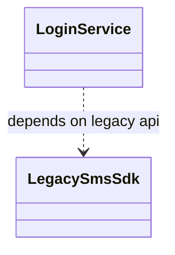

# 机制拆解

**A1. 要素 (Components)**
1. **Target (目标接口)**：当前系统（客户）所期待的标准接口（如：`USB-C`）。
2. **Adaptee (被适配者)**：现有的、不兼容的老组件（如：`HDMI` 接口）。
3. **Adapter (适配器)**：中间人。它实现 Target 接口，并在内部持有 Adaptee 的引用。


**A2. 结构 (Structure)**

- **组合式 ：** Adapter 类内部包含一个 Adaptee 的实例，在Adapter类里写一个**Target**所期待的接口，在接口的实现当中，执行核心的数据转换操作，并调用旧的Adaptee实例的接口，以此达到转换的目的。
- 调用链路：Client $\rightarrow$ `Adapter.methodA()` $\rightarrow$ (转换参数/逻辑) $\rightarrow$ `Adaptee.methodB()`。

**A3. 系统 (System Function)**
该系统实现了**“复用 (Reusability)”**与**“平滑过渡”**。它允许我们在不修改老代码（符合开闭原则）的前提下，让新老系统协同工作。

# 示例代码

```ts
// 1. Target: 新系统期待的标准接口
interface INotification {
  send(content: string, phone: string): void;
}

// 2. Adaptee: 祖传的老代码 (模拟第三方库，无法修改)
class OldAliyunSDK {
  public send_sms_xml(xmlData: string): void {
    console.log(`[Old SDK] 正在解析XML并发送: ${xmlData}`);
  }
}

// 3. Adapter: 适配器
class AliyunAdapter implements INotification {
  private oldSDK: OldAliyunSDK;

  constructor() {
    this.oldSDK = new OldAliyunSDK();
  }

  // 实现新接口
  public send(content: string, phone: string): void {
    // 核心工作：数据转换 (Translation)
    const xmlPayload = `<xml><phone>${phone}</phone><msg>${content}</msg></xml>`;
    
    // 转发调用
    this.oldSDK.send_sms_xml(xmlPayload);
  }
}

// --- 业务代码 (Client) ---
function mainApp(service: INotification) {
  service.send("您的验证码是 8888", "13800138000");
}

// 调用
const adapter = new AliyunAdapter();
mainApp(adapter);
```

# 模式补全

> 这一节按 [[八面剖析以理解一个概念]] / ljg-learn 的思路整理为 Markdown 版本：先定锚，再用八个方向切开概念，最后压缩成公式、例子、类图和检验题。

## 定锚

适配器模式（结构型）的通行定义：把一个已有对象的接口转换成客户端期望的接口，让原本不兼容的类协同工作。

常见误解：适配器不是业务补丁；它应该只处理接口转换，不偷偷承载新业务规则。

核心词素：Adapter 来自 adapt，意思是调适。它的隐喻是插头转换器，而不是重造电器。

## 八刀

### 历史

它来自复用遗留类和第三方库的需要。GoF 将它整理为类适配器和对象适配器两种形态。

### 辩证

反面是修改旧系统或让客户端迁就旧接口。更高理解是：变化发生在边界，核心代码保持自己的语言。

### 现象

新手机只有 USB-C，旧投影仪只有 HDMI，于是中间需要转接头。

### 语言

Adapter 来自 adapt，意思是调适。它的隐喻是插头转换器，而不是重造电器。

### 形式

Client -> TargetAdapter -> Adaptee。若两边语义不等价，只做接口转换会掩盖更大的模型冲突。

### 存在

它让系统学会和过去共处：不必推翻旧物，也不必牺牲新秩序。

### 美感

它美在桥头的小零件：不起眼，但让两个世界接上电。

### 元反思

插头隐喻让人以为只是形状转换。换成“翻译官”隐喻，会提醒我们语义也必须被翻译。

## 内观

我站在新旧接口之间。客户端讲 Target 的话，旧系统讲 Adaptee 的话，我负责翻译，不抢戏。

八刀共同指向的深层结构：适配器模式不是为了“炫技”，而是在某个变化点上建立边界，让稳定部分继续稳定，让变化部分有自己的位置。

## 压缩

公式：适配器 = 目标接口 + 被适配者 + 转换逻辑

一句话：适配器让客户端保持自己的接口，同时复用不兼容的旧能力。

结构图：

```text
Client -> Target
Adapter -> Adaptee
```

## 动机/意图

当已有类或外部服务的接口和当前系统期望的接口不一致时，直接修改旧类往往不可行，也会污染客户端。适配器模式的意图是在不改变被适配者的前提下，提供一个符合目标接口的转换层。

## 结构/角色

- `Target`：目标接口，客户端期望使用的接口。
- `Adaptee`：被适配者，已有能力所在的旧类、第三方类或外部服务。
- `Adapter`：适配器，实现目标接口，内部调用被适配者并做参数、结果或协议转换。
- `Client`：客户端只依赖目标接口。

## 典型 UML



## 使用场景

- 接入旧系统、第三方 SDK 或外部 API，但接口形状不匹配。
- 希望客户端统一依赖自己的领域接口。
- 迁移系统时需要临时兼容新旧接口。
- 需要进行参数格式转换、错误模型转换或单位转换。

## 正例：TypeScript

```ts
interface NotificationSender {
  send(message: string, to: string): void
}

class LegacySmsSdk {
  sendXml(xml: string) {
    console.log("legacy sms", xml)
  }
}

class SmsAdapter implements NotificationSender {
  constructor(private sdk: LegacySmsSdk) {}

  send(message: string, to: string) {
    this.sdk.sendXml("<sms><to>" + to + "</to><body>" + message + "</body></sms>")
  }
}
```

## 正例：UML 类图



## 反例：TypeScript

```ts
function sendLoginCode(message: string, phone: string) {
  const sdk = new LegacySmsSdk()
  sdk.sendXml("<sms><to>" + phone + "</to><body>" + message + "</body></sms>")
}
```

## 反例：UML 类图



## 案例
现需要设计一个可以模拟各种动物行为的机器人，在机器人中定义了一系列方法，如机器人叫喊方法cry()、机器人移动方法move()等。如果希望在不修改已有代码的基础上使得机器人能够像狗一样叫，像狗一样跑，使用适配器模式进行系统设计。

某系统需要提供一个加密模块，将用户信息（如密码等机密信息）加密之后再存储在数据库中，系统已经定义好了数据库操作类。为了提高开发效率，现需要重用已有的加密算法，这些算法封装在一些由第三方提供的类中，有些甚至没有源代码。使用适配器模式设计该加密模块，实现在不修改现有类的基础上重用第三方加密方法。

## 掌握检验

1. 适配器和外观模式都包了一层，它们的目的有什么不同？
2. 对象适配器为什么通常比类适配器更灵活？
3. 适配器应该处理业务规则吗？为什么？
