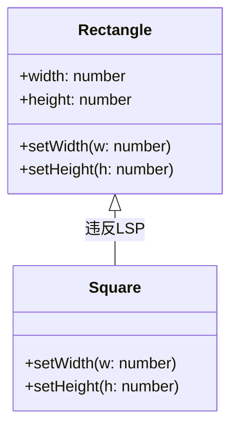
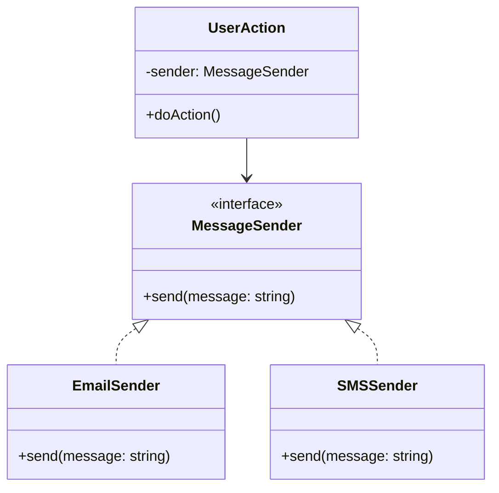
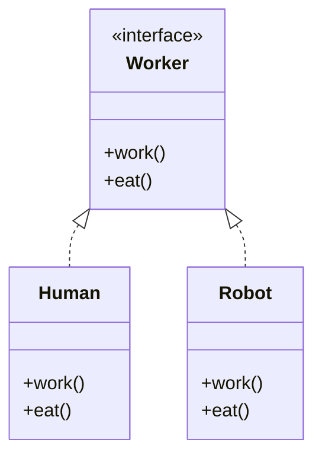
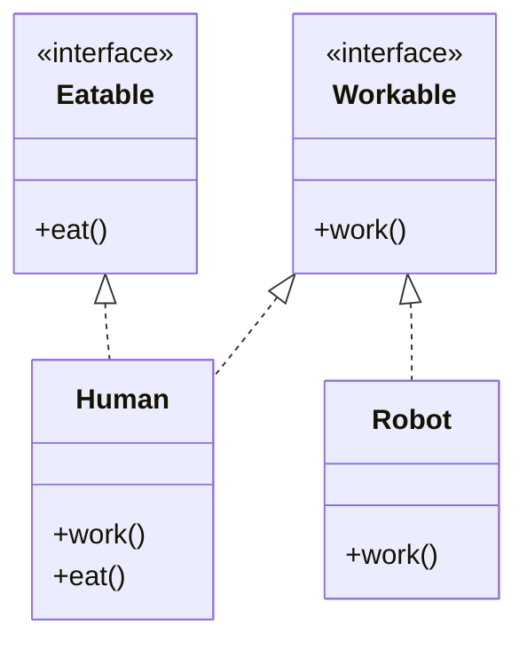
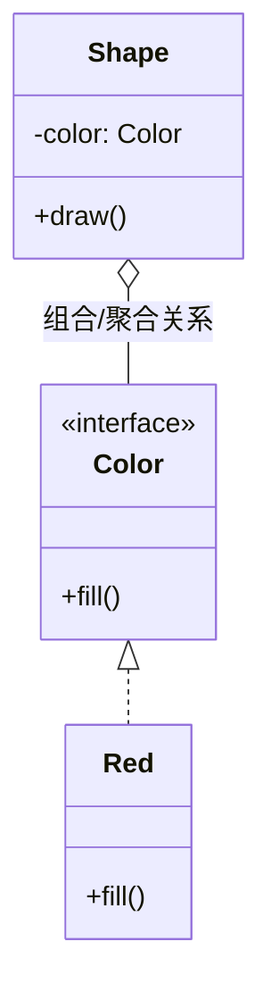
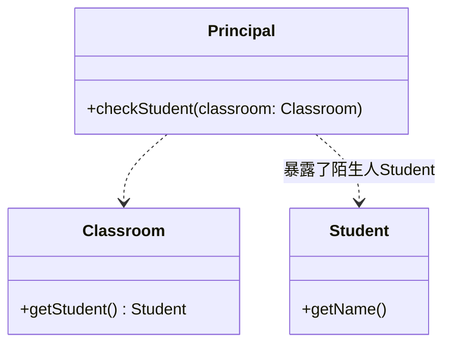
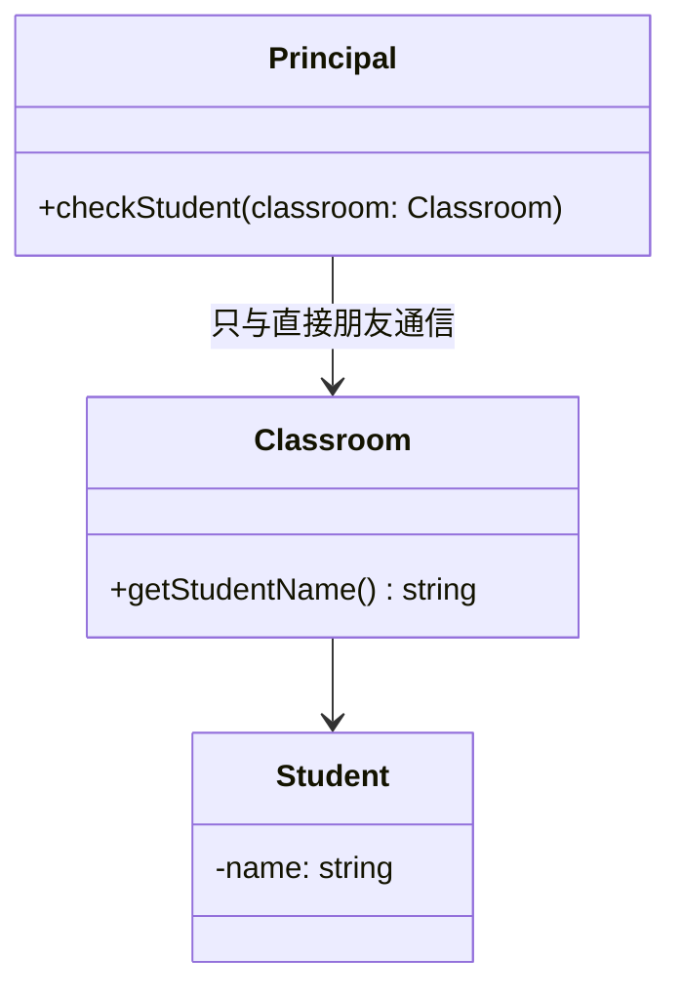

包括 7 个，相互依赖，相互补充，即[[SOLID 原则]]+[[CL]]

| 设计原则名称                                        | 设计原则简介                                                                      |
| --------------------------------------------- | --------------------------------------------------------------------------- |
| 单一职责原则 (Single Responsibility Principle, SRP) | 类的职责要单一，不能将太多的职责放在一个类中                                                      |
| 开闭原则 (Open-Closed Principle, OCP)             | 软件实体对扩展是开放的，但对修改是关闭的，即在不修改一 个软件实体的基础上去扩展其功能                                 |
| 里氏代换原则 (Liskov Substitution Principle, LSP)   | 在软件系统中，一个可以接受基类对象的地方必然可以接受一 个子类对象                                           |
| 依赖倒转原则 (Dependency Inversion Principle, DIP)  | 要针对抽象层编程，而不要针对具体类编程                                                         |
| 接口隔离原则 (Interface Segregation Principle, ISP) | 使用多个专门的接口来取代一个统一的接口                                                         |
| 合成复用原则 (Composite Reuse Principle, CRP)       | 在系统中应该尽量多使用组合和聚合关联关系，尽量少使用甚 至不使用继承关系                                        |
| 迪米特法则 (Law of Demeter, LoD)                   | 一个软件实体对其他实体的引用越少越好，或者说如果两个类 不必彼此直接通信，那么这两个类就不应当发生直接的相互作 用，而是通过引入一个第三者发生间接交互 |

里氏替换


依赖倒转



接口隔离原则（反例）


正例

```ts
interface Workable {
    work(): void;
}

interface Eatable {
    eat(): void;
}

class Human implements Workable, Eatable {
    work() { console.log("人类在工作..."); }
    eat() { console.log("人类在吃饭..."); }
}

class Robot implements Workable {
    work() { console.log("机器人在工作..."); }
}
```
合成复用原则



迪米特法则（反例）

假设一个“学校”系统，校长想要查看学生的信息。如果校长直接访问学生的内部对象链，就产生了过度的依赖。


正例
